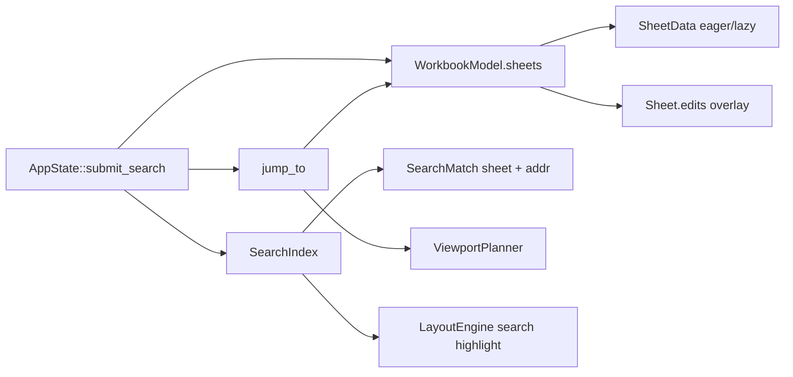
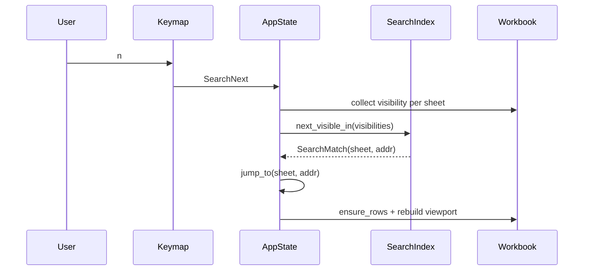

# Design Document

## Overview

**Purpose**: アクティブシート限定の検索を、ワークブック全体の検索とシート横断ジャンプへ拡張する。
**Users**: 複数シートにまたがる表をターミナルで調査する利用者。
**Impact**: `SearchMatch` にシートを追加し、`AppState::submit_search` が全シートを走査する。`n` / `N` は対象シートの可視性を使って移動し、ジャンプ時にシートを切り替える。検索行と状態行は対象シートを表示する。

### Goals

- 全シートの表示値・数式を一度の検索で走査する。
- 一致のシート順・行順・列順の安定した順序を保証する。
- フィルタで隠れた一致をスキップし、可視一致だけをジャンプ対象にする。
- シート横断ジャンプでフォーカスとビューポートを正しく更新する。
- 検索からの戻り先をジャンプ履歴で保持する。

### Non-Goals

- 正規表現検索、検索結果パネル、永続インデックス。
- バックグラウンド検索ワーカーと進捗表示。
- 非表示シートの可視化やシート保護の変更。
- 置換（`spreadsheet-editing` spec）。

## Boundary Commitments

### This Spec Owns

- `SearchMatch` のシート識別子と `SearchIndex` のシート対応可視性。
- 全シート走査、安定した結果順序、可視一致のステップ規則。
- シート横断ジャンプとジャンプ履歴。
- 検索行・状態行の対象シート表示。

### Out of Boundary

- ワークブックの編集、保存、置換。
- フィルタ条件の変更や可視性マップの構築規則。
- 遅延ロード、行キャッシュ、数式計算エンジン。
- 検索 UI のデザイン変更（既存の行レイアウトを維持する）。

### Allowed Dependencies

- 既存の `WorkbookModel` / `Sheet` / `VisibilityMap` / `SearchQuery`。
- 既存の `AppState` と `LayoutEngine`。
- 新しい外部クレートは追加しない。

### Revalidation Triggers

- `SearchMatch` または `SearchIndex` の公開シグネチャ変更。
- `Sheet` のセル走査 API または編集オーバーレイの追加。
- ビューポートとシート切替の規則変更。
- フィルタ可視性の行数・インデックス規則変更。

## Architecture

### Existing Architecture Analysis

- `SearchMatch` はセル座標だけを保持し、`SearchIndex` は単一の `VisibilityMap` を受け取る。
- `AppState::submit_search` はアクティブシートの `SheetData` を直接走査する。
- `AppState::next_match` は保存済みの現在位置を進め、シートを切り替えない。
- グリッドの `search_match` は `SearchIndex::is_match(addr)` を使うため、シートを区別できない。
- 遅延シートの検索は `scan_all` で全行を走査している。

### Architecture Pattern & Boundary Map



**Architecture Integration**:
- Selected pattern: 既存レイヤード構成を維持し、domain の検索型を拡張する。
- Domain/feature boundary: `SearchIndex` はシート対応の可視性を受け取る純粋な状態機械。`AppState` が走査とジャンプを調整する。
- Existing patterns preserved: `SearchQuery` のスマートケース literal、`VisibilityMap`、`RowRange` による行ロード。
- New components rationale: `JumpList` を追加してシート横断ジャンプの戻り先を管理する。

### Technology Stack

| Layer | Choice / Version | Role in Feature | Notes |
|-------|------------------|-----------------|-------|
| Domain | Rust 2024 | 検索一致型、可視性ステップ、ジャンプ履歴 | 外部クレート追加なし |
| App | 既存 AppState | 全シート走査、シート切替 | 既存の検索モードを維持 |
| UI | ratatui 0.30 | 検索行・状態行・ハイライト | 既存レイアウト内で表示 |

## File Structure Plan

### Modified Files

- `src/domain/search.rs` — `SearchMatch.sheet`、シート対応可視性、`active_sheet` によるハイライト判定。
- `src/app/state.rs` — 全シート検索、`jump_to`、ジャンプ履歴、`:goto`、プロンプト/状態表示。
- `src/app/keymap.rs` — `*` / `#`、`Ctrl-o` / `Ctrl-i`。
- `src/app/action.rs` — 検索語ジャンプ、ジャンプ履歴アクション。
- `src/ui/view.rs` / `src/ui/search_prompt.rs` / `src/ui/status.rs` — 対象シートとセルの表示。
- `src/domain/layout.rs` — `SearchIndex::is_match` のシート対応。
- `tests/view_consistency.rs`, `tests/app.rs` — 新シグネチャと横断検索のテスト。

## System Flows

### 検索からジャンプ



`jump_to` は同じシート内ならビューポートを最小限調整し、別シートならシートを切り替えてからフォーカスを可視化する。ジャンプ前の位置は `JumpList` に積む。

## Requirements Traceability

| Requirement | Summary | Components | Interfaces | Flows |
|-------------|---------|------------|------------|-------|
| 1.1-1.4 | 全シート検索 | SearchIndex, AppState | `submit_search` | 検索 |
| 1.5 | フィルタ可視一致 | SearchIndex | `next_visible_in` | 検索 |
| 2.1-2.6 | 横断移動・ジャンプ | SearchIndex, AppState | `jump_to`, `next_visible_in` | 検索からジャンプ |
| 2.7 | 不正ジャンプ | AppState | `:goto` パーサ | エラー |
| 3.1-3.4 | 状態表示 | SearchPromptView, StatusView | 表示契約 | - |
| 4.1-4.4 | ジャンプ履歴 | JumpList | `Ctrl-o` / `Ctrl-i` | 戻る/進む |
| 5.1-5.3 | 回帰 | テスト | - | - |

## Components and Interfaces

| Component | Domain/Layer | Intent | Req Coverage | Key Dependencies | Contracts |
|-----------|--------------|--------|--------------|------------------|-----------|
| SearchIndex | Domain | シート付き一致の保持と可視ステップ | 1, 2, 3 | VisibilityMap | State |
| JumpList | Domain/App | ジャンプ元の履歴 | 4 | CellAddr | State |
| AppState | App | 全シート走査とジャンプ | 1, 2, 3, 4 | WorkbookModel | Event |
| SearchPromptView | UI | 対象シート・セル表示 | 3 | SearchIndex | State |

#### SearchIndex

**Responsibilities & Constraints**
- 一致は `sheet` の昇順、`row`、`col` の昇順で保持する。
- `active_sheet` はグリッドハイライトの対象シートを表す。
- `next_visible_in` / `previous_visible_in` は一致のシートに対応する `VisibilityMap` を使う。
- 全一致が非表示なら `current` を `None` にし、`hidden_matches` を数える。

**Contracts**: State [x]

```rust
pub struct SearchMatch { pub sheet: usize, pub addr: CellAddr, pub source: MatchSource }
pub struct SearchIndex { pub active_sheet: usize, ... }
impl SearchIndex {
    pub fn is_match(&self, addr: CellAddr) -> bool;
    pub fn sync_visibility_for(&mut self, visibilities: &[VisibilityMap]);
    pub fn next_visible_in(&mut self, visibilities: &[VisibilityMap]) -> Option<SearchMatch>;
    pub fn previous_visible_in(&mut self, visibilities: &[VisibilityMap]) -> Option<SearchMatch>;
}
```

#### JumpList

- `Vec<(usize, CellAddr)>` と現在位置を持つ。
- 上限 100。`push` は現在位置を積み、`back` / `forward` はシートとセルを返す。
- ジャンプが同一位置の場合は積まない。

#### AppState

- `submit_search` は全シートを走査し、`(sheet, row, col)` でソートする。
- 遅延シートは `scan_all` を使い、編集オーバーレイがあれば優先する。
- `jump_to(sheet, addr)` はシート切替、行ロード、フォーカス、ビューポート、`SearchIndex.active_sheet` を更新する。
- `switch_sheet` は検索の `active_sheet` を更新する。

## Error Handling

- 不正な `:goto` は状態行に `unknown sheet` / `invalid address` を表示し、状態を変更しない。
- シートインデックスが範囲外の一致は無視する。
- 検索中に行が削除・再読み込みされた場合は、次のイベントループで検索インデックスを破棄する（既存の再読み込み規則に従う）。

## Testing Strategy

- Unit: シート付き可視ステップ、ラップ、全非表示、ジャンプ履歴の上限。
- Integration: 複数シート fixture で `/` 検索、`n` のシート切替、`:goto`、`*`。
- TUI: 検索行にシート名とセルが表示され、別シートの一致が誤ハイライトされないこと。
- Regression: 既存の単一シート検索、フィルタ、遅延ロード。
