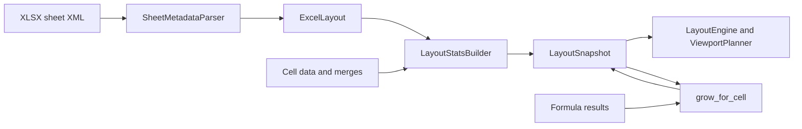
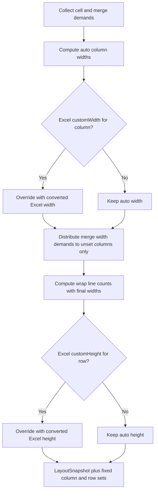
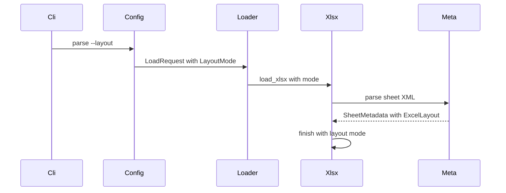

# Design Document

## Overview
**Purpose**: xlsx に保存された Excel の列幅・行高をターミナル表示へ反映し、列の切り詰め位置や行の高さを Excel の設定に近づける。
**Users**: リモート環境で xlsx を閲覧するターミナル利用者が、Excel で意図的に調整されたレイアウトを保ったまま内容を比較・確認するために利用する。
**Impact**: 現在の「内容だけから列幅・行高を決める」レイアウトを、「Excel 明示値を優先し、未指定だけ内容から自動計算する」ハイブリッドへ変更する。既定動作が変わるため、既存 fixture の期待値と steering の技術決定も更新する。

### Goals
- `<col customWidth>` と `<row customHeight>` を読み取り、Excel 明示の列幅・行高を確定値として表示へ反映する。
- 未指定の行・列は従来の自動計算を維持し、Excel 設定のないシートの可読性を落とさない。
- eager / lazy、reload、数式再計算の各経路で同じレイアウト規則を適用する。
- 既存の折り返し・はみ出し・切り詰め・freeze / filter / copy / search / detail を維持する。

### Non-Goals
- 非表示行・列（`hidden`）の表示制御。
- フォント・DPI・ピクセル単位での Excel 見た目の完全再現。
- 印刷レイアウト、csv の Excel 相当設定、セル編集・保存。
- Excel の best-fit 自動幅を TUI 側で再現すること。

## Boundary Commitments

### This Spec Owns
- xlsx シート XML から Excel の列幅・行高・シート既定値を取得する契約。
- Excel 値を端末桁・行数へ変換する規則と上限・下限の適用。
- `LayoutSnapshot` における Excel 明示列・行の識別と、数式再計算時の grow 抑制。
- レイアウトモード（`excel` / `content`）の既定値と読み込み経路への伝播。

### Out of Boundary
- 非表示行・列の可視性制御。`VisibilityMap` や freeze の変更は別 spec とする。
- フォントメトリクスの取得、ピクセル単位の列幅計算。
- csv の列幅・行高に対する外部設定。
- シートの編集・保存、Excel ファイルの書き戻し。

### Allowed Dependencies
- `quick-xml` 0.42 と `zip` 9.5（既存の `SheetMetadataParser` が使用）。
- `calamine` 0.38 が提供するセル・結合範囲・スタイル情報。
- `clap` 4.6 による CLI 定義。
- 依存方向は `domain` ← `io` / `config` ← `app` を維持し、`domain` から `io` へ依存しない。

### Revalidation Triggers
- `ExcelLayout` のフィールドや `LayoutSnapshot` の固定列・行の契約変更。
- 列幅・行高の変換規則（切り捨て・丸め・クランプ）の変更。
- `LayoutStatsBuilder::finish` の計算順序の変更。
- レイアウトモードの既定値または CLI 名の変更。

## Architecture

### Existing Architecture Analysis
- `LayoutStatsBuilder` がセル内容から `LayoutSnapshot { column_widths, row_heights }` を生成し、`LayoutEngine` / `ViewportPlanner` がそれを描画・スクロール・freeze に使う。
- `SheetMetadataParser` は eager / lazy の両方から呼ばれ、シート XML を 1 回走査して filter / freeze / 条件付き書式を読む。列幅・行高の追加はこの走査へ相乗りできる。
- `LayoutStatsBuilder::finish` は「自動列幅 → 結合幅の分配 → wrap 行高」の順で計算する。Excel 列幅はこの順序の途中で確定させる必要がある。
- `LayoutEngine::measure_cell` と `ViewportPlanner` は `Sheet.layout` のみを参照するため、読み込み時にレイアウトが確定すれば描画側の変更は不要。
- `grow_for_cell` は数式再計算後に列幅・行高を grow-only で拡大する。Excel 明示値を維持するには固定列・行の識別が必要。

### Architecture Pattern & Boundary Map



**Architecture Integration**:
- Selected pattern: 既存レイヤード構成を維持した Extension。Excel レイアウトは domain の値オブジェクトとして定義し、io が OOXML から変換する。
- Domain/feature boundaries: OOXML の属性名・ポイント・文字数は `io/sheet_meta.rs` で吸収し、`domain/layout.rs` は端末桁・行数の確定値だけを受け取る。
- Existing patterns preserved: `SheetMetadata` によるシート単位メタデータ、`LayoutStatsBuilder` の集計、`LayoutSnapshot` の grow-only 更新、CLI → `LoadRequest` の設定伝播。
- New components rationale: `ExcelLayout` は Excel 由来の生値と既定値を運ぶ。`LayoutSnapshot` の固定集合は再計算時の更新規則を型で表す。`LayoutMode` は既定動作の切替を明示する。
- Steering compliance: 依存方向、純粋関数としてのレイアウト計算、`unwrap` / `expect` を本番経路で使わない方針を維持する。

### Technology Stack

| Layer | Choice / Version | Role in Feature | Notes |
|-------|------------------|-----------------|-------|
| CLI | clap 4.6 | `--layout excel|content` の定義 | 既存 `Cli` / `Config` に追加 |
| Domain | Rust 2024 | `ExcelLayout`、変換、優先規則、固定集合 | 新規外部クレートなし |
| I/O | quick-xml 0.42 + zip 9.5 | `<cols>` / `<row>` / `<sheetFormatPr>` の解析 | 既存 `SheetMetadataParser` を拡張 |
| I/O | calamine 0.38 | セル・結合・スタイルの既存読み込み | 変更なし |
| UI | ratatui 0.30.2 | `Sheet.layout` を描画 | 変更なし |

## File Structure Plan

### Directory Structure
```
src/
├── domain/
│   └── layout.rs        # ExcelLayout、LayoutMode 非依存の変換・優先規則、固定集合
├── io/
│   ├── sheet_meta.rs    # OOXML から ExcelLayout を抽出
│   ├── xlsx.rs          # eager / lazy の finish へ ExcelLayout を渡す
│   └── loader.rs        # LoadRequest にレイアウトモードを追加
├── config.rs            # --layout と LayoutMode の既定値
└── domain/
    └── workbook.rs      # grow_for_cell の固定列・行スキップを利用
```

### Modified Files
- `src/domain/layout.rs` — `ExcelLayout`、変換・クランプ関数、`LayoutStatsBuilder::finish` の優先規則、`LayoutSnapshot.fixed_columns` / `fixed_rows`、`grow_for_cell` のスキップ。
- `src/io/sheet_meta.rs` — `SheetMetadata` に `ExcelLayout` を追加し、`<cols>` / `<col>` / `<row>` / `<sheetFormatPr>` を解析。
- `src/io/xlsx.rs` — eager / lazy の両経路で `stats.finish` にメタデータの `ExcelLayout` を渡す。
- `src/io/loader.rs` — `LoadRequest` に `LayoutMode` を追加し、xlsx / csv へ伝播。
- `src/config.rs` — `LayoutMode` と `--layout` を追加し、既定を `excel` にする。
- `tests/generate_fixtures.rs` — 明示幅・明示行高・既定値・結合・wrap を含む fixture を追加。
- `tests/fixtures_smoke.rs` / `tests/view_consistency.rs` / `tests/app.rs` — 列幅・行高の期待値とモード切替の検証を追加。
- `.kiro/steering/tech.md` / `.kiro/steering/product.md` — 「Excel の列幅・行高をそのまま使わない」記述をハイブリッド方式へ更新。

## System Flows

### レイアウト確定フロー



- Excel 明示列幅は自動列幅を置き換える。狭い場合もそのまま使い、内容は既存の overflow / truncate 規則で扱う。
- 結合幅の要求は Excel 明示列には分配しない。未指定列だけで合計幅を構成し、wrap 行高を計算する。
- Excel 明示行高は wrap 行高の計算後に置き換える。低い場合は切り詰め状態になる。

### レイアウトモードの伝播



- `content` モードでは `ExcelLayout` を `finish` に渡さない。csv は常に `content` として扱う。
- reload / watch は同じ `LoadRequest` を再利用するため、モードは自動的に維持される。

## Requirements Traceability

| Requirement | Summary | Components | Interfaces | Flows |
|-------------|---------|------------|------------|-------|
| 1.1, 1.2 | `<col>` の明示幅取得と重複時の後勝ち | SheetMetadataParser, ExcelLayout | `parse_sheet_xml` | レイアウト確定 |
| 1.3 | 狭い明示幅の維持と既存表示規則 | LayoutStatsBuilder, LayoutEngine | `finish`, `measure_cell` | レイアウト確定 |
| 1.4 | 未指定列の自動計算 | LayoutStatsBuilder | `finish` | レイアウト確定 |
| 1.5 | 列幅のクランプ | LayoutStatsBuilder | `clamp_column_width` | レイアウト確定 |
| 2.1, 2.2 | `<row>` の明示高取得と未指定フォールバック | SheetMetadataParser, LayoutStatsBuilder | `parse_sheet_xml`, `finish` | レイアウト確定 |
| 2.3 | 低い明示行高での切り詰め | LayoutEngine | `measure_cell`, `truncated_at` | レイアウト確定 |
| 2.4 | 行高のクランプ | LayoutStatsBuilder | `clamp_row_height` | レイアウト確定 |
| 2.5 | 結合範囲の明示行高 | LayoutStatsBuilder | `finish` | レイアウト確定 |
| 3.1, 3.2, 3.3 | 既定列幅・既定行高の下限利用 | SheetMetadataParser, LayoutStatsBuilder | `ExcelLayout.default_*` | レイアウト確定 |
| 3.4, 3.5 | 自動値との最大・明示値非上書き | LayoutStatsBuilder | `finish` | レイアウト確定 |
| 4.1, 4.2 | 列幅切り捨て・行高四捨五入 | ExcelLayout 変換関数 | `excel_columns`, `excel_lines` | レイアウト確定 |
| 4.3, 4.4 | 上下限クランプ | LayoutStatsBuilder | `clamp_*` | レイアウト確定 |
| 4.5 | eager / lazy 一致 | XlsxLoader | `stats.finish` | レイアウト確定 |
| 4.6 | 不正値の無視 | SheetMetadataParser | `parse_sheet_xml` | レイアウトモード |
| 5.1 | 確定列幅での wrap 行高 | LayoutStatsBuilder | `finish` | レイアウト確定 |
| 5.2 | 結合幅を未指定列のみへ分配 | LayoutStatsBuilder | `finish` | レイアウト確定 |
| 5.3, 5.4 | overflow / truncate の維持と詳細一致 | LayoutEngine | `measure_cell` | レイアウト確定 |
| 5.5 | フォント差を再現しない | ExcelLayout 変換関数 | `excel_columns`, `excel_lines` | レイアウト確定 |
| 6.1, 6.2 | 既定 excel と content 切替 | Config, LoadRequest | `LayoutMode` | モード伝播 |
| 6.3 | csv は常に content | Loader, CsvLoader | `LoadRequest` | モード伝播 |
| 6.4, 6.5 | reload / eager / lazy のモード維持 | Loader, XlsxLoader | `LoadRequest` | モード伝播 |
| 7.1, 7.2 | 固定列・行の grow 抑制と自動値の grow | LayoutSnapshot, WorkbookModel | `grow_for_cell` | レイアウト確定 |
| 7.3 | 固定識別の保持 | LayoutSnapshot | `fixed_columns`, `fixed_rows` | レイアウト確定 |
| 7.4 | 再計算後の切り詰め | LayoutEngine | `measure_cell` | レイアウト確定 |
| 8.1 | 既存機能の維持 | 全体 | 既存インターフェース | 全フロー |
| 8.2 | 追加全走査なし | SheetMetadataParser | `parse` | レイアウトモード |
| 8.3 | 変換・優先規則の単体テスト | ExcelLayout, LayoutStatsBuilder | 純粋関数 | レイアウト確定 |
| 8.4 | 既存 fixture の期待値更新 | Tests | fixture | 全フロー |
| 8.5 | 新規 fixture | Tests | fixture | 全フロー |

## Components and Interfaces

| Component | Domain/Layer | Intent | Req Coverage | Key Dependencies (P0/P1) | Contracts |
|-----------|--------------|--------|--------------|--------------------------|-----------|
| ExcelLayout | Domain | Excel 由来の生値・既定値を運ぶ | 1, 2, 3, 4 | なし | State |
| LayoutStatsBuilder | Domain | 自動計算と Excel 明示値の優先規則を確定する | 1, 2, 3, 4, 5 | ExcelLayout (P0), MergeIndex (P0) | Service |
| LayoutSnapshot | Domain | 確定レイアウトと固定列・行を保持する | 4, 5, 7 | LayoutStatsBuilder (P0) | State |
| LayoutEngine | Domain | 確定レイアウトで計測・切り詰めを提供する | 2, 5, 7 | LayoutSnapshot (P0) | Service |
| SheetMetadataParser | I/O | OOXML から ExcelLayout を抽出する | 1, 2, 3, 4 | quick-xml (P0), zip (P0) | Service |
| LoadRequest / Loader | I/O | レイアウトモードを読み込み経路へ伝播する | 6 | Config (P0) | State |
| LayoutMode / Config | Config | CLI と既定値を提供する | 6 | clap (P0) | Service |

### Domain

#### ExcelLayout

| Field | Detail |
|-------|--------|
| Intent | Excel の列幅・行高・既定値を端末変換前の値として保持する |
| Requirements | 1.1, 1.2, 2.1, 2.2, 3.1, 3.2, 3.3 |

**Responsibilities & Constraints**
- `<col>` の明示幅（0 始まり列インデックス）、`<row>` の明示高（0 始まり行インデックス）、シート既定値を保持する。
- 値は Excel の単位（列は文字数、行はポイント）のまま保持し、OOXML の知識を domain に漏らさない。
- 同一列・行に複数の定義がある場合は、解析時に後勝ちで確定させる。

**Dependencies**
- Inbound: `SheetMetadataParser` — OOXML から生成（P0）。
- Outbound: `LayoutStatsBuilder` — 変換・優先規則の入力（P0）。

**Contracts**: State [x]

##### State Management
- State model:
  - `column_widths: BTreeMap<u32, f32>`（0 始まり列 → 文字数）
  - `row_heights: BTreeMap<u32, f32>`（0 始まり行 → ポイント）
  - `default_column_width: Option<f32>`
  - `default_row_height: Option<f32>`
- Persistence & consistency: 読み込み時に一度だけ生成し、以後は不変。
- Concurrency strategy: 読み込みスレッド内で完結し、共有可変状態を持たない。

**Implementation Notes**
- Integration: `SheetMetadata` のフィールドとして保持し、`finish` に参照渡しする。
- Validation: 負値・NaN・無限大は解析時に除外する。`customWidth` / `customHeight` が偽の値は明示値として扱わない。
- Risks: 列幅の単位はフォント依存の近似であり、ピクセル完全一致は保証しない。

#### LayoutStatsBuilder

| Field | Detail |
|-------|--------|
| Intent | 自動計算と Excel 明示値を統合し、最終レイアウトを確定する |
| Requirements | 1.3, 1.4, 1.5, 2.3, 2.4, 2.5, 3.4, 3.5, 4.1, 4.2, 4.3, 4.4, 5.1, 5.2 |

**Responsibilities & Constraints**
- セル内容から自動列幅・自動行高を計算する既存責務を維持する。
- Excel 明示列幅を自動列幅へ上書きし、その後で結合幅・wrap 行高を計算する。
- Excel 明示行高を最終行高へ上書きし、固定列・行の集合を `LayoutSnapshot` に記録する。
- 既定列幅・既定行高は未指定列・行の下限としてのみ使う。

**Dependencies**
- Inbound: `XlsxLoader` — セル・結合・`ExcelLayout` を渡す（P0）。
- Outbound: `LayoutSnapshot` — 確定結果を返す（P0）。
- External: `textwrap` 0.16 / `unicode-width` 0.2 — 折り返し・表示幅（P1）。

**Contracts**: Service [x]

##### Service Interface
```rust
struct LayoutStatsBuilder { /* ... */ }

impl LayoutStatsBuilder {
    fn observe(&mut self, row: u32, col: u32, display: &str, wrap_text: bool);
    fn observe_merge(&mut self, range: CellRange, display: &str, wrap_text: bool);
    fn finish(self, merges: &MergeIndex, excel: Option<&ExcelLayout>, used: CellRange) -> LayoutSnapshot;
}
```
- Preconditions: `excel` のインデックスは 0 始まりで、解析済みの有効値のみを含む。
- Postconditions: `column_widths` / `row_heights` は上下限内。`fixed_columns` / `fixed_rows` は Excel 明示値に対応する。
- Invariants: Excel 明示列幅は自動計算で拡大されない。未指定列は内容に応じて自動計算される。

**Implementation Notes**
- Integration: eager / lazy の両方で `stats.finish(&merges, metadata.layout(), used_range)` を呼ぶ。
- Validation: 変換後の値が 0 になる場合は最小値へクランプする。上限超過は上限へクランプする。
- Risks: 計算順序を誤ると wrap 行高が旧列幅で確定するため、順序を単体テストで固定する。

#### LayoutSnapshot

| Field | Detail |
|-------|--------|
| Intent | 描画・スクロール・再計算更新の唯一のレイアウト状態を保持する |
| Requirements | 4, 5, 7 |

**Responsibilities & Constraints**
- `column_widths: Vec<u16>`、`row_heights: Vec<u8>` に加え、Excel 明示値に由来する列・行を保持する。
- `grow_for_cell` は固定列・行を拡大しない。自動列・行だけを grow-only で更新する。
- 既存の「縮小しない」不変条件を維持する。

**Dependencies**
- Inbound: `LayoutStatsBuilder` — 初期状態（P0）、`WorkbookModel` — 再計算更新（P0）。
- Outbound: `LayoutEngine`, `ViewportPlanner` — 描画・スクロール入力（P0）。

**Contracts**: State [x]

##### State Management
- State model:
  - `column_widths: Vec<u16>`
  - `row_heights: Vec<u8>`
  - `fixed_columns: BTreeSet<u32>`
  - `fixed_rows: BTreeSet<u32>`
- Persistence & consistency: メモリ上のみ。ファイルへ保存しない。
- Concurrency strategy: UI スレッドの状態更新として扱い、`grow_for_cell` は単一スレッドで呼ばれる。

**Implementation Notes**
- Integration: `grow_for_cell` の引数は変更せず、内部で `fixed_columns` / `fixed_rows` を参照する。
- Validation: 固定集合の要素は `column_widths` / `row_heights` の範囲内に収める。
- Risks: reload 時に固定集合を作り直さないと、古い固定状態が残る。

### I/O

#### SheetMetadataParser

| Field | Detail |
|-------|--------|
| Intent | シート XML から Excel レイアウト情報を抽出する |
| Requirements | 1.1, 1.2, 2.1, 2.2, 3.1, 3.2, 3.3, 4.6, 8.2 |

**Responsibilities & Constraints**
- 既存の 1 パス走査で `<sheetFormatPr>`、`<cols>` / `<col>`、`<row>` を解析する。
- `min` / `max` は 1 始まりのため 0 始まりへ変換する。範囲指定は列ごとに展開する。
- 数値として解釈できない値、負値、非有限値は無視する。
- テーブルパートの解析結果にはレイアウト情報を含めない。

**Dependencies**
- Inbound: `SheetMetadataParser::parse` — ワークブック読み込み（P0）。
- Outbound: `ExcelLayout` — 解析結果（P0）。
- External: `quick-xml` 0.42, `zip` 9.5（P0）。

**Contracts**: Service [x]

##### Service Interface
```rust
impl SheetMetadataParser {
    fn parse(path: &Path) -> Result<HashMap<String, SheetMetadata>, MetadataError>;
}

struct SheetMetadata {
    // existing fields...
    layout: ExcelLayout,
}
```
- Preconditions: 対象パスは xlsx の ZIP。
- Postconditions: シート名ごとに `ExcelLayout` を返す。解析できない属性は無視される。
- Invariants: 追加の ZIP エントリ読み取りやシート XML の再走査を行わない。

**Implementation Notes**
- Integration: `parse_sheet_xml` のイベント分岐に `sheetFormatPr` / `col` / `row` を追加する。
- Validation: `customWidth` / `customHeight` の真偽を確認してから明示値として登録する。
- Risks: `col` の範囲が広い場合に列数分のメモリを使うため、シートの最大列数で上限を設ける。

#### LoadRequest / WorkbookLoader

| Field | Detail |
|-------|--------|
| Intent | レイアウトモードを読み込み経路へ伝播する |
| Requirements | 6.1, 6.2, 6.3, 6.4, 6.5 |

**Responsibilities & Constraints**
- `LoadRequest` に `LayoutMode` を追加し、xlsx / csv の読み込みへ渡す。
- xlsx の eager / lazy 双方で同じモードを使う。
- csv はモードに関係なく `content` として扱う。
- reload / watch は同じ `LoadRequest` を再利用する。

**Dependencies**
- Inbound: `Config` — CLI 設定（P0）。
- Outbound: `load_xlsx`, `load_csv` — モード引数（P0）。

**Contracts**: State [x]

##### State Management
- State model: `LoadRequest.layout_mode: LayoutMode`。
- Persistence & consistency: プロセス内のみ。reload 時に同じ値を使う。
- Concurrency strategy: 読み込みワーカーへ clone して渡す。

**Implementation Notes**
- Integration: `LoadRequest::from_config` で `config.layout_mode` を設定する。
- Validation: `content` モードでは `ExcelLayout` を無視し、既存の完全自動経路を通す。
- Risks: 呼び出し箇所の追加漏れがあると既定 `excel` と `content` が混在するため、`LoadRequest` の生成を 1 箇所に集約する。

### Config

#### LayoutMode / Config

| Field | Detail |
|-------|--------|
| Intent | Excel 準拠と完全自動の切替を CLI から提供する |
| Requirements | 6.1, 6.2 |

**Responsibilities & Constraints**
- `LayoutMode { Excel, Content }` を定義し、既定を `Excel` とする。
- `--layout` の値として `excel` / `content` を受け付ける。
- `--max-col-width` / `--max-row-lines` は変換後のクランプに再利用する。

**Dependencies**
- Inbound: CLI 引数（P0）。
- Outbound: `Config`, `LoadRequest`（P0）。
- External: `clap` 4.6（P0）。

**Contracts**: Service [x]

##### Service Interface
```rust
enum LayoutMode { Excel, Content }

struct Config {
    // existing fields...
    layout_mode: LayoutMode,
}
```
- Preconditions: CLI 値は `ValueEnum` で検証される。
- Postconditions: `Config::from_cli` が `layout_mode` を保持する。
- Invariants: 既定値は `Excel`。`content` は明示指定時のみ。

**Implementation Notes**
- Integration: `Cli` に `#[arg(long, value_enum, default_value_t = LayoutMode::Excel)] pub layout: LayoutMode` を追加する。
- Validation: 既存の `max_col_width` / `max_row_lines` の範囲検証を再利用する。
- Risks: ヘルプ文言と README の既定値説明を同期させる。

## Data Models

### Domain Model
- `ExcelLayout` は値オブジェクトであり、Excel の生値を保持する。列・行のインデックスは 0 始まり。
- `LayoutSnapshot` は集約的なレイアウト状態であり、確定幅・高さと固定集合を同一整合性境界で保持する。
- 不変条件:
  - 列幅は `min_col_width <= width <= max_col_width`。
  - 行高は `1 <= height <= max_row_lines`。
  - `fixed_columns` / `fixed_rows` は Excel 明示値に対応し、`grow_for_cell` で変更されない。
  - 未指定列・行は自動計算値を持ち、grow-only で拡大できる。

### Logical Data Model

**Structure Definition**:
- `ExcelLayout.column_widths`: 0 始まり列 → 文字数（`f32`）。
- `ExcelLayout.row_heights`: 0 始まり行 → ポイント（`f32`）。
- `ExcelLayout.default_column_width` / `default_row_height`: シート既定値（`Option<f32>`）。
- `LayoutSnapshot.column_widths`: 端末表示桁（`Vec<u16>`）。
- `LayoutSnapshot.row_heights`: 端末行数（`Vec<u8>`）。
- `LayoutSnapshot.fixed_columns` / `fixed_rows`: Excel 明示値に由来するインデックス集合。

**Consistency & Integrity**:
- `finish` の完了時に固定集合と確定値が同時に作られる。
- reload 時は `Sheet` ごとに新しい `LayoutSnapshot` を生成し、固定集合を引き継がない。
- 数式再計算は `grow_for_cell` を通じてのみレイアウトを変更する。

### Data Contracts & Integration

**OOXML → ExcelLayout**
- `<sheetFormatPr defaultColWidth defaultRowHeight>` → 既定値。
- `<col min max width customWidth>` → 明示列幅。`customWidth` が真のときのみ採用。
- `<row r ht customHeight>` → 明示行高。`customHeight` が真のときのみ採用。
- `min` / `max` / `r` は 1 始まり。範囲は列・行ごとに展開する。
- 不正値は無視し、読み込みエラーにしない。

**LayoutMode → Loader**
- `excel`: `ExcelLayout` を `finish` に渡す。
- `content`: `ExcelLayout` を渡さない。
- `csv`: 常に `content`。

## Error Handling

### Error Strategy
- OOXML のレイアウト属性が不正でも読み込みを失敗させない。既存の「メタデータは `unwrap_or_default` でフォールバックする」方針を維持する。
- シート XML 自体が解析できない場合は、既存どおりメタデータなしで読み込みを継続する。
- 変換後の値が範囲外の場合はクランプし、エラーにしない。

### Error Categories and Responses
- **不正な数値**: 属性を無視し、その列・行を自動計算へフォールバックする。
- **範囲外の値**: 最小・最大へクランプする。
- **欠落した属性**: 自動計算へフォールバックする。
- **シート XML 不在**: 既存の `SheetMetadataParser` のスキップ動作を維持する。

### Monitoring
- 既存の `warnings: Vec<String>` に、必要に応じて「無視したレイアウト属性」の警告を追加できる。ただし既定では静かにフォールバックし、警告で UI を埋めない。

## Testing Strategy

### Unit Tests
- `excel_columns`: 24.7109375 → 24、8.7109375 → 8、0.5 → 1（最小）、上限超過 → 上限。
- `excel_lines`: 15pt → 1、30pt → 2、22.5pt → 2、0 → 1、上限超過 → 上限。
- `LayoutStatsBuilder::finish`: 明示列幅が自動幅を置き換える、未指定列は自動のまま、明示行高が wrap 行高を置き換える。
- 結合セル: 明示列と未指定列にまたがる場合、明示列を変えず未指定列だけ分配する。
- `grow_for_cell`: 固定列・行は伸びず、自動列・行だけ伸びる。

### Integration Tests
- 新 fixture `excel_layout.xlsx`: 明示列幅、明示行高、既定値、wrap、狭い明示幅、結合セルを含む。
- eager / lazy で同じ `column_widths` / `row_heights` になる。
- `--layout content` で従来の自動幅に戻る。csv は常に自動。
- reload / watch でモードが維持される。
- 既存 fixture（`basic_types`、`formulas`、`styles`、`borders`、`merged_tail`）の期待値を更新し、意図した幅になることを確認する。

### E2E/UI Tests
- 明示列幅のシートを描画し、切り詰め記号と詳細表示の `truncated` が一致する。
- freeze / filter / copy / search が新しいレイアウトで従来どおり動作する。

### Performance/Load
- `SheetMetadataParser` の走査回数が増えないことをコードレビューと計測で確認する。
- `large_lazy.xlsx` の読み込み時間が有意に増えないことを確認する。

## Risks & Mitigations
- **フォント差による 1 桁程度のずれ** — 変換規則を近似として明記し、floor / round をテストで固定する。将来 `max_digit_width` を考慮する拡張余地を残す。
- **明示幅が狭いシートの可読性低下** — `--layout content` を提供し、既存の overflow / 詳細表示で内容を確認できるようにする。
- **既存テストの期待値変更** — `set_column_width` を持つ fixture の期待値を明示的に更新し、差分をレビュー可能にする。
- **計算順序の退行** — `finish` の順序を単体テストで固定し、wrap 行高が確定列幅で計算されることを検証する。
- **固定集合の作り忘れ** — `LayoutStatsBuilder::finish` の戻り値としてのみ `LayoutSnapshot` を生成し、直接構築する箇所を限定する。
- **hidden の誤解釈** — 本仕様では `hidden` を読んでもレイアウトに反映しないことをテストで確認する。
