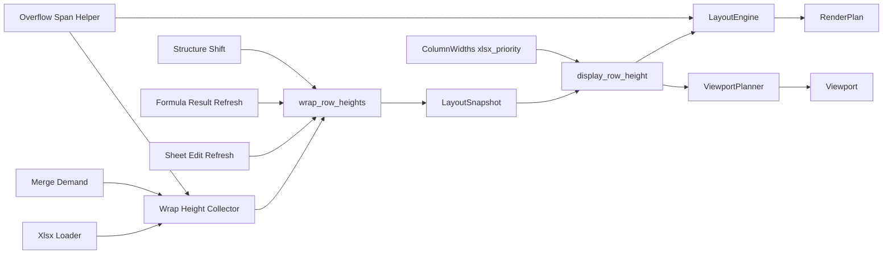
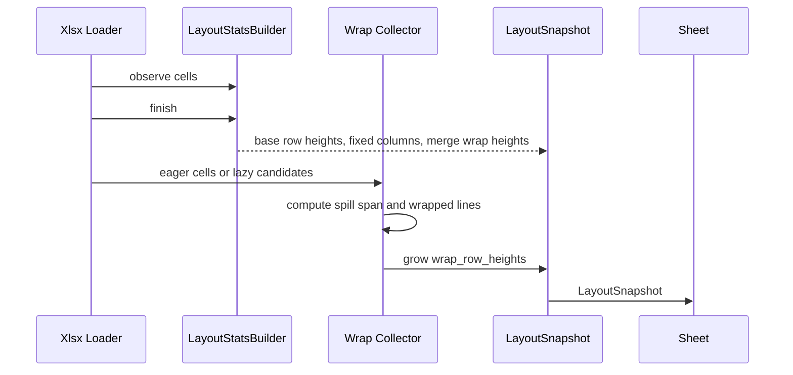
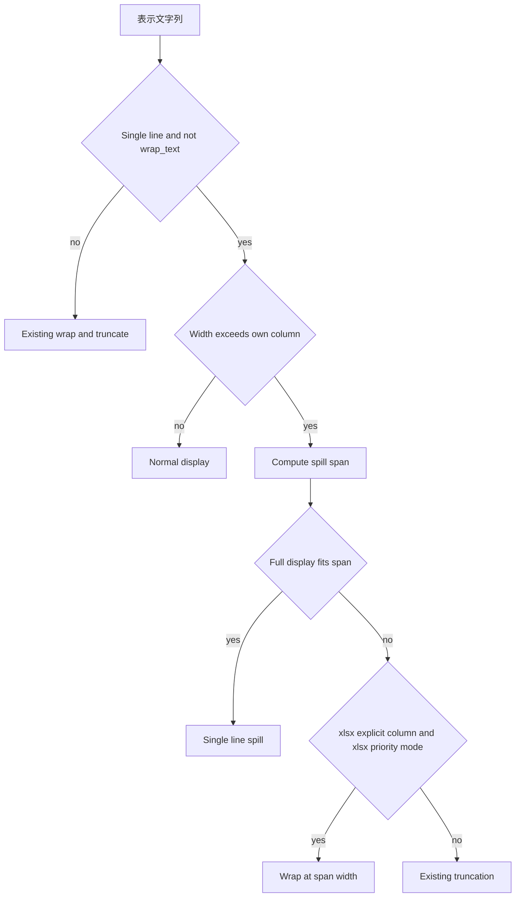
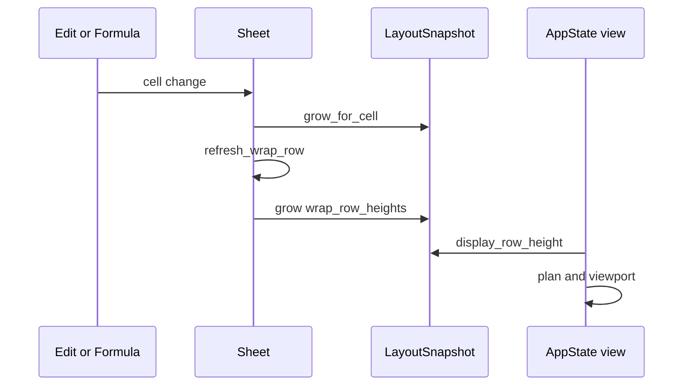

# Design Document

## Overview
**Purpose**: xlsx の明示列幅を優先する表示モードで、列に収まらない長い文字列をはみ出し可能な範囲で折り返し、行高を広げて全体を表示する。
**Users**: 狭い明示列幅を持つ xlsx をターミナルで閲覧し、切り詰められた内容を推測せずに読みたい利用者。
**Impact**: 既存の横方向はみ出し規則を維持しつつ、収まらない場合だけ折り返す。追加の折り返し行高は表示モード専用に保持し、fit-width / content レイアウト / csv の既存挙動を変更しない。

### Goals
- 明示列幅の列で、全文がはみ出し可能幅に収まらない場合に折り返して表示する。
- 折り返し行数に応じて行高を拡張し、明示行高は下限として扱う。
- グリッド、print、セル詳細、スクロール、freeze、フィルタ可視計算で同じ実効行高を使う。
- 編集・数式再計算・再読込・構造編集の後も行高と表示を整合させる。
- fit-width、content レイアウト、csv、`wrap_text` の既存挙動を維持する。

### Non-Goals
- fit-width モードでの動的な行高再計算。
- content レイアウトの自動列幅の変更。
- `wrap_text` セルまたは明示改行を含むセルの折り返し規則の変更。
- 列幅の直接編集や Excel への書き戻し。
- 新しい CLI オプション、キーバインド、ステータス表示。
- `--max-row-lines` を超える行の全文表示。

## Boundary Commitments

### This Spec Owns
- xlsx 明示列幅セルにおける「はみ出し」「折り返し」「切り詰め」の分岐規則。
- 追加の折り返し行高 `wrap_row_heights` の計算・更新・参照契約。
- グリッド計画、セル詳細、スクロール、freeze における実効行高の共有。
- 編集・数式再計算・再読込・構造編集後の行高再評価。

### Out of Boundary
- Excel 明示幅・行高の読み取りと `LayoutSnapshot.row_heights` の基本確定規則。
- fit-width の列幅比例縮小。
- content レイアウトの自動列幅計算。
- Excel ファイルの書き戻しと列幅変更。
- `wrap_text` の既存折り返し規則。
- ターミナルテーマ、ANSI 描画、TUI レイアウト全体。

### Allowed Dependencies
- `domain/layout.rs` の `LayoutSnapshot`、`LayoutEngine`、`ColumnWidths`、`CELL_GUTTER`。
- `domain/viewport.rs` の `ViewportPlanner`。
- `domain/sheet.rs`、`domain/workbook.rs`、`domain/structure.rs` の既存編集・構造更新経路。
- `io/xlsx.rs` の eager / lazy 読み込み経路。
- `textwrap` 0.16 と `unicode-width` 0.2。
- 依存方向は `domain` ← `io` / `ui` / `config` ← `app` を維持する。

### Revalidation Triggers
- `ColumnWidths` / `LayoutSnapshot` / `LayoutEngine` / `ViewportPlanner` の契約変更。
- はみ出し停止条件、ガター規則、折り返し行数の上限規則の変更。
- `wrap_row_heights` の更新タイミングや構造編集時の扱いの変更。
- fit-width または content レイアウトの列幅契約の変更。

## Architecture

### Existing Architecture Analysis
- `LayoutStatsBuilder::finish` が列幅・結合幅・wrap 行高・Excel 明示行高を確定し、`LayoutSnapshot` を生成する。
- `LayoutEngine::plan` と `measure_cell` は、それぞれ独立したはみ出しループで表示幅・切り詰めを決めている。
- `LayoutEngine::effective_freeze`、`LayoutEngine::plan`、`ViewportPlanner`、`measure_cell` は `row_heights` を直接参照する。
- `ColumnWidths` は fit-width の表示時列幅を表し、`Sheet.layout` を変更しない。
- `AppState::column_widths` は fit-width の有無で `ColumnWidths::fit` / `from_sheet` を選ぶ。
- 編集は `Sheet::set_edit_cell`、数式結果は `Workbook::apply_formula_results` が `grow_for_cell` を呼ぶ grow-only 経路を持つ。
- 行・列の構造編集は `structure.rs` が `LayoutSnapshot` の行高・列幅をシフトする。

### Architecture Pattern & Boundary Map



**Architecture Integration**:
- Selected pattern: 既存のレイヤード構成を維持した「表示時派生 + ドメイン内の純粋計算」。
- Domain/feature boundaries: はみ出し幅・折り返し行数の規則は `domain/layout.rs` に置き、IO はセル情報の収集だけを行う。
- Existing patterns preserved: `ColumnWidths` による表示時派生、`RenderPlan` による描画、grow-only なレイアウト更新、`ViewportPlanner` による可視補正。
- New components rationale: `OverflowSpan` はグリッド・詳細・読み込み時の幅計算を統一する。`wrap_row_heights` は fit-width と xlsx 幅優先の行高を分離する。
- Steering compliance: 純粋関数としてのレイアウト計算、`domain` から UI / IO への逆依存禁止、既存の型付き表示状態を維持する。

### Technology Stack

| Layer | Choice / Version | Role in Feature | Notes |
|-------|------------------|-----------------|-------|
| Domain | Rust 2024 | はみ出し幅、折り返し行数、実効行高 | 新しい外部クレートなし |
| IO | calamine 0.38 streaming reader | eager / lazy のセル収集 | 既存経路を拡張 |
| Text | textwrap 0.16.4 / unicode-width 0.2 | 折り返し行数と表示幅 | 既存依存 |
| App | Rust 2024 | 編集・数式・構造更新の再評価 | `Sheet` / `Workbook` / `structure.rs` |
| UI | ratatui 0.30.2 | グリッド・詳細・print | `RenderPlan` の行高をそのまま使用 |
| Tests | fixture + 単体 / 統合テスト | eager / lazy と表示整合 | 既存パターンを踏襲 |

## File Structure Plan

### Directory Structure
```
src/
├── domain/
│   ├── layout.rs        # OverflowSpan、wrap_row_heights、ColumnWidths、LayoutEngine
│   ├── viewport.rs      # 実効行高を使うスクロール補正
│   ├── sheet.rs         # 編集後の行単位 wrap 再評価
│   ├── workbook.rs      # 数式結果後の行単位 wrap 再評価
│   └── structure.rs     # 行・列構造変更時の wrap テーブル更新
├── io/
│   └── xlsx.rs          # eager 後処理 / lazy 候補収集
└── ui/
    └── grid.rs          # 変更なし。RenderPlan の行高を使用
```

### Modified Files
- `src/domain/layout.rs` — `OverflowSpan` / `OverflowSlot` を追加し、`ColumnWidths` に xlsx 幅優先フラグ、`LayoutSnapshot` に `wrap_row_heights` と `display_row_height` を追加。`LayoutEngine::plan` / `measure_cell` / `effective_freeze` を実効行高と共通はみ出し計算へ更新。
- `src/domain/viewport.rs` — `ViewportPlanner::ensure_visible` の縦方向計算を実効行高へ更新。
- `src/io/xlsx.rs` — eager の後処理と lazy の候補セル収集を追加。
- `src/domain/sheet.rs` — `refresh_wrap_row` / `refresh_wrap_merge` を追加し、`set_edit_cell` から呼ぶ。
- `src/domain/workbook.rs` — 数式結果反映後に影響行の wrap 再評価を呼ぶ。
- `src/domain/structure.rs` — 行挿入・削除で `wrap_row_heights` をシフトし、列挿入・削除で再計算する。
- `tests/generate_fixtures.rs` — `excel_width_wrap.xlsx` を追加。
- `tests/fixtures_smoke.rs` / `tests/view_consistency.rs` / `tests/tui.rs` / `tests/cli.rs` — 折り返し・詳細・print・編集の統合テストを追加。
- `README.md` / `.kiro/steering/tech.md` / `.kiro/steering/product.md` — 挙動と制約を更新。

## System Flows

### 読み込み時の折り返し行高確定



- eager はレイアウト確定後に全セルを参照する。
- lazy は読み込み中に候補セルと右方向の停止位置だけを保持し、最終使用範囲と列幅が確定してから折り返し行数を計算する。
- 結合範囲は `LayoutStatsBuilder::finish` が保持する merge demand から計算する。

### セル表示の分岐



- `Target` が偽の場合、従来の表示・切り詰めを維持する。
- `Wrap` の行数は `display_row_height` の範囲に収まる場合だけ全文表示し、超過分は `…` にする。

### 編集後の行高更新



## Requirements Traceability

| Requirement | Summary | Components | Interfaces | Flows |
|-------------|---------|------------|------------|-------|
| 1.1 | 明示列幅・結合範囲を対象化 | ColumnWidths, Xlsx Loader | `xlsx_priority`, `fixed_columns` | 読み込み時 |
| 1.2 | content / 自動幅 / fit-width を対象外 | ColumnWidths, AppState | mode flag | 読み込み時 / 表示 |
| 1.3 | はみ出し可能幅の計算 | OverflowSpan | `overflow_span` | セル表示 |
| 1.4 | 停止条件 | OverflowSpan | stop rules | セル表示 |
| 1.5 | ガター加算 | OverflowSpan | `CELL_GUTTER` | セル表示 |
| 1.6 | 列幅を変更しない | LayoutSnapshot | `column_widths` 不変 | 全体 |
| 2.1 | 収まる場合は1行はみ出し | LayoutEngine | cell text plan | セル表示 |
| 2.2 | 収まらない場合は折り返し | LayoutEngine | cell text plan | セル表示 |
| 2.3 | 結合範囲の折り返し | LayoutEngine, LayoutSnapshot | merge wrap | セル表示 |
| 2.4 | 隣接表示を上書きしない | LayoutEngine, GridWidget | `RenderCell.width` | 描画 |
| 2.5 | 既存 wrap_text / 明示改行を維持 | LayoutEngine | existing branch | セル表示 |
| 2.6 | グリッドと詳細の一致 | LayoutEngine | `measure_cell` | セル表示 |
| 3.1 | 折り返し行数以上の行高 | LayoutSnapshot | `wrap_row_heights` | 読み込み |
| 3.2 | 行内最大の行数 | Wrap Collector | row max | 読み込み |
| 3.3 | 明示行高を下限に | LayoutSnapshot | `display_row_height` | 読み込み / 表示 |
| 3.4 | 既定・自動行高を下限に | LayoutSnapshot | `display_row_height` | 読み込み / 表示 |
| 3.5 | `--max-row-lines` 上限 | OverflowSpan, LayoutEngine | cap | 読み込み / 表示 |
| 3.6 | 共通の実効行高 | LayoutEngine, ViewportPlanner | `display_row_height` | 描画 / スクロール |
| 4.1 | fit-width では追加行高を使わない | ColumnWidths | `fit` | 表示 |
| 4.2 | content レイアウトを維持 | Xlsx Loader | `fixed_columns` empty | 読み込み |
| 4.3 | csv を変更しない | Csv Loader | no Excel layout | 読み込み |
| 4.4 | 値・選択・コピーを変更しない | LayoutSnapshot | 表示専用テーブル | 全体 |
| 4.5 | CLI 契約を変更しない | Config | 既存オプション | 起動 |
| 4.6 | wrap_text の既存挙動を維持 | LayoutEngine | existing branch | セル表示 |
| 5.1 | 編集後の行高再評価 | Sheet | `refresh_wrap_row` | 編集 |
| 5.2 | 数式再計算後の再評価 | Workbook | `refresh_wrap_row` | 数式 |
| 5.3 | 再読込後の再計算 | Xlsx Loader | wrap collector | 読み込み |
| 5.4 | 行構造変更のシフト | Structure | `wrap_row_heights` shift | 構造編集 |
| 5.5 | 列構造変更の再計算 | Structure, Sheet | `recompute_wrap_heights` | 構造編集 |
| 5.6 | 編集後のグリッドと詳細一致 | LayoutEngine, Sheet | `measure_cell` | 編集 / 表示 |
| 6.1 | 純粋関数の単体テスト | OverflowSpan, LayoutSnapshot | unit tests | テスト |
| 6.2 | 境界ケースのテスト | Tests | fixture | テスト |
| 6.3 | 既存 overflow の非回帰 | Tests | `overflow.xlsx` | テスト |
| 6.4 | fit-width / content / csv の非回帰 | Tests | existing suites | テスト |
| 6.5 | print / 詳細 / 編集の統合テスト | Tests | integration | テスト |

## Components and Interfaces

| Component | Domain/Layer | Intent | Req Coverage | Key Dependencies (P0/P1) | Contracts |
|-----------|--------------|--------|--------------|--------------------------|-----------|
| OverflowSpan | Domain | はみ出し可能幅と停止状態を計算する | 1.3, 1.4, 1.5, 2.1, 2.2, 3.5, 6.1 | MergeIndex (P0), CELL_GUTTER (P0) | Service |
| LayoutSnapshot | Domain | 基準行高と追加折り返し行高を保持・公開する | 1.1, 1.6, 3.1, 3.2, 3.3, 3.4, 4.4 | ColumnWidths (P0) | State |
| ColumnWidths | Domain | 表示幅と xlsx 幅優先モードを表現する | 1.1, 1.2, 4.1 | LayoutSnapshot (P0) | State |
| LayoutEngine | Domain | 実効行高とはみ出し・折り返しを使って RenderPlan を作る | 2.1, 2.2, 2.3, 2.4, 2.5, 2.6, 3.5, 3.6, 5.6 | OverflowSpan (P0), LayoutSnapshot (P0), ColumnWidths (P0) | Service |
| ViewportPlanner | Domain | 実効行高で縦スクロールを補正する | 3.6, 4.1 | LayoutSnapshot (P0), ColumnWidths (P0) | Service |
| Xlsx Wrap Collector | IO | eager / lazy のセル情報から追加行高を収集する | 1.1, 3.1, 3.2, 3.3, 5.3 | LayoutSnapshot (P0), OverflowSpan (P0) | Service |
| Sheet | Domain | 編集後の行・結合の wrap 再評価 | 5.1, 5.5, 5.6 | LayoutSnapshot (P0) | State |
| Workbook | Domain | 数式結果後の wrap 再評価 | 5.2 | Sheet (P0) | Service |
| Structure | Domain | 構造編集時の wrap テーブル更新 | 5.4, 5.5 | LayoutSnapshot (P0) | Service |

### Domain

#### OverflowSpan

| Field | Detail |
|-------|--------|
| Intent | 既存の横方向はみ出し規則を純粋関数として提供する |
| Requirements | 1.3, 1.4, 1.5, 2.1, 2.2, 3.5, 6.1 |

**Responsibilities & Constraints**
- 自列幅・右罫線・使用範囲終端・結合・隣接セルの空/罫線から、はみ出し可能幅と「拡張したか」を返す。
- 値を持つセル、左罫線を持つセル、結合範囲の直前で停止する。
- 右罫線を持つセルの直後で停止し、そのセルの幅を含める。
- 幅の加算は saturating 演算で行う。

**Dependencies**
- Inbound: `LayoutEngine`, `Xlsx Wrap Collector`, `Sheet` — 幅計算（P0）。
- Outbound: `MergeIndex`, `CELL_GUTTER` — 停止判定と幅（P0）。

**Contracts**: Service [x]

```rust
pub struct OverflowSpan {
    pub width: u16,
    pub spilled: bool,
}

pub struct OverflowSlot {
    pub empty: bool,
    pub left_border: bool,
    pub right_border: bool,
}

pub fn overflow_span(
    row: u32,
    col: u32,
    own_width: u16,
    own_right_border: bool,
    used_end_col: u32,
    merges: &MergeIndex,
    width_of: impl Fn(u32) -> u16,
    slot_at: impl Fn(u32) -> Option<OverflowSlot>,
) -> OverflowSpan;

pub fn overflow_wrap_lines(
    display: &str,
    wrap_text: bool,
    row: u32,
    col: u32,
    own_width: u16,
    own_borders: CellBorders,
    used_end_col: u32,
    merges: &MergeIndex,
    limits: &LayoutLimits,
    width_of: impl Fn(u32) -> u16,
    slot_at: impl Fn(u32) -> Option<OverflowSlot>,
) -> Option<u8>;
```

- Preconditions: `width_of` は 1 以上を返す。`slot_at` は未存在セルに `None` を返す。
- Postconditions: `overflow_span` は自列幅以上を返す。`overflow_wrap_lines` は対象外なら `None`、対象なら `--max-row-lines` 以下の行数を返す。
- Invariants: 既存の単一行はみ出しと完全に同じ停止規則を使う。

**Implementation Notes**
- Integration: `render_row` / `measure_cell` / loader / `Sheet::refresh_wrap_row` から呼ぶ。
- Validation: 値・結合・左右罫線・使用範囲終端・ガターの単体テストを用意する。
- Risks: 停止規則が描画とずれると折り返し行高だけが増減するため、グリッドと詳細の一致テストを必須にする。

#### LayoutSnapshot

| Field | Detail |
|-------|--------|
| Intent | 基準行高と xlsx 幅優先モード用の追加折り返し行高を保持する |
| Requirements | 1.1, 1.6, 3.1, 3.2, 3.3, 3.4, 4.4 |

**Responsibilities & Constraints**
- `row_heights` は既存の Excel / content レイアウトの基準行高として維持する。
- `wrap_row_heights` は明示列幅の折り返しで必要な行数だけを保持する。
- `display_row_height(row, xlsx_priority)` は、xlsx 幅優先時のみ両者の最大値を返す。
- 追加行高はセル値・列幅・選択・コピー内容を変更しない。

**Dependencies**
- Inbound: `Xlsx Wrap Collector`, `Sheet`, `Structure` — 追加行高の更新（P0）。
- Outbound: `LayoutEngine`, `ViewportPlanner` — 実効行高の参照（P0）。

**Contracts**: State [x]

##### State Management
- State model:
  ```rust
  pub struct LayoutSnapshot {
      pub column_widths: Vec<u16>,
      pub row_heights: Vec<u8>,
      pub fixed_columns: BTreeSet<u32>,
      pub fixed_rows: BTreeSet<u32>,
      pub wrap_row_heights: BTreeMap<u32, u8>,
  }

  impl LayoutSnapshot {
      pub fn display_row_height(&self, row: u32, xlsx_priority: bool) -> u16;
      pub fn grow_wrap_height(&mut self, row: u32, lines: u8);
  }
  ```
- Persistence & consistency: メモリ上のみ。ファイルへ保存しない。再読込で再構築する。
- Concurrency strategy: UI スレッドで完結する。数式結果の反映後も同じスレッドで更新する。

**Implementation Notes**
- Integration: `grow_wrap_height` は最大値を保持する grow-only 更新とする。
- Validation: `xlsx_priority = false` では `wrap_row_heights` を無視するテストを追加する。
- Risks: 行数が `u8` のため、`--max-row-lines` の上限でクランプする。

#### ColumnWidths

| Field | Detail |
|-------|--------|
| Intent | 表示用列幅と xlsx 幅優先モードを同時に表現する |
| Requirements | 1.1, 1.2, 4.1 |

**Responsibilities & Constraints**
- `from_sheet` は xlsx 幅優先、`fit` は非優先として生成する。
- `xlsx_priority()` は fit-width OFF かつ `from_sheet` 由来の場合だけ true を返す。
- content レイアウトでは `fixed_columns` が空のため、フラグが true でも折り返し対象は存在しない。

**Contracts**: State [x]

```rust
impl ColumnWidths {
    pub fn from_sheet(sheet: &Sheet) -> Self;
    pub fn fit(sheet: &Sheet, available: u16) -> Self;
    pub fn xlsx_priority(&self) -> bool;
}
```

**Implementation Notes**
- Integration: `AppState::column_widths` は既存どおり fit の有無で生成を切り替える。
- Validation: `fit` が `wrap_row_heights` を参照しないことを統合テストで確認する。
- Risks: フラグの既定値誤りで content レイアウトや csv に影響するため、`fixed_columns` との二重条件をテストする。

#### LayoutEngine

| Field | Detail |
|-------|--------|
| Intent | 実効行高とはみ出し・折り返し規則から RenderPlan と詳細測定を生成する |
| Requirements | 2.1, 2.2, 2.3, 2.4, 2.5, 2.6, 3.5, 3.6, 5.6 |

**Responsibilities & Constraints**
- 非結合セルの表示計画を共通化し、`render_row` と `measure_cell` が同じ幅・折り返し・切り詰めを返す。
- 対象セルでは `OverflowSpan` の幅で折り返し、行高は `display_row_height` を使う。
- 結合セルでは結合幅で折り返し、行高は結合範囲の実効行高合計を使う。
- `wrap_text` と明示改行は既存分岐を維持する。
- 上限超過時のみ `…` を付ける。

**Dependencies**
- Inbound: `AppState` — 表示幅（P0）。
- Outbound: `OverflowSpan`, `LayoutSnapshot`, `ColumnWidths`, `RenderPlan`（P0）。

**Contracts**: Service [x]

```rust
LayoutEngine::plan(sheet, viewport, focus, selection, search, widths) -> RenderPlan;
LayoutEngine::effective_freeze(sheet, viewport, widths) -> EffectiveFreeze;
LayoutEngine::measure_cell(sheet, addr, widths) -> CellMeasure;
LayoutEngine::truncated_at(sheet, addr, widths) -> bool;
```

- Preconditions: `widths` は対象シートの使用範囲を覆う。
- Postconditions: グリッドと詳細の `truncated` が一致する。
- Invariants: 対象外モードでは既存の `…` と横方向はみ出しを維持する。

**Implementation Notes**
- Integration: 表示テキスト計画を内部ヘルパーに集約する。
- Validation: 収まる場合・はみ出しのみ・折り返し・上限超過・結合・罫線停止をテストする。
- Risks: `RenderCell.width` はスロット幅と異なるため、罫線描画と選択塗りは `slot_width` を使い続ける。

#### ViewportPlanner

| Field | Detail |
|-------|--------|
| Intent | 実効行高でフォーカス行の可視位置を補正する |
| Requirements | 3.6, 4.1 |

**Responsibilities & Constraints**
- 縦方向の可視計算で `display_row_height` を使う。
- fit-width 時は追加行高を無視する。
- 横方向の既存計算は変更しない。

**Contracts**: Service [x]

```rust
ViewportPlanner::ensure_visible(sheet, viewport, focus, freeze, widths) -> ViewportPlan;
```

**Implementation Notes**
- Integration: `vertical` に `widths` を渡し、`ColumnWidths::xlsx_priority()` を渡す。
- Validation: 折り返しで行高が増えた行へ移動してもフォーカスが画面内に残る。
- Risks: 行高参照の更新漏れでスクロール位置がずれるため、統合テストを追加する。

### IO

#### Xlsx Wrap Collector

| Field | Detail |
|-------|--------|
| Intent | eager / lazy のセル情報から `wrap_row_heights` を構築する |
| Requirements | 1.1, 3.1, 3.2, 3.3, 5.3 |

**Responsibilities & Constraints**
- eager: レイアウト確定後に全セルを走査し、明示列幅・単一行・非 `wrap_text`・全文がはみ出し幅に収まらないセルの行数を求める。
- lazy: 読み込み中に候補セルと右方向の停止位置だけを保持し、最終使用範囲・列幅の確定後に折り返し行数を求める。
- 結合範囲は `LayoutStatsBuilder::finish` の merge demand から計算する。
- 既存の `LayoutStatsBuilder` の列幅・基準行高計算は変更しない。

**Dependencies**
- Inbound: `io/xlsx.rs` — セル読み込み（P0）。
- Outbound: `OverflowSpan`, `LayoutSnapshot`（P0）。

**Contracts**: Service [x]

```rust
enum SpillStop {
    Before(u32),
    After(u32),
}

struct WrapCandidate {
    row: u32,
    col: u32,
    display: String,
    own_right_border: bool,
    stop: Option<SpillStop>,
}
```

- Preconditions: 候補は明示列幅・単一行・非 `wrap_text`・自列幅超過のセルに限る。
- Postconditions: eager と lazy で同じ `wrap_row_heights` が得られる。
- Invariants: lazy は候補セル以外のセル文字列を保持しない。

**Implementation Notes**
- Integration: `load_xlsx` の eager 経路は `stats.finish` 後に後処理し、`load_xlsx_lazy` は行確定時に候補を保存する。
- Validation: 同一 fixture を eager / lazy で読み、`wrap_row_heights` が一致することをテストする。
- Risks: 停止位置の列が最終使用範囲より外側の場合、最終使用範囲でクランプする。

### Application / Domain Updates

#### Sheet

| Field | Detail |
|-------|--------|
| Intent | 編集後の行・結合の折り返し行高を再評価する |
| Requirements | 5.1, 5.5, 5.6 |

**Responsibilities & Constraints**
- `refresh_wrap_row(row)` は固定列セルの候補を再走査し、必要な行数を grow-only で加算する。
- 結合セルは `refresh_wrap_merge(region)` で結合幅から必要行数を再計算する。
- `set_edit_cell` の後に呼ぶ。
- 列構造変更時は `recompute_wrap_heights()` で対象シート全体を再計算する。

**Contracts**: State [x]

```rust
impl Sheet {
    pub fn refresh_wrap_row(&mut self, row: u32);
    pub fn refresh_wrap_merge(&mut self, region: MergeRegion);
    pub fn recompute_wrap_heights(&mut self);
}
```

**Implementation Notes**
- Integration: `set_edit_cell` と構造編集の後に呼ぶ。行挿入・削除では `wrap_row_heights` をシフトする。
- Validation: 隣接セルを埋めて左側の長文が折り返されるケース、結合セルの編集をテストする。
- Risks: 行全体の走査が編集回数に比例するため、固定列が存在するシートに限定する。

#### Workbook

| Field | Detail |
|-------|--------|
| Intent | 数式再計算結果の反映後に折り返し行高を再評価する |
| Requirements | 5.2 |

**Responsibility**: `apply_formula_results` で表示文字列を更新した後、対象行の `refresh_wrap_row` を呼ぶ。

#### Structure

| Field | Detail |
|-------|--------|
| Intent | 構造編集後の追加行高を整合させる |
| Requirements | 5.4, 5.5 |

**Responsibility**: 行挿入・削除で `wrap_row_heights` のキーをシフトし、列挿入・削除では対象シートの追加行高を再計算する。

## Data Models

### Domain Model
- `wrap_row_heights` は「xlsx 明示列幅の折り返しによって追加で必要になった行数」を表す値オブジェクト的なマップ。
- `row_heights` は既存の基準行高であり、Excel 明示行高・既定行高・自動計算の結果を含む。
- 実効行高は `max(row_heights[row], wrap_row_heights[row])`（xlsx 幅優先時のみ）。
- 追加行高は 1 以上 `--max-row-lines` 以下。

**Consistency & Integrity**:
- `wrap_row_heights` のキーは使用範囲内の行に限る。
- 行削除時は削除行のエントリを破棄し、後続行をシフトする。
- 列削除時は古い幅に基づくエントリを残さない。
- 追加行高は grow-only で更新し、再読込時だけ新しい内容から再構築する。

## Error Handling

### Error Strategy
- 折り返し計算は失敗しない。範囲外の列・行はクランプし、未存在セルは空として扱う。
- `u32` / `u16` の加算は saturating 演算を使う。
- 折り返し行数が `u8` を超える場合は `--max-row-lines` でクランプする。
- 対象外モード・対象外セル・結合不一致では既存経路へフォールバックする。

### Error Categories and Responses
- **幅のオーバーフロー**: 合計幅を `u32` で計算し、`u16` へ返す際にクランプする。
- **極端に長い文字列**: `--max-row-lines` で打ち切り、`…` と詳細表示で全文を確認できるようにする。
- **lazy の候補行欠落**: 停止位置が最終使用範囲外なら使用範囲終端でクランプする。
- **行高参照の不一致**: `display_row_height` を共通利用し、個別の `row_heights` 直接参照を残さない。

### Monitoring
- 新しいログ、ステータス、警告は追加しない。既存の `truncated` 表示で上限到達を確認できる。

## Testing Strategy

### Unit Tests
- `OverflowSpan`:
  - 自列に収まる / はみ出しのみで収まる / 値・結合・左右罫線・使用範囲終端で停止する。
  - ガターが加算され、`spilled` が正しい。
- `overflow_wrap_lines`:
  - 全文がはみ出し幅に収まる場合は `None`。
  - 収まらない場合は折り返し行数を返し、`--max-row-lines` でクランプする。
  - `wrap_text`・明示改行・非対象列は `None`。
- `LayoutSnapshot`:
  - `display_row_height` が xlsx 幅優先時だけ追加行高を使う。
  - 明示行高が下限として残る。
  - 結合範囲の追加行高が均等配分される。

### Integration Tests
- `excel_width_wrap.xlsx` を eager / lazy で読み、同じ `wrap_row_heights` になる。
- `LayoutEngine::plan` の対象セルが `overflow = true` / `truncated = false` で複数行になる。
- 全文が収まるセルは従来どおり1行ではみ出す。
- `measure_cell` の `truncated` がグリッドと一致する。
- fit-width では追加行高を使わず、従来の行高になる。
- content レイアウトと csv の既存テストが通る。
- `--print` のスナップショットに対象セルの折り返しが表示される。

### E2E/UI Tests
- 狭い明示列幅の長文がグリッド上で複数行に表示される。
- 上限を超える長文が `…` で終わり、詳細表示で全文を確認できる。
- 編集で長文を追加した後、行高が広がり全文が表示される。
- 隣接セルを編集してはみ出しを塞いだ後、左側の長文が折り返される。

### Performance/Load
- eager の後処理がセル数に比例し、候補セルの右方向走査が行幅程度に収まることを確認する。
- lazy の候補保持が候補セル数に比例し、全セル文字列を保持しないことを確認する。
- 描画時の追加コストが既存の `RenderPlan` 生成と同程度であることを確認する。

## Risks & Mitigations
- **はみ出し計算の重複解消漏れ** — `OverflowSpan` を唯一の規則とし、`render_row` と `measure_cell` の両方から呼ぶ。
- **fit-width の行高退行** — `ColumnWidths::fit` は `xlsx_priority = false` とし、`display_row_height` が追加行高を無視するテストを追加する。
- **lazy のメモリ増加** — 候補セルと停止位置だけを保持し、行全体・全セル文字列の複製を避ける。
- **構造編集後の古い行高** — 行はシフト、列は再計算する。構造編集の統合テストを追加する。
- **極端に高い行** — `--max-row-lines` の既存上限を維持し、上限超過時は `…` とする。
- **結合セルの分配ずれ** — 既存の均等配分と同じ計算を使い、結合範囲の実効行高合計で切り詰め判定する。
