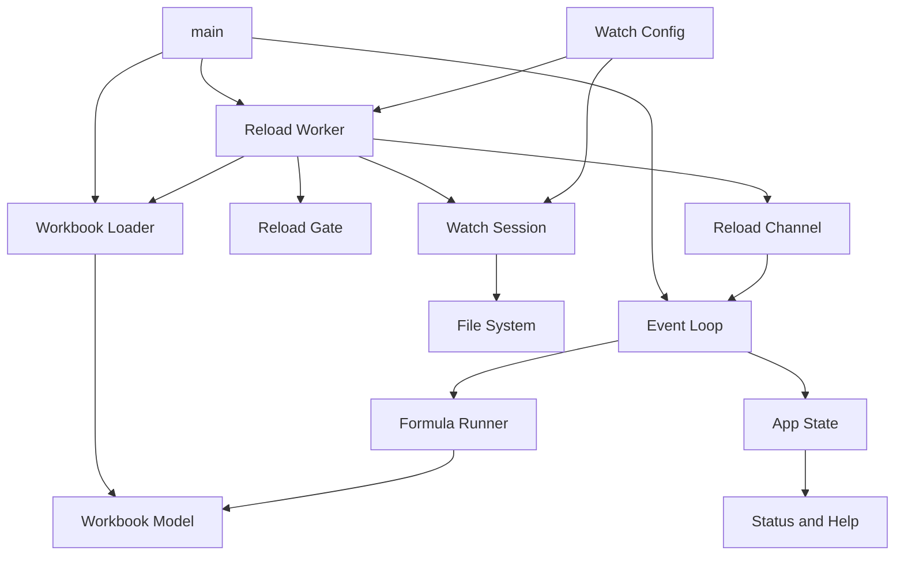
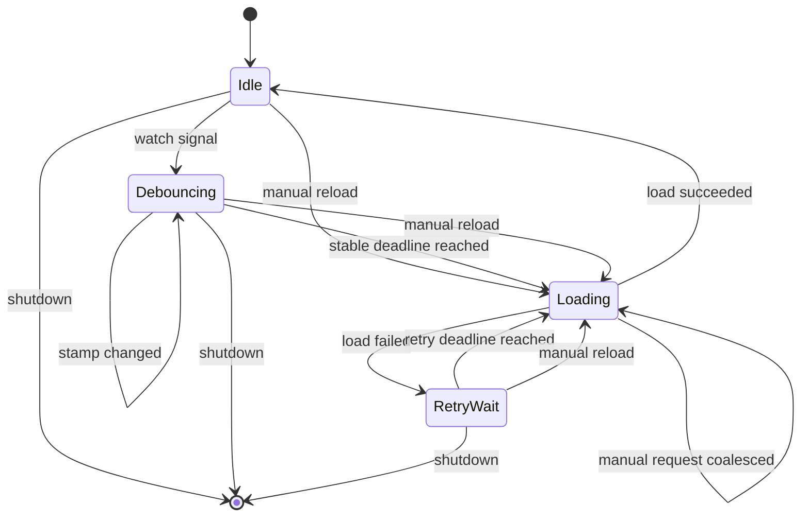

# Design Document

## Overview

`sheetgaze` は xlsx / csv をターミナルで閲覧する読み取り専用 TUI である。本設計は、起動時に読み込んだ 1 ファイルを監視し、変更時に自動で再読み込みする機能と、`r` キーによる手動リロードを追加する。

**Purpose**: 表示中のファイルが外部で更新されたとき、利用者がファイルを開き直さずに最新の内容へ追従できるようにする。
**Users**: ターミナル中心の開発者、SSH 越しの運用担当者、WSL2 や Box Drive 上の表計算ファイルを参照する利用者。
**Impact**: 起動時の読み込みを共通ローダーへ抽出し、監視・デバウンス・再試行・再読み込みを行うバックグラウンドワーカーを追加する。`AppState` は再読み込み後の表示状態を引き継ぎ、数式再計算は世代照合で旧結果を破棄する。CLI に監視方式と間隔を追加する。

### Goals

- 既定の 1 秒ポーリングで、単一ファイルの変更と置換保存を検出して自動反映する。
- 保存途中の不完全なファイルを読んでも旧表示を保持し、成功するまで再試行する。
- 監視が使えない環境でも `r` キーで確実に再読み込みできる。
- 再読み込み後も、シート・フォーカス・選択・フィルタの作業状態を可能な限り維持する。
- 監視・読み込み・再計算をバックグラウンドで行い、TUI の操作を妨げない。

### Non-Goals

- 複数ファイルの同時監視、ディレクトリの再帰監視、外部リンク先や画像の変更検出。
- 差分表示、変更履歴、通知音、デスクトップ通知。
- セル編集・保存、リモート URL の監視、監視設定の永続化。
- 既存ローダーの解析性能改善、CSV ストリーミングデコード、検索のバックグラウンド化。
- 非同期ランタイムの導入。

## Boundary Commitments

### This Spec Owns

- 単一ファイルの監視方式（`poll` / `native` / `auto` / `off`）と、監視対象パスの選定規則。
- ファイル変更のデバウンス、安定確認、再読み込み要求の合流、失敗時の再試行スケジュール。
- 再読み込み用のバックグラウンドワーカーと、UI スレッドへのメッセージ契約。
- 起動時と再読み込みで共有する `WorkbookLoader` の読み込み構成。
- 再読み込み後のワークブック差し替えと、シート・フォーカス・選択・フィルタ・モードの引き継ぎ。
- ワークブック世代と数式再計算結果の照合。
- `--watch` / `--watch-interval-ms`、`r` キー、ヘルプ、状態表示。

### Out of Boundary

- ローダーが扱う xlsx / csv の解析規則、レイアウト、フィルタ評価、検索一致規則の変更。
- ファイルの書き込み、編集、保存、ロック取得。
- 複数ファイル監視、再帰監視、ファイル内容のハッシュ比較を必須とする検出。
- デスクトップ通知、設定ファイル、監視状態の永続化。
- Box Drive / WSL2 固有の API 連携やドライバ判定の完全自動化。
- 数式計算エンジン（formualizer）の変更。

### Allowed Dependencies

- 既存の `domain` / `io` / `ui` / `config` / `app` モジュールと、既存クレート。
- 新規クレート `notify` 8.2.2（CC0-1.0、MSRV 1.88）。`io::watch` の内部に限定する。
- `domain` は `notify`、`ratatui`、`crossterm`、`calamine`、`formualizer` の型を公開しない。
- 依存方向は `domain` ← `io` / `ui` / `config` ← `app` ← `main` を維持する。
- 標準ライブラリの `std::thread` / `std::sync::mpsc` をワーカー間通信に使う。非同期ランタイムは追加しない。

### Revalidation Triggers

- `WorkbookModel` / `Sheet` / `FilterState` / `FileFingerprint` の契約変更。
- `load_xlsx` / `load_csv` のシグネチャまたは読み込み後処理の変更。
- `FormulaMessage`、`FormulaResults`、`Generation` の契約変更。
- `AppState` のフォーカス・選択・モード・ビューポート更新規則の変更。
- `--no-filter`、`--sheet`、lazy 設定など起動時オプションの意味変更。
- `notify` のメジャーバージョン更新、または監視対象を複数ファイルへ拡張する変更。

## Architecture

### Existing Architecture Analysis

既存実装はレイヤード構成であり、`main` が CLI を解釈してローダーを呼び、`AppState` と `EventLoop` が TUI を駆動する。数式再計算は `mpsc` で結果を受け取る別スレッドとして実装されている。

維持する既存境界:

- `domain` はファイル I/O と端末型に依存しない。`WorkbookModel` と `Sheet` が表示モデルを所有する。
- `io` は calamine / csv / formualizer / OOXML とファイルシステムをドメイン型へ変換する。
- `app` は状態機械とイベントループを所有し、`domain` / `io` / `ui` を組み立てる。
- `ui` は `ScreenView` を描画するだけで、ファイルやスレッドを参照しない。

本設計で解消する技術的負債:

- 起動時読み込みの手順が `main` に散在し、再読み込みで再利用できない。
- `Generation` が結果適用時に照合されず、非同期結果の世代競合を防げない。
- フィルタ状態・検索結果・フォーカスの差し替え規則が存在しない。

### Architecture Pattern & Boundary Map



**Architecture Integration**:

- Selected pattern: 既存のレイヤード構成に、ファイル I/O を担う単一ワーカーと純粋な状態機械を追加する。
- Domain/feature boundaries: `domain::reload` は時間規則とスタンプ比較だけを所有する。`io::loader` は読み込み手順、`io::watch` は OS 監視、`app::reload` はスレッドとメッセージ調停を所有する。
- Existing patterns preserved: 型付き enum、`thiserror`、`unsafe` 禁止、`mpsc` によるワーカー連携、`domain` の外部型非依存。
- New components rationale: `ReloadGate` はデバウンス・安定確認・再試行をテスト可能にする。`WorkbookLoader` は起動時と再読み込みの設定一致を保証する。`WatchSession` は notify のバックエンド差を隠蔽する。`ReloadWorker` は単一飛行を保証する。`FormulaRunner` は世代とキャンセルを一元化する。
- Steering compliance: 依存方向を維持し、UI はワーカーや notify を参照しない。新しい外部型はアダプタ内に閉じる。

### Technology Stack

| Layer | Choice / Version | Role in Feature | Notes |
| ----- | ---------------- | --------------- | ----- |
| Language / Runtime | Rust 2024 edition、MSRV 1.88 | 既存バイナリ内のワーカーと状態機械 | 非同期ランタイムは追加しない |
| File watching | `notify` 8.2.2 | PollWatcher / RecommendedWatcher | `io::watch` に隔離。CC0-1.0 |
| Messaging | `std::sync::mpsc` | 監視通知、手動コマンド、再読み込み結果 | 既存の数式結果と同方式 |
| Data ingestion | calamine 0.38、csv 1.4、encoding_rs 0.8 | 再読み込み時のワークブック構築 | 既存ローダーを変更しない |
| Formula | formualizer 0.14 | 再読み込み後の再計算 | 世代照合とキャンセルを追加 |
| TUI | ratatui 0.30.2 + crossterm 0.29 | 状態表示、ヘルプ、既存描画 | 新しい画面は追加しない |
| Testing | `cargo test`、`tempfile`、`insta` | Gate 単体、ワーカー統合、TUI 回帰 | 実時間テストは短い間隔で行う |

## File Structure Plan

### Directory Structure

```text
src/
├── domain/
│   └── reload.rs          # 新規: WatchMode、WatchConfig、ReloadGate、FileFingerprint 比較
├── io/
│   ├── loader.rs          # 新規: 起動時と再読み込みで共有する WorkbookLoader
│   ├── watch.rs           # 新規: notify の PollWatcher / RecommendedWatcher、auto 判定
│   ├── formula.rs         # 変更: 世代付き失敗メッセージ、再計算ジョブ起動の補助
│   ├── xlsx.rs            # 変更なし（既存 load_xlsx を loader から呼ぶ）
│   └── csv.rs             # 変更なし（既存 load_csv を loader から呼ぶ）
├── app/
│   ├── reload.rs          # 新規: ReloadWorker、ReloadHandle、ReloadMessage、表示状態スナップショット
│   ├── formula_runner.rs  # 新規: 数式ジョブの世代管理とキャンセル
│   ├── state.rs           # 変更: replace_workbook、watch 状態、検索破棄、世代照合
│   ├── action.rs          # 変更: Action::Reload
│   ├── keymap.rs          # 変更: 通常モードの r
│   ├── event_loop.rs      # 変更: ReloadHandle / FormulaRunner の統合
│   └── terminal.rs        # 変更なし
├── ui/
│   ├── help.rs            # 変更: r の説明
│   ├── status.rs          # 変更: watch ラベル
│   └── view.rs            # 変更: StatusView.reload_label
├── config.rs              # 変更: --watch / --watch-interval-ms と検証
└── main.rs                # 変更: WorkbookLoader とワーカー・ランナーの起動
```

### Modified Files

- `Cargo.toml` — `notify = "8.2.2"` を追加する。
- `src/domain/mod.rs` — `reload` を公開する。
- `src/io/mod.rs` — `loader` と `watch` を公開する。
- `src/app/mod.rs` — `reload` と `formula_runner` を公開する。
- `src/app/state.rs` — `replace_workbook`、`WatchState`、`formula_generation`、`apply_formula_results` の世代照合を追加する。
- `src/app/event_loop.rs` — `ReloadHandle` と `FormulaRunner` を受け取り、メッセージ適用と再計算再起動を行う。
- `src/main.rs` — 形式判定と読み込みを `WorkbookLoader` に置き換え、`ReloadHandle` と `FormulaRunner` を生成する。
- `README.md` — `--watch`、`--watch-interval-ms`、`r` キー、制限事項を追記する。

## System Flows

### 自動リロードのシーケンス

```mermaid
sequenceDiagram
    participant FS as File System
    participant Watch as Watch Session
    participant Worker as Reload Worker
    participant Gate as Reload Gate
    participant Loader as Workbook Loader
    participant Loop as Event Loop
    participant State as App State
    participant Formula as Formula Runner

    FS->>Watch: change or directory entry event
    Watch->>Worker: WatchEvent Changed
    Worker->>Worker: read FileFingerprint
    Worker->>Gate: on_signal stamp now
    Gate-->>Worker: Wait until deadline
    Worker->>Worker: recv_timeout until deadline
    Worker->>Worker: read FileFingerprint
    Worker->>Gate: on_tick now stamp
    alt stamp stable and differs from last loaded
        Gate-->>Worker: Load
        Worker->>Loop: ReloadMessage Started
        Worker->>Loader: load
        alt load succeeded
            Loader-->>Worker: WorkbookModel
            Worker->>Loop: ReloadMessage Loaded
            Loop->>State: replace_workbook
            Loop->>Formula: restart
        else load failed
            Loader-->>Worker: LoadError
            Worker->>Gate: on_failed now
            Worker->>Loop: ReloadMessage Failed
            Worker->>Worker: retry after 1s
        end
    else stamp changed again
        Gate-->>Worker: Wait extended
    end
```

### ReloadGate の状態遷移



**Key Decisions**:

- 自動通知は 750ms の安定待ちを経て、検出時と期限時の `FileFingerprint` が一致した場合だけ読み込む。変更が続く間は期限を延長する。
- 変更判定は存在有無・サイズ・mtime のみで行い、内容ハッシュは計算しない。同一サイズ・同一 mtime の書き換えは検出対象外であり、必要に応じて手動リロードを使う。
- 手動リロードは安定待ちをバイパスして即時試行する。読み込み中に届いた手動要求は重複実行せず、完了後の最新状態で 1 回だけ再試行する。
- 読み込み成功後に再度スタンプを確認し、読み込み中に変更されていれば次の自動リロードを予約する。
- 失敗時は旧 `WorkbookModel` を保持し、1 秒間隔で再試行する。再試行はスタンプが変わっていなくても行う。

## Requirements Traceability

| Requirement | Summary | Components | Interfaces | Flows |
| ----------- | ------- | ---------- | ---------- | ----- |
| 1.1 | 単一ファイルのみ監視 | WatchSession, WorkbookLoader | `WatchSession::start` | 自動リロード |
| 1.2 | xlsx / xlsm / csv 共通 | WorkbookLoader, WatchSession | `LoadRequest` | 自動リロード |
| 1.3 | 既定 1 秒ポーリング | WatchSession, WatchConfig | `WatchMode::Poll`, `WatchConfig::poll_interval` | 自動リロード |
| 1.4 | サイズと mtime で判定 | ReloadGate | `FileFingerprint`, `ReloadGate::on_tick` | 自動リロード |
| 1.5 | 親ディレクトリ非再帰監視 | WatchSession | `WatchSession::start` | 自動リロード |
| 1.6 | 500ms〜1 秒のデバウンス | ReloadGate | `ReloadGate::on_signal` | 状態遷移 |
| 1.7 | 監視周期の I/O を限定 | WatchSession, ReloadWorker | `WatchSession::start` | 自動リロード |
| 1.8 | 仮想・遠隔 FS で動作 | WatchSession | `auto` 判定 | 自動リロード |
| 1.9 | 終了時に監視停止 | ReloadHandle, ReloadWorker | `Drop for ReloadHandle` | 状態遷移 |
| 1.10 | 削除・再作成の検出 | WatchSession, ReloadGate, ReloadWorker | `FileFingerprint` | 自動リロード |
| 2.1 | 安定後の再読み込み | ReloadGate, ReloadWorker | `GateDecision::Load` | 自動リロード |
| 2.2 | 読み込み中も操作可能 | ReloadWorker, EventLoop | `ReloadMessage` | 自動リロード |
| 2.3 | 成功時に表示と状態更新 | AppState, StatusView | `replace_workbook` | 自動リロード |
| 2.4 | 読み込み中の変更を収束 | ReloadWorker, ReloadGate | `ReloadWorker::run` | 自動リロード |
| 2.5 | 再計算を再実行 | FormulaRunner | `FormulaRunner::restart` | 自動リロード |
| 2.6 | 旧世代の結果を破棄 | FormulaRunner, AppState | `apply_formula_results` | 自動リロード |
| 2.7 | 変化継続中は待機 | ReloadGate | `ReloadGate::on_tick` | 状態遷移 |
| 2.8 | 元ファイルを変更しない | WorkbookLoader, WatchSession | 読み取り専用 | 自動リロード |
| 3.1 | 失敗時に旧表示を保持 | ReloadWorker, AppState | `ReloadMessage::Failed` | 自動リロード |
| 3.2 | 失敗理由を状態表示 | EventLoop, StatusView | `ReloadMessage::Failed` | 自動リロード |
| 3.3 | 成功まで再試行 | ReloadGate, ReloadWorker | `on_failed`, `on_tick` | 状態遷移 |
| 3.4 | 復旧時に切り替え | AppState, EventLoop | `ReloadMessage::Loaded` | 自動リロード |
| 3.5 | 再試行中も操作可能 | ReloadWorker | ワーカースレッド | 自動リロード |
| 3.6 | 3 回連続失敗の通知 | ReloadGate, StatusView | `RetryDecision::Notify` | 自動リロード |
| 3.7 | 恒久エラーでも手動実行可能 | ReloadWorker, ReloadHandle | `reload_now` | 自動リロード |
| 3.8 | 最新状態のみを読み込む | ReloadWorker, ReloadGate | `FileFingerprint` | 自動リロード |
| 4.1 | r で即時リロード | Keymap, Action, ReloadWorker | `ReloadCommand::Now` | 手動リロード |
| 4.2 | 未変更でも強制実行 | ReloadWorker | `ReloadTrigger::Manual` | 手動リロード |
| 4.3 | 重複要求を抑止し状態表示 | ReloadHandle, ReloadWorker | `ReloadMessage::Started` | 手動リロード |
| 4.4 | 成功時に内容と状態を更新 | AppState | `replace_workbook` | 手動リロード |
| 4.5 | 失敗時に旧表示と再実行 | AppState, ReloadWorker | `ReloadMessage::Failed` | 手動リロード |
| 4.6 | 監視無効時も手動利用 | ReloadWorker, WatchMode::Off | `ReloadHandle` | 手動リロード |
| 4.7 | ヘルプに r を表示 | HelpView, help.rs | キー一覧 | 手動リロード |
| 4.8 | 既存キーバインドを維持 | Keymap | `translate` | 手動リロード |
| 5.1 | シート名で復元 | AppState | `ViewSnapshot`, `replace_workbook` | 状態引き継ぎ |
| 5.2 | シート消失時は先頭 | AppState | `replace_workbook` | 状態引き継ぎ |
| 5.3 | フォーカスをクランプ | AppState | `replace_workbook` | 状態引き継ぎ |
| 5.4 | 非表示行から近傍へ移動 | AppState | `replace_workbook`, `ensure_focus_visible` | 状態引き継ぎ |
| 5.5 | 選択の維持と解除 | AppState | `replace_workbook` | 状態引き継ぎ |
| 5.6 | フィルタ設定の維持 | AppState | `FilterSnapshot`, `FilterSource` | 状態引き継ぎ |
| 5.7 | フィルタ非互換時の初期化 | AppState | `FilterSnapshot` | 状態引き継ぎ |
| 5.8 | 検索結果の破棄 | AppState | `replace_workbook` | 状態引き継ぎ |
| 5.9 | 開いている画面の維持 | AppState | `Mode`, `replace_workbook` | 状態引き継ぎ |
| 5.10 | 成功時に旧エラーを消す | AppState, StatusView | `ReloadSummary` | 状態引き継ぎ |
| 6.1 | 4 つの監視方式 | Config, WatchMode | `--watch` | 起動 |
| 6.2 | 既定を poll に | Config, WatchConfig | `WatchMode::Poll` | 起動 |
| 6.3 | poll は状態確認のみ | WatchSession | `WatchMode::Poll` | 自動リロード |
| 6.4 | native は保険確認付き | WatchSession, ReloadWorker | `native_safety` | 自動リロード |
| 6.5 | native 登録失敗で poll | WatchSession, ReloadWorker | `WatchStartup` | 起動 |
| 6.6 | auto は環境で選択 | WatchSession | `auto` 判定 | 起動 |
| 6.7 | off は自動監視なし | Config, ReloadWorker | `WatchMode::Off` | 起動 |
| 6.8 | 間隔の既定値と範囲 | Config, WatchConfig | `--watch-interval-ms` | 起動 |
| 6.9 | 不正値の使用法エラー | Config | `Config::from_cli` | 起動 |
| 6.10 | 判定不能時は poll | WatchSession | `auto` 判定 | 起動 |
| 7.1 | 監視と読み込みを背景化 | ReloadWorker | ワーカースレッド | 自動リロード |
| 7.2 | 再読み込み中の再描画 | EventLoop | 80ms ループ | 自動リロード |
| 7.3 | 旧ワークブックの解放 | AppState | `replace_workbook` | 状態引き継ぎ |
| 7.4 | 終了時に待たない | ReloadHandle, TerminalGuard | `Drop` | 状態遷移 |
| 7.5 | off 時の既存動作維持 | Config, EventLoop | `WatchMode::Off` | 起動 |
| 7.6 | ファイルを変更しない | WorkbookLoader, WatchSession | 読み取り専用 | 自動リロード |
| 7.7 | 短い間隔で検証可能 | Config, ReloadGate | `WatchConfig` | テスト |
| 7.8 | 既存表示規則の適用 | AppState, WorkbookModel | `replace_workbook` | 状態引き継ぎ |

## Components and Interfaces

| Component | Domain/Layer | Intent | Req Coverage | Key Dependencies (P0/P1) | Contracts |
| --------- | ------------ | ------ | ------------ | ------------------------ | --------- |
| `WatchConfig` / CLI | Config | 監視方式と間隔の解釈・検証 | 1.3, 6.1–6.10, 7.5 | `WatchMode` (P0) | Service |
| `ReloadGate` | Domain | デバウンス・安定確認・再試行の純粋状態機械 | 1.4, 1.6, 2.1, 2.4, 2.7, 3.3, 3.6, 3.8 | `FileFingerprint` (P0) | State |
| `WorkbookLoader` | I/O | 起動時と再読み込みで共有する読み込み手順 | 1.2, 2.8, 3.1, 7.1, 7.6 | `load_xlsx` / `load_csv` (P0) | Service |
| `WatchSession` | I/O | notify バックエンドの選択・登録・解除 | 1.1, 1.3, 1.5, 1.7–1.10, 6.3–6.7, 6.10 | `notify` (P0), `WatchConfig` (P0) | Service, Event |
| `ReloadWorker` | App | 単一ワーカーで監視・待機・読み込み・再試行を調停 | 1.9, 2.1–2.4, 3.1–3.8, 4.1–4.6, 7.1, 7.4 | `ReloadGate` (P0), `WatchSession` (P0), `WorkbookLoader` (P0) | Service, Event, State |
| `FormulaRunner` | App | 数式ジョブの起動・キャンセル・世代管理 | 2.5, 2.6, 5.10 | `formula::recalculate` (P0) | Service, State |
| `AppState` reload | App | ワークブック差し替えと表示状態の引き継ぎ | 2.3, 3.1, 3.4, 4.4, 4.5, 5.1–5.10, 7.3, 7.8 | `WorkbookModel` (P0) | State |
| `EventLoop` | App | メッセージ適用と再計算再起動 | 2.2, 2.6, 3.2, 7.2 | `ReloadHandle` (P0), `FormulaRunner` (P0) | Event |
| `Keymap` / `Action` / Help | App/UI | `r` の入力とヘルプ表示 | 4.1, 4.7, 4.8 | `Action::Reload` (P0) | Service |
| `StatusView` | UI | watch ラベルと再読み込みメッセージ | 2.3, 3.2, 5.10 | `WatchState` (P1) | State |

### Configuration

#### WatchConfig / CLI

| Field | Detail |
| ----- | ------ |
| Intent | 監視方式とタイミングを CLI から受け取り、ドメインの `WatchConfig` へ変換する |
| Requirements | 1.3, 6.1–6.10, 7.5, 7.7 |
| Owner / Reviewers | — |

**Responsibilities & Constraints**

- `--watch` は `poll` / `native` / `auto` / `off` を受け取り、既定値を `poll` とする。
- `--watch-interval-ms` は 100〜60,000 の範囲で検証し、既定値を 1,000 とする。
- デバウンス 750ms、再試行 1,000ms、native 保険確認 5,000ms、失敗通知間隔 3 回は固定値として `WatchConfig` に設定する。
- 不正値は `Config::from_cli` で `String` エラーを返し、既存の使用法エラー経路に乗せる。

**Contracts**: Service [x] / API [ ] / Event [ ] / Batch [ ] / State [ ]

```rust
#[derive(Clone, Copy, Debug, ValueEnum)]
pub enum WatchModeArg {
    Poll,
    Native,
    Auto,
    Off,
}

pub struct Config {
    // existing fields
    pub watch: WatchConfig,
}
```

- Preconditions: CLI 値は clap により列挙値として解釈済み。
- Postconditions: `Config::watch` は常に有効な `WatchConfig` を持つ。
- Invariants: `poll_interval` は 100ms〜60s。`off` でも手動リロード用ワーカーは起動する。

**Implementation Notes**

- Integration: `Config::default` と `main` の両方で同じ既定値を使う。`--no-recalc` など既存オプションの意味は変更しない。
- Validation: `--watch` の各値、境界値、`0`、範囲外、非数値をテストする。
- Risks: 設定ファイルは導入しないため、利用者は毎回 CLI で指定する。

### Domain

#### ReloadGate

| Field | Detail |
| ----- | ------ |
| Intent | 監視通知・手動要求・タイマーを、読み込み可否の判断へ変換する |
| Requirements | 1.4, 1.6, 2.1, 2.4, 2.7, 3.3, 3.6, 3.8 |
| Owner / Reviewers | — |

**Responsibilities & Constraints**

- `FileFingerprint` のサイズ、mtime、存在有無を比較し、内容ハッシュは扱わない。
- 自動通知には安定待ちを適用し、手動要求は待機をバイパスする。
- 再試行回数と次回期限を保持し、3 回連続失敗の通知要否を返す。
- ファイル I/O・スレッド・時刻取得は行わない。`now_ms` は呼び出し側が渡す単調時刻。

**Dependencies**

- Inbound: `ReloadWorker` — スタンプと現在時刻を渡す（P0）
- Outbound: なし
- External: なし

**Contracts**: Service [ ] / API [ ] / Event [ ] / Batch [ ] / State [x]

##### State Management

```rust
pub enum WatchMode {
    Poll,
    Native,
    Auto,
    Off,
}

pub struct WatchConfig {
    pub mode: WatchMode,
    pub poll_interval: Duration,
    pub debounce: Duration,
    pub retry: Duration,
    pub native_safety: Duration,
    pub failure_notice_interval: u32,
}

pub enum GateDecision {
    Idle,
    Wait { until_ms: u64 },
    Load { reason: ReloadReason },
}

pub enum ReloadReason {
    WatchChange,
    Manual,
    Retry,
    SafetyCheck,
}

pub struct ReloadGate {
    // last_loaded, pending deadline/stamp, retry attempt/next deadline, config
}

impl ReloadGate {
    pub fn new(config: WatchConfig, last_loaded: FileFingerprint) -> Self;
    pub fn on_signal(&mut self, stamp: FileFingerprint, now_ms: u64) -> GateDecision;
    pub fn on_tick(&mut self, stamp: FileFingerprint, now_ms: u64) -> GateDecision;
    pub fn on_manual(&mut self) -> GateDecision;
    pub fn on_loaded(&mut self, stamp: FileFingerprint);
    pub fn on_failed(&mut self, now_ms: u64) -> RetryDecision;
    pub fn next_deadline_ms(&self) -> Option<u64>;
    pub fn is_retrying(&self) -> bool;
}

pub enum RetryDecision {
    Retry { attempt: u32, next_ms: u64, notify: bool },
    ExhaustedNotice { attempt: u32, next_ms: u64 },
}
```

- Preconditions: `now_ms` は単調増加。スタンプはファイル状態のスナップショット。
- Postconditions: `GateDecision::Load` を返した場合、呼び出し側が 1 回だけ読み込みを実行する。
- Invariants: 読み込み中に複数の `Load` を返さない。手動要求は保留中の自動要求を置き換える。`last_loaded` は成功時だけ更新する。

**Implementation Notes**

- Integration: `ReloadWorker` が `std::time::Instant` 由来の経過ミリ秒を渡す。
- Validation: 期限直前、連続変更、手動割り込み、3 回失敗、復旧を単体テストする。
- Risks: 750ms の安定待ちは PollWatcher の 1 秒間隔と合わせて最大約 1.75 秒の反映遅延になる。これは要件 1.6 の範囲内である。

### I/O

#### WorkbookLoader

| Field | Detail |
| ----- | ------ |
| Intent | CLI と設定から読み込み要求を組み立て、起動時と再読み込みで同じ手順を提供する |
| Requirements | 1.2, 2.8, 3.1, 7.1, 7.6 |
| Owner / Reviewers | — |

**Responsibilities & Constraints**

- 拡張子から `SourceFormat` を決定し、未対応形式は `LoadError::UnsupportedFormat` を返す。
- `--lazy always|never` の上書きを適用し、`LayoutLimits`、`LazyConfig`、`encoding`、`no_filter` を保持する。
- 読み込み後に `--no-filter` の初期状態を適用する。既存ローダーの解析規則は変更しない。
- ファイルを読み取り専用で開き、書き込み・ロック・mtime 更新を行わない。

**Dependencies**

- Inbound: `main`、`ReloadWorker` — 読み込み要求（P0）
- Outbound: `io::xlsx::load_xlsx`、`io::csv::load_csv` — 既存ローダー（P0）
- External: なし

**Contracts**: Service [x] / API [ ] / Event [ ] / Batch [ ] / State [ ]

##### Service Interface

```rust
pub struct LoadRequest {
    pub path: PathBuf,
    pub format: SourceFormat,
    pub layout: LayoutLimits,
    pub lazy: LazyConfig,
    pub encoding: Option<String>,
    pub no_filter: bool,
}

pub struct WorkbookLoader {
    request: LoadRequest,
}

impl WorkbookLoader {
    pub fn new(request: LoadRequest) -> Result<Self, LoadError>;
    pub fn from_config(path: PathBuf, config: &Config) -> Result<Self, LoadError>;
    pub fn load(&self) -> Result<WorkbookModel, LoadError>;
    pub fn fingerprint(&self) -> FileFingerprint;
}
```

- Preconditions: `path` はローカルファイル。`lazy` は CLI の上書きを反映済み。
- Postconditions: 成功時は `source.path`、`source.format`、`source.fingerprint` が設定された `WorkbookModel` を返す。`fingerprint` はファイルの存在有無を含む。
- Invariants: `load` は副作用としてファイルを変更しない。`from_config` は `--sheet` を適用しない（初期シート選択は `main` の責務）。

**Implementation Notes**

- Integration: `main` は `WorkbookLoader::from_config` → `load` → 初期シート選択の順に使う。ワーカーは同じローダーを clone して使う。
- Validation: 未対応拡張子、存在しないファイル、`--no-filter` の初期状態をテストする。
- Risks: ローダーが `WorkbookModel` を返すまでメモリを保持するため、同時に複数回ロードしないことをワーカーで保証する。

#### WatchSession

| Field | Detail |
| ----- | ------ |
| Intent | notify のバックエンドを選択し、監視対象ファイルと親ディレクトリを非再帰で監視する |
| Requirements | 1.1, 1.3, 1.5, 1.7–1.10, 6.3–6.7, 6.10 |
| Owner / Reviewers | — |

**Responsibilities & Constraints**

- `poll`: `PollWatcher` を 1 秒間隔、`compare_contents = false` で生成する。
- `native`: `RecommendedWatcher` を生成し、登録失敗時は `PollWatcher` へフォールバックする。
- `auto`: Linux は `/proc/self/mountinfo` のファイルシステム種別、Windows は保守的に poll、macOS は native + 保険確認を選ぶ。
- 監視対象は `path` と `path.parent()`（非再帰）。親が取得できない場合はファイルのみ。
- notify のイベントは `WatchEvent` へ変換し、パスのフィルタは行わない（ワーカーがスタンプで判定する）。
- バックエンドの実行時エラーは `WatchEvent::BackendError` として通知し、ワーカーが poll へ切り替える。

**Dependencies**

- Inbound: `ReloadWorker` — 監視開始とイベント受信（P0）
- Outbound: ファイルシステム（P0）
- External: `notify` 8.2.2 — PollWatcher / RecommendedWatcher（P0）

**Contracts**: Service [x] / API [ ] / Event [x] / Batch [ ] / State [ ]

##### Service Interface

```rust
pub enum WatchEvent {
    Changed,
    BackendError(String),
}

pub enum WatchError {
    Registration(String),
    Unavailable(String),
}

pub enum WatchNotice {
    Fallback { from: WatchMode, reason: String },
    Unavailable(String),
}

pub struct WatchStartup {
    pub session: WatchSession,
    pub effective: WatchMode,
    pub notice: Option<WatchNotice>,
}

pub struct WatchSession {
    // backend handle
}

impl WatchSession {
    pub fn start<F>(path: &Path, config: &WatchConfig, handler: F) -> Result<WatchStartup, WatchError>
    where
        F: Fn(WatchEvent) + Send + 'static;

    pub fn effective_mode(&self) -> WatchMode;
}
```

- Preconditions: `path` は起動時に読み込めたファイル。`config.interval` は 100ms〜60s。
- Postconditions: 成功時、`WatchSession` が drop されるまで監視が継続する。
- Invariants: 監視対象は 1 ファイルとその親ディレクトリのみ。再帰監視は行わない。

##### Event Contract

- Published events: `WatchEvent::Changed`（対象パスまたは親ディレクトリの変更）、`WatchEvent::BackendError`（バックエンド障害）。
- Subscribed events: なし。
- Ordering / delivery guarantees: イベントは重複し得る。ワーカーはスタンプ比較で重複を吸収する。

**Implementation Notes**

- Integration: `auto` 判定は `io::watch::mounts` の純粋関数として実装し、`/proc/self/mountinfo` の内容を引数に取ってテストする。
- Validation: PollWatcher の変更検出、親ディレクトリの rename 検出、native 登録失敗のフォールバックを統合テストする。
- Risks: Box Drive のパス判定は行わない。Windows の `auto` は常に poll とする。

### Application

#### ReloadWorker

| Field | Detail |
| ----- | ------ |
| Intent | 監視・手動要求・タイマーを直列化し、読み込み結果を UI へ通知する単一ワーカー |
| Requirements | 1.9, 2.1–2.4, 3.1–3.8, 4.1–4.6, 7.1, 7.4 |
| Owner / Reviewers | — |

**Responsibilities & Constraints**

- 起動時に監視を開始し、`WatchEvent` と `ReloadCommand` を同じチャネルで受ける。
- `ReloadGate` にスタンプと時刻を渡し、`Load` のときだけ `WorkbookLoader::load` を呼ぶ。
- `native` 選択時は 5 秒間隔の保険確認を行い、通知が欠落してもスタンプ変化を検出する。
- 読み込み成功時に `ReloadMessage::Loaded` を送り、失敗時に `ReloadMessage::Failed` を送って再試行する。
- 読み込み中に届いた要求は即時の重複読み込みを行わず、完了後に最新スタンプを 1 回だけ再評価する。
- `off` でも手動リロードのためにワーカーを起動する。
- `Shutdown` 受信時は監視を drop して終了する。UI スレッドは join を待たない。

**Dependencies**

- Inbound: `main` — ワーカー起動（P0）。`EventLoop` — 手動リロード要求（P0）
- Outbound: `WatchSession`（P0）、`WorkbookLoader`（P0）、`ReloadGate`（P0）
- External: なし

**Contracts**: Service [x] / API [ ] / Event [x] / Batch [ ] / State [x]

##### Service Interface

```rust
pub struct ReloadContext {
    pub loader: WorkbookLoader,
    pub watch: WatchConfig,
}

pub enum ReloadTrigger {
    Watch,
    Manual,
}

pub enum ReloadMessage {
    Started { trigger: ReloadTrigger },
    Loaded {
        workbook: WorkbookModel,
        stamp: FileFingerprint,
        trigger: ReloadTrigger,
    },
    Failed {
        trigger: ReloadTrigger,
        attempt: u32,
        message: String,
        notify: bool,
        retry_in: Duration,
    },
    WatchNotice(WatchNotice),
    WatchState {
        configured: WatchMode,
        effective: WatchMode,
    },
}

pub struct ReloadHandle {
    pub events: Receiver<ReloadMessage>,
    commands: Sender<ReloadCommand>,
}

pub enum ReloadError {
    Spawn(String),
}

impl ReloadHandle {
    pub fn spawn(context: ReloadContext) -> Result<Self, ReloadError>;
    pub fn reload_now(&self);
}

impl Drop for ReloadHandle {
    fn drop(&mut self);
}
```

- Preconditions: `context.loader` は起動時と同じ設定。`watch.mode` は検証済み。
- Postconditions: 成功した `Loaded` は 1 つの完全な `WorkbookModel` を所有し、受信側へ所有権を移す。
- Invariants: 同時に 1 つの読み込みだけを実行する。`Loaded` の `stamp` は読み込み開始前のスタンプ。

##### Event Contract

- Published events: `Started`、`Loaded`、`Failed`、`WatchNotice`、`WatchState`。
- Subscribed events: `WatchEvent::Changed`、`WatchEvent::BackendError`、`ReloadCommand::Now`、`ReloadCommand::Shutdown`。
- Ordering / delivery guarantees: 単一ワーカーから送信されるため順序保証あり。`Loaded` と `Failed` は同一試行につき 1 つ。

##### State Management

- State model: `Idle` / `Debouncing` / `Loading` / `RetryWait` を `ReloadGate` が保持する。ワーカーは追加の読み込み状態を持たない。
- Persistence & consistency: 状態はプロセス内のみ。再起動で初期化される。
- Concurrency strategy: 監視コールバックと手動要求を同一 `mpsc` に集約し、ワーカーループで直列処理する。

**Implementation Notes**

- Integration: `ReloadHandle::spawn` は監視開始をワーカー内で行い、起動をブロックしない。監視開始結果は `WatchState` と `WatchNotice` で通知する。
- Validation: 自動変更、手動、保存途中、連続変更、3 回失敗、読み込み中の追加変更、終了を統合テストする。
- Risks: ワーカーが長時間のネットワーク I/O 中に終了要求を受けても、プロセス終了を待たせない。監視の drop はワーカーの終了経路で行う。

#### FormulaRunner

| Field | Detail |
| ----- | ------ |
| Intent | 現在のワークブックに対する数式ジョブの起動・キャンセル・世代照合を一元化する |
| Requirements | 2.5, 2.6, 5.10 |
| Owner / Reviewers | — |

**Responsibilities & Constraints**

- `should_recalculate` と formula cell 収集を既存規則のまま適用する。
- ジョブ開始時にワークブック世代を 1 増やし、`FormulaResults` / `Failed` に同じ世代を付ける。
- 再読み込み時に旧ジョブをキャンセルし、旧世代の結果を UI が適用しないようにする。
- 再計算をスキップした場合は、その理由を状態メッセージへ渡す。

**Dependencies**

- Inbound: `EventLoop` — ワークブック差し替え後の再起動（P0）
- Outbound: `io::formula::recalculate`（P0）、`WorkbookModel::apply_formula_results`（P0）
- External: formualizer 0.14（P1）

**Contracts**: Service [x] / API [ ] / Event [ ] / Batch [ ] / State [x]

##### Service Interface

```rust
pub struct FormulaStart {
    pub generation: u64,
    pub started: bool,
    pub skipped_reason: Option<String>,
}

pub struct FormulaRunner {
    // active handle, generation
}

impl FormulaRunner {
    pub fn new() -> Self;
    pub fn restart(&mut self, workbook: &mut WorkbookModel, config: &RecalcConfig) -> FormulaStart;
    pub fn poll(&mut self) -> Vec<FormulaMessage>;
    pub fn cancel(&mut self);
}
```

- Preconditions: `workbook` は現在表示中のもの。
- Postconditions: `workbook.generation` は常に返した `generation` と一致し、旧世代の結果は適用されない。`started == true` の場合に限り数式ジョブが実行される。
- Invariants: 同時に 1 つの数式ジョブだけを保持する。旧ジョブの結果は現在の世代と一致しない限り適用しない。

**Implementation Notes**

- Integration: `main` の初期読み込み後と、`EventLoop` の `Loaded` 適用後に `restart` を呼ぶ。
- Validation: 遅い再計算中の再読み込み、結果到着順の逆転、キャンセル後の結果破棄をテストする。
- Risks: 計算中にワークブックが drop されても、ジョブはパスのみを保持するため安全に完了または失敗する。

#### AppState の再読み込み適用

| Field | Detail |
| ----- | ------ |
| Intent | 新しいワークブックへ表示状態を引き継ぎ、世代と検索を更新する |
| Requirements | 2.3, 3.1, 3.4, 4.4, 4.5, 5.1–5.10, 7.3, 7.8 |
| Owner / Reviewers | — |

**Responsibilities & Constraints**

- 差し替え前に `ViewSnapshot` を取得する。
- 新しいワークブックのシート名からアクティブシートを決定し、フォーカス・選択をクランプする。
- フィルタ状態を `FilterSource` と `col_id` の組で引き継ぎ、互換性がなければ保存済み初期状態へ戻す。
- 検索インデックスを破棄し、検索プロンプト入力中でなければ通常モードへ戻す。
- 詳細・ヘルプ・フィルタパネルのモードは、対象が存在する限り維持する。
- `apply_formula_results` は結果の世代が現在のワークブック世代と一致する場合だけ適用する。
- 成功メッセージには再読み込みの契機を含め、以前のエラーを消す。

**Dependencies**

- Inbound: `EventLoop` — `Loaded` 適用（P0）
- Outbound: `Sheet::rebuild_visibility`（P0）、`LayoutEngine::effective_freeze`（P1）
- External: なし

**Contracts**: Service [ ] / API [ ] / Event [ ] / Batch [ ] / State [x]

##### State Management

```rust
pub struct ViewSnapshot {
    pub sheet_name: Option<String>,
    pub focus: CellAddr,
    pub selection: Option<Selection>,
    pub mode: Mode,
    pub detail_scroll: usize,
    pub selected_filter: usize,
    pub filters: Vec<FilterSnapshot>,
}

pub struct FilterSnapshot {
    pub sheet_name: String,
    pub filters: Vec<SheetFilterSnapshot>,
}

pub struct SheetFilterSnapshot {
    pub source: FilterSource,
    pub enabled: bool,
    pub columns: Vec<(u32, bool)>,
}

pub struct ReloadSummary {
    pub sheet_fallback: bool,
    pub filter_reset: bool,
    pub focus_moved: bool,
    pub search_cleared: bool,
}

impl AppState {
    pub fn replace_workbook(
        &mut self,
        workbook: WorkbookModel,
        trigger: ReloadTrigger,
    ) -> ReloadSummary;

    pub fn set_watch_state(&mut self, configured: WatchMode, effective: WatchMode);
}
```

- Preconditions: `workbook` は完全に読み込まれた新しいモデル。
- Postconditions: `workbook.active_sheet` は復元後のシートを指し、`focus` は使用範囲と可視行の内側にある。
- Invariants: 旧ワークブックは差し替え時に解放される。検索結果は引き継がない。フィルタの可視性は新しい定義と引き継いだ状態から再構築する。

**Implementation Notes**

- Integration: `EventLoop` は `replace_workbook` の直後に `FormulaRunner::restart` を呼ぶ。
- Validation: シート削除、列数減少、フィルタ列追加・削除、非表示行のフォーカス、詳細モード中の差し替えをテストする。
- Risks: 遅延シートのフィルタ再構築は cached mask の合成のみで、全行再走査を避ける。

### App / UI Integration

- `Action::Reload` を追加し、通常モードの `r` だけに割り当てる。検索・フィルタ・詳細・ヘルプ・ビジュアルモードの既存キーは変更しない。
- `HelpView` と `ui::help::render` に「Reload r manual reload」を追加する。
- `StatusView.reload_label` に `watch:poll` / `watch:native` / `watch:auto` / `watch:off` / `watch:poll (fallback)` を設定し、`ui::status::status_line` で表示する。状態メッセージは既存の `status.message` を使う。
- `EventLoop` は 80ms ごとに `ReloadHandle::events.try_recv()` と `FormulaRunner::poll()` を処理する。再読み込み中も描画とキー入力を継続する。

## Data Models

### Domain Model

- `FileFingerprint { len, modified_ms, present }` は既存の値オブジェクトを拡張し、ファイルの存在有無を追加する。等価比較だけで変更を判定する。
- `ReloadGate` は「最後に読み込んだスタンプ」「保留中のスタンプと期限」「再試行回数と次回期限」を保持する。ワークブックそのものは所有しない。
- `ViewSnapshot` は再読み込み前の UI 状態の値オブジェクトであり、ワークブックの所有権を持たない。
- `FilterSnapshot` はフィルタ定義の同一性を `FilterSource` と列 ID で表す。フィルタ条件の値そのものは引き継がない（保存済み定義を新しいファイルから読むため）。

### Logical Data Model

- 1 つの `ReloadWorker` は 1 つの監視対象と 1 つの `WorkbookLoader` を持つ。
- 1 つの `ReloadWorker` は同時に 1 つの `WorkbookModel` を構築する。
- 1 つの `WorkbookModel` は 1 つの `Generation` を持ち、1 つの `FormulaRunner` が現在のジョブを管理する。
- `ReloadMessage::Loaded` の受信時に旧 `WorkbookModel` を置き換えるため、同時に 2 つの完全なモデルを保持するのは差し替えの瞬間だけである。

### Physical Data Model

ファイルやデータベースのスキーマ変更はない。監視間隔・タイミングはプロセス内の設定値であり、永続化しない。

## Error Handling

### Error Strategy

- 監視の登録失敗は致命的ではない。poll へフォールバックし、状態表示で通知する。
- 読み込み失敗は旧表示を保持し、再試行する。終了しない。
- 監視バックエンドの実行時エラーは、ワーカーが新しい poll セッションを開始して継続する。
- 手動リロードは監視状態に依存せず、常に受け付ける。

### Error Categories and Responses

| Error | Detection | Response | User-visible |
| ----- | --------- | -------- | ------------ |
| 監視登録失敗 | `WatchSession::start` が `Err` | poll へフォールバック | `watch fallback: ...` |
| 監視実行時エラー | `WatchEvent::BackendError` | poll セッションを再作成 | `watch fallback: ...` |
| 保存途中の破損 | `WorkbookLoader::load` が `Err` | 旧モデル保持、1 秒後に再試行 | 初回・3 回目・以降 3 回ごと |
| 一時的なファイル消失 | `Fingerprint` が missing、load 失敗 | 再試行を継続 | 失敗メッセージ |
| 権限不足 | load が `Err` | 旧モデル保持、再試行と手動要求を継続 | エラー理由 |
| 空ワークブック | `LoadError::EmptyWorkbook` | 失敗として扱う | エラー理由 |
| 終了要求 | `ReloadCommand::Shutdown` | 監視を drop して終了 | なし |
| 旧世代の数式結果 | 世代不一致 | 結果を破棄 | なし（必要ならデバッグ表示） |

### Monitoring

- 状態表示は既存の `status_message` と `reload_label` を使う。ログファイルや外部監視は追加しない。
- 再試行メッセージは初回、3 回目、以降 3 回ごとに抑止し、成功時に消す。

## Testing Strategy

### Unit Tests

- `ReloadGate`: 変更なし、デバウンス中の連続変更、期限到達、手動割り込み、3 回失敗、復旧、読み込み中の追加変更。
- `FileFingerprint`: サイズのみ、mtime のみ、両方、missing の比較。
- `mounts`: 9p / drvfs / fuse / cifs / nfs / ext4 の mountinfo サンプルから poll / native を選ぶ。
- `Config::from_cli`: `--watch` の各値、間隔の下限・上限・不正値。
- `AppState::replace_workbook`: シート名復元、シート消失、フォーカスクランプ、非表示行、選択解除、フィルタ引き継ぎ、検索破棄、モード維持。
- `FormulaRunner`: 世代増加、キャンセル、旧世代結果の破棄、サイズポリシーによるスキップ。

### Integration Tests

- `tests/reload.rs` で一時 CSV を作成し、poll 間隔 100ms で変更を検出して `ReloadMessage::Loaded` が届くことを確認する。
- 一時ファイル + rename による置換保存を検出する。
- 不完全な CSV を書き込んで `Failed` と旧表示保持を確認し、修正後に `Loaded` へ遷移する。
- `r` 相当の `reload_now` が監視 off でも `Loaded` を返す。
- 読み込み中に再度変更した場合、最終的な内容が最新ファイルと一致する。
- 数式を含む fixture で、再読み込み後に旧世代の結果が適用されないことを確認する。

### E2E / UI Tests

- `TestBackend` でヘルプに `r` が表示される。
- ステータス行に `watch:poll` / `watch:off` が表示される。
- 再読み込み成功メッセージが表示され、以前のエラーが消える。
- 詳細モード・フィルタパネルを開いたまま再読み込みしてもパニックしない。

### Performance / Load

- 1 秒間隔の poll で、監視対象 1 ファイルと親ディレクトリのみを stat することを確認する。
- 大きな fixture を 1 秒以内に複数回変更しても、同時に 1 つの読み込みだけが走る。
- 連続 10 回の再読み込み後もメモリ使用量が単調増加しないことを確認する。

## Performance & Scalability

- 既定の poll 間隔は 1 秒。1 周期あたりの確認はファイルと親ディレクトリのメタデータのみで、ファイル内容は読み込まない。
- 自動リロードの反映遅延は、poll 1 秒 + デバウンス 750ms + 読み込み時間を上限の目安とする。
- 読み込みはワーカースレッドで行い、UI スレッドは 80ms の既存ループを維持する。
- 再読み込みのたびに旧 `WorkbookModel` を drop し、遅延シートのスピルファイルも同時に解放する。
- ネットワーク FS では stat 自体が遅延し得るため、UI スレッドからファイルシステムへアクセスしない。

## Open Questions / Risks

- `notify` の PollWatcher が WSL2 drvfs で mtime を期待どおり更新するかは実機確認が必要。検出できない場合は手動リロードが最終手段となる。
- 内容ハッシュは行わないため、存在有無・サイズ・mtime がすべて同一の書き換えは検出しない。厳密な検出が必要な場合は将来の任意 hash モードで対応する。
- Box Drive の Windows パスは自動判定しない。`auto` は Windows で poll を選ぶため、Box Drive 利用者に追加設定は不要。
- 750ms の安定待ちは固定値とする。利用者ごとの調整が必要になった場合は `--watch-debounce-ms` を将来追加する。
- 読み込み中の手動要求は「完了後に 1 回だけ再試行」とする。要求回数は保持しない。
- 遅延シートのフィルタ引き継ぎは、読み込み時に構築済みの列マスクを合成するだけで、全行再走査を行わない。
