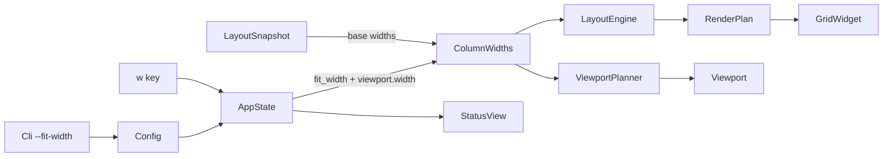
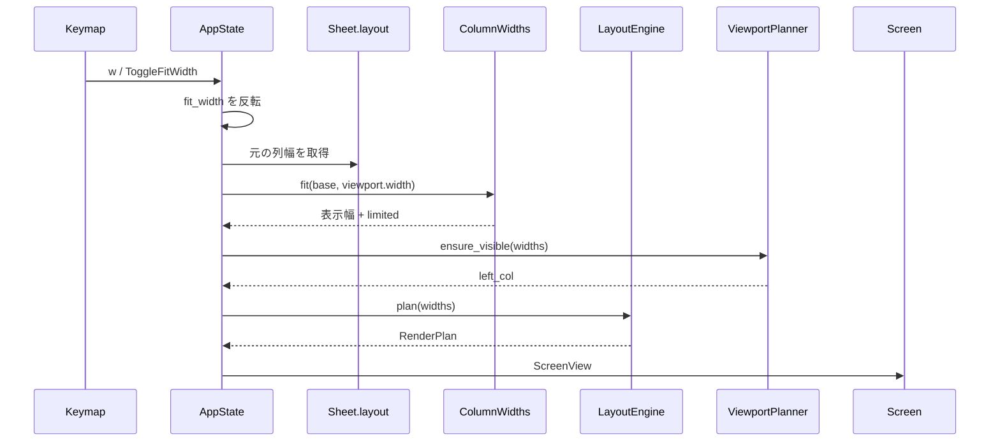

# Design Document

## Overview
**Purpose**: 閲覧中のシートで使用範囲の全列を端末幅に比例縮小し、横スクロールなしで表全体を一望できる「フィット幅モード」を提供する。
**Users**: リモート環境や狭いターミナルで、列数の多い xlsx / csv の全体像を素早く把握したい利用者。
**Impact**: 既存の `Sheet.layout` は変更せず、表示時だけ `ColumnWidths` を派生させる。`w` キーと `--fit-width` で元の列幅表示と切り替えられるようにする。

### Goals
- 使用範囲の全列を、端末幅に比例配分して縮小表示する。
- 元の Excel 準拠 / content レイアウトを破壊せず、トグルで即座に戻せる。
- グリッド、横スクロール、固定列、セル詳細で同じ表示幅を使う。
- リサイズ、再読込、数式再計算の後も表示幅を再計算する。
- `--print` でも同じフィット幅を再現する。

### Non-Goals
- 行高の再計算や `wrap_text` の再折り返し。
- 列の非表示制御、ユーザーによる列幅編集、Excel への書き戻し。
- フィット幅の設定ファイル永続化。
- 列ごとの個別フィットや、列数が多すぎる場合のページ分割。

## Boundary Commitments

### This Spec Owns
- 使用範囲全列の表示用幅を計算する規則（比例縮小、最低 1 桁、`limited` 判定）。
- フィット幅モードの状態、`w` キー、`--fit-width` CLI、ステータス表示。
- フィット幅を描画・横スクロール・固定列・詳細表示へ伝播する契約。

### Out of Boundary
- `Sheet.layout` の確定規則（Excel 明示幅 / content レイアウト）。
- 行高・折り返し行数の再計算、フィルタ・検索・コピーのデータ変換。
- 端末サイズやテーマ、ANSI 描画。
- 設定ファイルやセッション間の状態永続化。

### Allowed Dependencies
- `domain/layout.rs` の既存 `LayoutSnapshot`、`LayoutEngine`、`CELL_GUTTER`。
- `domain/viewport.rs` の `ViewportPlanner`。
- `app/state.rs` の `AppState`、`ui/view.rs` の `StatusView`。
- 既存の `clap` による CLI、`ratatui` による描画。
- 依存方向は `domain` ← `ui` / `config` ← `app` を維持する。

### Revalidation Triggers
- `ColumnWidths` の契約、`LayoutEngine` / `ViewportPlanner` のシグネチャ変更。
- フィット幅の配分規則、最低幅、`limited` の判定変更。
- `w` キーまたは `--fit-width` の名前変更。
- ステータスラベルの変更。

## Architecture

### Existing Architecture Analysis
- `LayoutStatsBuilder::finish` が `LayoutSnapshot` を生成し、読み込み後に不変に近い状態で使われる。
- `LayoutEngine::plan` は `sheet.layout.column_widths` を直接参照し、`RenderPlan` を組み立てる。
- `ViewportPlanner::ensure_visible` は同じ列幅で横スクロール位置を決める。
- `LayoutEngine::effective_freeze` は固定列の幅を表示領域と比較する。
- `AppState::view` が `ensure_focus_visible` → plan の順で描画情報を作る。
- 数式再計算は `grow_for_cell` で `Sheet.layout` を grow-only 更新する。

### Architecture Pattern & Boundary Map



**Architecture Integration**:
- Selected pattern: 既存レイヤード構成を維持した表示時派生（View Model）。
- Domain/feature boundaries: 幅の計算規則は `domain/layout.rs` に置き、`AppState` は状態と表示幅の選択だけを行う。
- Existing patterns preserved: `LayoutSnapshot` の grow-only 更新、`RenderPlan` による描画、`ViewportPlanner` による可視補正。
- New components rationale: `ColumnWidths` は「元のレイアウト」と「表示幅」を分離し、フィット幅の有無を明示する。
- Steering compliance: 純粋関数としてのレイアウト計算、`domain` から UI への逆依存禁止、型付きの表示状態を維持する。

### Technology Stack

| Layer | Choice / Version | Role in Feature | Notes |
|-------|------------------|-----------------|-------|
| CLI | clap 4.6 | `--fit-width` の解析 | 既存 `Cli` / `Config` に追加 |
| Domain | Rust 2024 | `ColumnWidths`、比例縮小、`limited` 判定 | 新しい外部クレートなし |
| App | Rust 2024 | トグル状態、キーマップ、表示幅の生成 | `w` は Normal / Visual |
| UI | ratatui 0.30.2 | ステータス・ヘルプ表示 | グリッドは `RenderPlan` をそのまま使用 |
| Tests | assert_cmd / ratatui TestBackend | CLI / TUI / 単体テスト | 既存パターンを踏襲 |

## File Structure Plan

### Directory Structure
```
src/
├── domain/
│   ├── layout.rs        # ColumnWidths、fit_column_widths、LayoutEngine の幅参照
│   └── viewport.rs      # 横スクロールを表示幅で計算
├── app/
│   ├── action.rs        # ToggleFitWidth
│   ├── keymap.rs        # w キー
│   └── state.rs         # fit_width 状態、表示幅の生成、ステータス
├── config.rs            # --fit-width
└── ui/
    ├── view.rs          # StatusView.fit_label
    ├── status.rs        # fit ラベル表示
    └── help.rs          # キー説明
```

### Modified Files
- `src/domain/layout.rs` — `ColumnWidths` / `fit_column_widths` を追加し、`LayoutEngine::plan` / `effective_freeze` / `measure_cell` / `truncated_at` が表示幅を受け取るように変更。
- `src/domain/viewport.rs` — `ViewportPlanner::ensure_visible` が表示幅を受け取るように変更。
- `src/app/action.rs` — `Action::ToggleFitWidth` を追加。
- `src/app/keymap.rs` — Normal / Visual の `w` を追加。
- `src/app/state.rs` — `fit_width`、`ColumnWidths` の生成、トグル、ステータスラベル、詳細表示への伝播。
- `src/config.rs` — `--fit-width` と `Cli` 初期値。
- `src/ui/view.rs` / `src/ui/status.rs` / `src/ui/help.rs` — `fit:on` / `fit:limited` とキー説明。
- `tests/app.rs` / `tests/tui.rs` / `tests/cli.rs` / `tests/view_consistency.rs` / `tests/fixtures_smoke.rs` — トグル、描画、CLI、シグネチャ更新。
- `README.md` / `.kiro/steering/tech.md` — 利用方法と制約。

## System Flows

### フィット幅の生成と消費



- `fit_width` が無効のときは `ColumnWidths::from_sheet` を使い、既存の列幅をそのまま渡す。
- 数式再計算や再読込の後も、`Sheet.layout` から毎回 `ColumnWidths` を作り直す。
- 端末リサイズは `set_size` → `view` / `ensure_focus_visible` の流れで自然に再計算される。

## Requirements Traceability

| Requirement | Summary | Components | Interfaces | Flows |
|-------------|---------|------------|------------|-------|
| 1.1 | 全列の表示幅計算 | ColumnWidths | `fit` | フィット幅の生成 |
| 1.2 | 収まる場合は変更しない | fit_column_widths | 純粋関数 | フィット幅の生成 |
| 1.3 | 最低 1 桁 + 比例配分 | fit_column_widths | 純粋関数 | フィット幅の生成 |
| 1.4 | 元の幅を超えない | fit_column_widths | 純粋関数 | フィット幅の生成 |
| 1.5 | 1 桁でも収まらない場合 | ColumnWidths | `limited` | フィット幅の生成 |
| 1.6 | 決定的な端数配分 | fit_column_widths | 純粋関数 | フィット幅の生成 |
| 1.7 | 列数比例の計算量 | ColumnWidths | `fit` | フィット幅の生成 |
| 2.1 | `w` でトグル | Keymap, AppState | `ToggleFitWidth` | トグル |
| 2.2 | 有効時に先頭列へ | AppState | `viewport.left_col` | トグル |
| 2.3 | 無効時にフォーカス補正 | AppState, ViewportPlanner | `ensure_focus_visible` | トグル |
| 2.4 | リサイズ後の再計算 | AppState | `set_size`, `view` | 表示更新 |
| 2.5 | シート切替・再読込で維持 | AppState | `fit_width` | 状態保持 |
| 2.6 | ステータス表示 | StatusView | `fit_label` | 描画 |
| 2.7 | `fit:limited` | ColumnWidths, StatusView | `limited` | 描画 |
| 2.8 | 他モードでは無効 | Keymap | モード分岐 | 入力 |
| 3.1 | `--fit-width` で起動時有効 | Cli, AppState | `fit_width` | 起動 |
| 3.2 | print にも適用 | AppState | `view` | 起動 |
| 3.3 | 既定は無効 | Cli | `fit_width=false` | 起動 |
| 3.4 | `--layout` と独立 | Config | `layout_mode` | 起動 |
| 3.5 | 無効時は元のレイアウト | ColumnWidths | `from_sheet` | 描画 |
| 4.1 | 描画・スクロール・詳細の一致 | LayoutEngine, ViewportPlanner | `ColumnWidths` 引数 | 描画 |
| 4.2 | 結合セルの縮小 | LayoutEngine | `merged_width` | 描画 |
| 4.3 | wrap_text の切り詰め | LayoutEngine | `wrap_display` | 描画 |
| 4.4 | 行高は再計算しない | LayoutEngine | `row_height` | 描画 |
| 4.5 | 無効時の既存挙動維持 | 全体 | 既存テスト | 回帰 |
| 4.6 | 値・選択・コピー不変 | AppState | 既存処理 | 回帰 |
| 5.1 | 数式再計算後の再計算 | AppState | `view` | 表示更新 |
| 5.2 | 再読込後の再計算 | AppState | `replace_workbook` | 再読込 |
| 5.3 | `Sheet.layout` を書き換えない | ColumnWidths | 表示時派生 | 全体 |
| 5.4 | 無効時に元の幅を表示 | ColumnWidths | `from_sheet` | トグル |
| 6.1 | 純粋関数の単体テスト | fit_column_widths | 単体テスト | テスト |
| 6.2 | 既存テストの非回帰 | 全体 | 既存テスト | 回帰 |
| 6.3 | 境界テスト | fit_column_widths | 単体テスト | テスト |
| 6.4 | キー・CLI・print のテスト | Keymap, Cli, AppState | 統合テスト | テスト |

## Components and Interfaces

| Component | Domain/Layer | Intent | Req Coverage | Key Dependencies (P0/P1) | Contracts |
|-----------|--------------|--------|--------------|--------------------------|-----------|
| ColumnWidths | Domain | 表示用の列幅と limited 判定を保持する | 1, 4, 5 | LayoutSnapshot (P0), LayoutLimits (P0) | State |
| fit_column_widths | Domain | 比例縮小の純粋計算 | 1, 6 | なし | Service |
| LayoutEngine | Domain | RenderPlan と切り詰め判定を表示幅で生成する | 4 | ColumnWidths (P0) | Service |
| ViewportPlanner | Domain | 表示幅で横スクロールを補正する | 2, 4 | ColumnWidths (P0) | Service |
| AppState | App | モード状態と表示幅の生成・伝播 | 2, 3, 5 | ColumnWidths (P0), Config (P0) | State |
| Keymap | App | `w` をトグルへ変換する | 2 | Mode (P0) | Service |
| Cli / Config | Config | `--fit-width` を提供する | 3 | clap (P0) | Service |
| StatusView / HelpView | UI | 状態とキー説明を表示する | 2 | ScreenView (P0) | State |

### Domain

#### ColumnWidths

| Field | Detail |
|-------|--------|
| Intent | 元のレイアウトから表示用の列幅を生成し、全コンポーネントで共有する |
| Requirements | 1.1, 1.2, 1.3, 1.4, 1.5, 1.7, 4.1, 5.3 |

**Responsibilities & Constraints**
- `Sheet.layout` の列幅を使用範囲の末尾まで展開する。
- `fit` では比例縮小した幅と `limited` を保持する。
- `width(col)` は常に 1 以上を返す。
- `Sheet.layout` を変更しない。

**Dependencies**
- Inbound: `AppState` — 表示幅の生成（P0）。
- Outbound: `LayoutEngine`, `ViewportPlanner` — 表示幅の消費（P0）。
- External: なし。

**Contracts**: State [x]

##### State Management
- State model: `widths: Vec<u16>`, `limited: bool`。
- Persistence & consistency: メモリ上のみ。描画ごとに生成し、ファイルへ保存しない。
- Concurrency strategy: UI スレッドで完結する。

**Implementation Notes**
- Integration: `ColumnWidths::from_sheet(sheet)` と `ColumnWidths::fit(sheet, viewport.width)` を用意する。
- Validation: 空の使用範囲でも空ベクタを返し、`width` は 1 を返す。
- Risks: 使用範囲が極端に広い場合は列数分の `Vec<u16>` を確保するが、セル数には依存しない。

#### fit_column_widths

| Field | Detail |
|-------|--------|
| Intent | 最低 1 桁 + 比例配分の純粋計算 |
| Requirements | 1.2, 1.3, 1.4, 1.5, 1.6, 6.1, 6.3 |

**Responsibilities & Constraints**
- `base: &[u16]` と `available: u16` を受け取り、`FitWidths { widths, limited }` を返す。
- 合計スロット（列幅 + 列数分のガター）が `available` 以下なら `base` をそのまま返す。
- 収まらない場合は各列 1 桁を確保し、残りを元の幅の比率で配分する。
- 元の幅を超えない。
- 1 桁でも収まらない場合は全列 1 桁で `limited = true`。
- 端数は最大剰余順で配分し、同点は列インデックス順で解決する。

**Contracts**: Service [x]

```rust
impl ColumnWidths {
    pub fn from_sheet(sheet: &Sheet) -> Self;
    pub fn fit(sheet: &Sheet, available: u16) -> Self;
    pub fn width(&self, col: u32) -> u16;
    pub fn limited(&self) -> bool;
}

pub fn fit_column_widths(base: &[u16], available: u16) -> FitWidths;

pub struct FitWidths {
    pub widths: Vec<u16>,
    pub limited: bool,
}
```

- Preconditions: `base` の各要素は 1 以上を想定するが、0 は 1 にクランプする。
- Postconditions: `widths.len() == base.len()`。`limited` は 1 桁でも収まらない場合のみ true。
- Invariants: 各 `widths[i] <= base[i]`、`widths[i] >= 1`、合計は `available` を超えない（`limited` を除く）。

**Implementation Notes**
- Integration: `ColumnWidths::fit` が `fit_column_widths` を呼ぶ。
- Validation: `u32` で合計を計算し、`available` との比較でオーバーフローを避ける。
- Risks: 端数配分の同点規則が変わるとテストが不安定になるため、列インデックス順を明示する。

#### LayoutEngine

| Field | Detail |
|-------|--------|
| Intent | 表示幅で `RenderPlan` と切り詰め判定を生成する |
| Requirements | 4.1, 4.2, 4.3, 4.4, 4.5 |

**Responsibilities & Constraints**
- `plan(sheet, viewport, focus, selection, search, widths)` は `widths` から列幅・結合幅・はみ出し幅を決める。
- `effective_freeze(sheet, viewport, widths)` は表示幅で固定列を決める。
- `measure_cell(sheet, addr, widths)` と `truncated_at` は詳細表示とグリッドで同じ切り詰め判定を返す。
- 行高は `sheet.layout.row_heights` のまま使う。

**Dependencies**
- Inbound: `AppState` — 表示幅（P0）。
- Outbound: `RenderPlan`, `CellMeasure`（P0）。

**Contracts**: Service [x]

##### Service Interface
```rust
LayoutEngine::plan(sheet, viewport, focus, selection, search, widths: &ColumnWidths) -> RenderPlan;
LayoutEngine::effective_freeze(sheet, viewport, widths: &ColumnWidths) -> EffectiveFreeze;
LayoutEngine::measure_cell(sheet, addr, widths: &ColumnWidths) -> CellMeasure;
LayoutEngine::truncated_at(sheet, addr, widths: &ColumnWidths) -> bool;
```

- Preconditions: `widths` は対象シートの使用範囲を覆う。
- Postconditions: `RenderPlan` の全セル幅は `widths` に一致する。
- Invariants: `Sheet.layout.column_widths` を参照しない。

**Implementation Notes**
- Integration: `render_row` / `plan_columns` / `merged_width` / はみ出し計算を `widths.width(col)` に置き換える。
- Validation: 結合セルの幅は構成列の合計 + ガターで計算する。
- Risks: `ViewportPlanner` と幅の渡し忘れがあるとフォーカスが画面外になるため、統合テストで確認する。

### Application

#### AppState

| Field | Detail |
|-------|--------|
| Intent | フィット幅モードの状態と表示幅の生成・伝播 |
| Requirements | 2.1, 2.2, 2.3, 2.4, 2.5, 3.1, 3.2, 3.3, 5.1, 5.2, 5.3, 5.4 |

**Responsibilities & Constraints**
- `fit_width: bool` を保持し、`Config.cli.fit_width` で初期化する。
- `Action::ToggleFitWidth` で反転し、有効時は `left_col = 0`、その後 `ensure_focus_visible`。
- `view()` / `ensure_focus_visible()` / `detail_view()` で同じ `ColumnWidths` を生成する。
- `replace_workbook` で `fit_width` を維持する。
- ステータスに `fit:on` / `fit:limited` を設定する。

**Contracts**: State [x]

##### State Management
- State model: `fit_width: bool`。
- Persistence & consistency: セッション内のみ。再起動時は CLI 既定値。
- Concurrency strategy: UI スレッドで完結する。

**Implementation Notes**
- Integration: `fn column_widths(&self, sheet: &Sheet) -> ColumnWidths` を追加し、fit の有無で `fit` / `from_sheet` を選ぶ。
- Validation: `fit:limited` は `ColumnWidths::limited()` で判定する。
- Risks: `view()` で `ensure_focus_visible()` の後に別の `ColumnWidths` を作ると微妙にずれる可能性があるため、同じ `viewport.width` を使う。

#### Keymap

| Field | Detail |
|-------|--------|
| Intent | `w` をフィット幅トグルへ変換する |
| Requirements | 2.1, 2.8 |

**Responsibility**: Normal / Visual モードでのみ `Action::ToggleFitWidth` を返す。Search / Filter / Detail / Help では返さない。

### Config / UI

#### Cli / Config

| Field | Detail |
|-------|--------|
| Intent | `--fit-width` を提供する |
| Requirements | 3.1, 3.2, 3.3, 3.4 |

**Responsibility**: `Cli.fit_width: bool` を追加し、`Config::default` では false。`AppState::new` が初期値を読む。

#### StatusView / HelpView

| Field | Detail |
|-------|--------|
| Intent | フィット状態とキー操作を表示する |
| Requirements | 2.6, 2.7 |

**Responsibility**: `StatusView.fit_label` をステータス行に追加し、ヘルプに `w fit columns to screen` を表示する。

## Data Models

### Domain Model
- `ColumnWidths` は値オブジェクト。元の `LayoutSnapshot` を参照して生成されるが、元データを変更しない。
- `FitWidths` は純粋計算の結果で、`widths` と `limited` を保持する。

### Logical Data Model
- `ColumnWidths.widths`: 0 始まり列インデックスに対応する表示桁数（`u16`）。
- `ColumnWidths.limited`: 1 桁でも収まらない場合に true。
- `base` の長さは `used_range.end.col + 1`。
- ガターは `CELL_GUTTER = 1` で、各列の後ろに 1 桁。

**Consistency & Integrity**:
- `widths` の長さは常に `base` と同じ。
- `limited = false` のとき、`sum(widths) + widths.len() <= available`。
- `fit` の結果は元の `base` を超えない。
- `Sheet.layout` はフィット幅の影響を受けない。

## Error Handling

### Error Strategy
- フィット幅の計算は失敗しない。範囲外の値はクランプし、エラーを返さない。
- 列が多すぎて収まらない場合はエラーではなく `limited` 状態として扱う。
- 空の使用範囲では空の `widths` を返し、描画側は既存の空シート処理に任せる。

### Error Categories and Responses
- **数値のオーバーフロー**: `u32` の saturating 計算で防ぐ。
- **0 幅の列**: 1 にクランプする。
- **極端な列数**: 1 桁幅で `limited = true`。ステータスに表示する。
- **幅の不一致**: `ColumnWidths` を LayoutEngine / ViewportPlanner / 詳細表示で共有して防ぐ。

### Monitoring
- 新しいログや警告は追加しない。既存のステータス行で `fit:on` / `fit:limited` を確認できる。

## Testing Strategy

### Unit Tests
- `fit_column_widths`:
  - ちょうど収まる場合は幅不変。
  - 比例縮小後、`sum(width) + len <= available`。
  - 元の幅を超えない。
  - 1 桁でも収まらない場合は全列 1 桁 + `limited`。
  - 1 列のみ、空、0 幅、極端な列数の境界。
  - 端数配分が最大剰余順、同点は列インデックス順で決定的。
- `ColumnWidths::fit` が `Sheet.layout` を変更しないこと。

### Integration Tests
- `AppState` で `w` トグル後に `RenderPlan` の全列が表示幅内に収まる。
- OFF に戻すと元の列幅・横スクロールに戻る。
- リサイズ後にフィット幅が再計算される。
- `--fit-width` で起動した `AppState` が最初からフィット状態になる。
- 再読込後も `fit_width` が維持される。
- 詳細表示の `truncated` がグリッドと一致する。

### E2E/UI Tests
- 横に長い CSV を狭い端末で描画し、フィット ON で最終列の内容が見える。
- OFF では最終列が見えず、横スクロールが必要である。
- ステータス行に `fit:on` / `fit:limited` が表示される。
- ヘルプに `w` の説明が表示される。

### Performance/Load
- `fit_column_widths` が列数に比例し、セル数に依存しないことをコードレビューで確認する。
- 大きな使用範囲でも描画ごとの追加コストが列数分の `Vec<u16>` 確保に留まることを確認する。

## Risks & Mitigations
- **横スクロールと描画の不一致** — `ColumnWidths` を全コンポーネントで共有し、フォーカス可視性の統合テストを追加する。
- **列数過多によるメモリ使用** — 列数分の `Vec<u16>` のみ。1 桁でも収まらない場合は `limited` として横スクロールを残す。
- **wrap_text の切り詰め増加** — 既存の `…` 表示と詳細表示を使い、README の制約に明記する。
- **既存テストのシグネチャ変更漏れ** — コンパイルエラーで検出し、呼び出しを一括更新する。
- **reload 後の状態消失** — `AppState.fit_width` を `replace_workbook` で保持し、統合テストで確認する。
