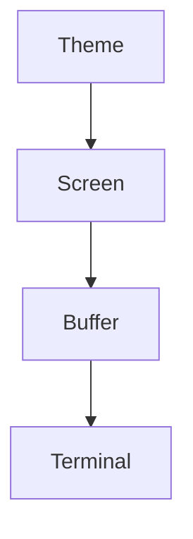
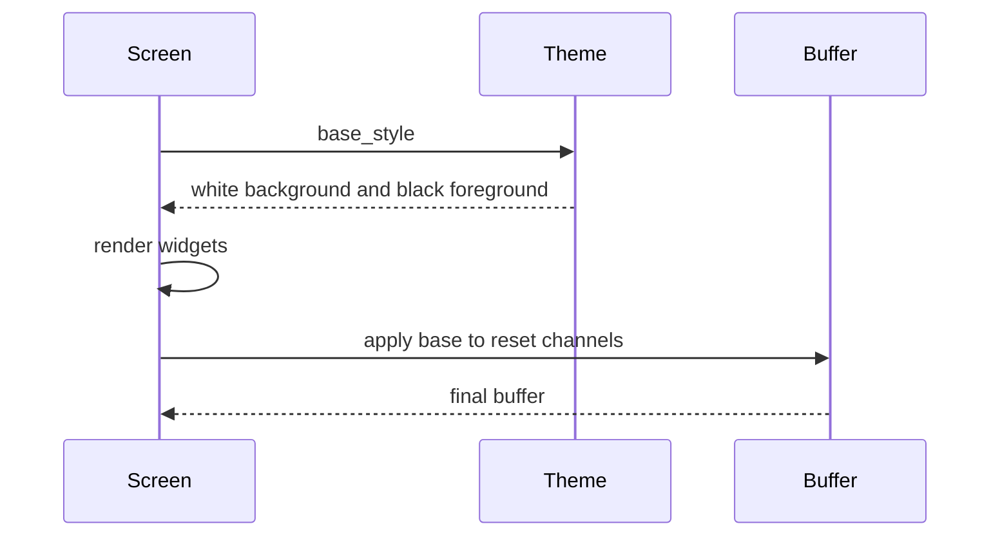

# Design Document

## Overview

**Purpose**: `Mono` 以外のカラーモードで、明示的な色指定がない UI 領域を白背景・黒文字に統一し、明るい端末でも表と操作 UI を読みやすくする。

**Users**: ターミナルで xlsx / csv を閲覧するすべてのユーザー。特に、端末の既定配色が明るい背景と暗い文字、またはその逆でセル色と衝突する環境。

**Impact**: `Theme` に基底スタイルを追加し、`Screen` の描画後にバッファの `Color::Reset` チャネルを補完する。既存のウィジェット実装と Excel の明示的な色情報は変更しない。

### Goals

- 非 Mono モードで全 UI に白背景・黒文字の既定配色を適用する。
- Mono モードでは端末既定色を尊重する。
- Excel のセル色・塗りつぶし・選択・検索のコントラストを維持する。
- `--no-ansi` スナップショットの文字内容を変えない。

### Non-Goals

- カラーモードの追加、テーマファイル、ユーザー定義配色。
- ターミナル全体の背景色を変更する ANSI 制御。
- Excel 側の色情報の変更。
- フォントや描画属性の変更。

## Boundary Commitments

### This Spec Owns

- `Theme` の基底背景色・文字色。
- `Screen` 描画後のバッファ補完。
- 非 Mono モードの UI 全体への配色適用。
- Mono モードでの非適用。

### Out of Boundary

- 構造編集、選択、クリップボード、保存。
- Excel のセル色・塗りつぶしの解釈変更。
- カラーモードの追加やテーマ設定ファイル。
- ターミナルエミュレータの背景色制御。

### Allowed Dependencies

- 既存の `ratatui` 0.30 `Buffer` / `Style` / `Color`。
- 既存の `Theme` と `Screen`。
- 新しい外部クレートは追加しない。

### Revalidation Triggers

- `Screen::render_impl` の描画順序変更。
- `Theme` のスタイル構造変更。
- 新しいポップアップや全画面ウィジェットの追加。
- スナップショット出力形式の変更。

## Architecture

### Existing Architecture Analysis

- `Theme` は `mode`、`fill_mode`、`selection`、`search`、`current`、`header`、`border`、`grid` を持つ。
- `Screen::render_impl` はステータス、グリッド、タブ、ポップアップを順に描画する。
- 各ウィジェットは `Style::default()` を基底にパッチするため、`fg` / `bg` が `Color::Reset` のセルが残る。
- `Clear` はポップアップ領域のセルを初期化する。

### Architecture Pattern & Boundary Map



**Architecture Integration**:
- Selected pattern: 既存の描画パイプラインに「基底色の後処理」を 1 段追加する。
- Domain/feature boundaries: 配色は UI 層に閉じ、domain / app / io には影響しない。
- Existing patterns preserved: `Theme` によるスタイル決定、`Screen` の描画順序、`--no-ansi` の出力変換。
- New components rationale: `Theme::base_style` と `Theme::apply_base` のみを追加し、ウィジェットごとの変更を避ける。

### Technology Stack

| Layer | Choice / Version | Role in Feature | Notes |
|-------|------------------|-----------------|-------|
| UI | ratatui 0.30.2 | バッファのセルスタイル補完 | 既存依存 |
| UI | Rust 2024 | 基底スタイルの定義 | 既存スタック |

## File Structure Plan

### Modified Files

- `src/ui/theme.rs` — `base_style` と `apply_base` を追加。非 Mono は白背景・黒文字、Mono は `Reset`。
- `src/ui/screen.rs` — 描画後に `apply_base` を呼ぶ。画面サイズ不足時の早期 return 経路も対象にする。
- `tests/tui.rs` — 非 Mono のスナップショット期待値を更新し、Mono の回帰テストを追加。
- `README.md` — 非 Mono モードの既定配色を記載する。

## System Flows



Mono モードでは `base_style` が `Reset` を返し、`apply_base` は何もしない。

## Requirements Traceability

| Requirement | Summary | Components | Interfaces | Flows |
|-------------|---------|------------|------------|-------|
| 1.1, 1.2, 1.3, 1.4, 1.5, 1.6 | 非 Mono の既定配色 | Theme, Screen, Buffer | `Theme::base_style`, `Theme::apply_base` | 描画後補完 |

## Components and Interfaces

| Component | Domain/Layer | Intent | Req Coverage | Key Dependencies | Contracts |
|-----------|--------------|--------|--------------|------------------|-----------|
| Theme | UI | 基底色と既存スタイルの決定 | 1.1, 1.2, 1.3, 1.6 | ratatui Style | State |
| Screen | UI | 描画後のバッファ補完 | 1.4, 1.5 | Theme, Buffer | State |

### Theme

| Field | Detail |
|-------|--------|
| Intent | 非 Mono の基底色を提供する |
| Requirements | 1.1, 1.2, 1.3, 1.6 |

**Responsibilities & Constraints**
- `base_style` は `ColorMode::Mono` では `Style::default()`、それ以外では `bg(White).fg(Black)` を返す。
- `apply_base` は `fg` が `Reset` なら黒、`bg` が `Reset` なら白を設定する。チャネル単位で判定する。
- 既存の `selection` / `search` / `current` / `header` / `border` / `grid` は変更しない。

**Contracts**: State [x]

```rust
impl Theme {
    pub fn base_style(&self) -> Style;
    pub fn apply_base(&self, buffer: &mut Buffer, area: Rect);
}
```

- Preconditions: `area` はバッファ内。
- Postconditions: 非 Mono では `Reset` の `fg` / `bg` がそれぞれ黒 / 白になる。
- Invariants: Mono ではバッファを変更しない。

### Screen

| Field | Detail |
|-------|--------|
| Intent | 全ウィジェット描画後に基底色を適用する |
| Requirements | 1.4, 1.5 |

**Responsibilities & Constraints**
- `render_impl` の最後に `theme.apply_base(frame.buffer_mut(), area)` を呼ぶ。
- 画面サイズ不足時の早期 return でも同じ後処理を行う。
- `SnapshotStyle::Plain` は ANSI を出力しないため、文字内容は変わらない。

**Contracts**: State [x]

## Error Handling

- バッファ範囲外へのアクセスは saturating clamp で防止する。
- 非 Mono / Mono の判定は `ColorMode` に一元化し、個別ウィジェットで分岐しない。
- `--no-ansi` の出力変換は既存の `ansi::buffer_to_string` を維持する。

## Testing Strategy

### Unit Tests

- `Theme::base_style` が非 Mono で白背景・黒文字、Mono で `Reset` を返す。
- `apply_base` が `fg` のみ `Reset` のセル、`bg` のみ `Reset` のセル、両方 `Reset` のセルを正しく補完する。
- Mono ではバッファが変更されない。

### Integration Tests

- 非 Mono のスナップショットに白背景・黒文字が含まれる。
- Mono のスナップショットに白背景・黒文字が含まれない。
- `--no-ansi` の文字内容が配色変更前後で一致する。
- ヘルプ・詳細・フィルタパネル・入力行が同じ基底色になる。

### Performance

- バッファ走査が画面サイズに対して線形である。
- Mono では走査をスキップする。

## Risks & Mitigations

- **スナップショット差分**: 既存の TUI テストを更新し、Mono の回帰テストを追加する。
- **明示的な `Reset` の扱い**: 非 Mono では `Reset` を基底色として扱う仕様を README に記載する。
- **ポップアップの `Clear`**: 描画後の後処理で確実に適用する。
