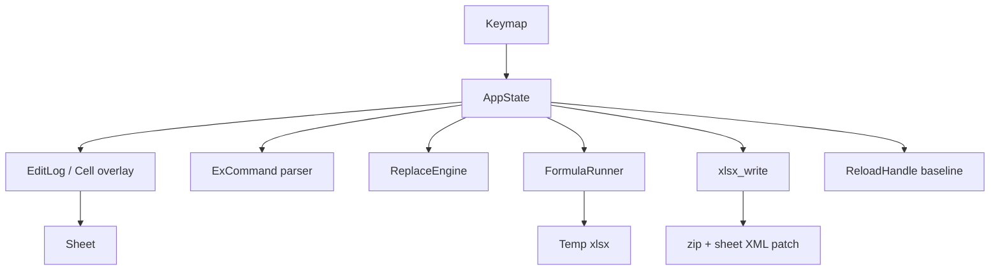
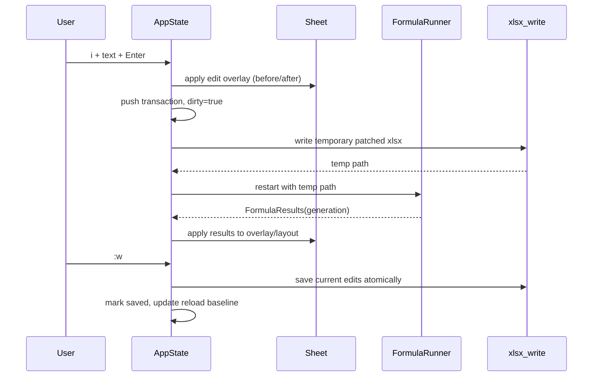

# Design Document

## Overview

**Purpose**: xlsx のセル値・数式を Vim 風のモーダル操作で編集し、変更セルだけを安全に既存ファイルへ書き戻す。
**Users**: ターミナルで表を調査しながら軽微な修正を行う開発者・運用担当者。
**Impact**: `Sheet` に編集オーバーレイを追加し、`AppState` に Insert / Command モード、undo / redo、保存を追加する。数式再計算は未保存編集を含む一時 xlsx を使って既存エンジンを再利用する。保存は OOXML の差分パッチで行う。

### Goals

- 閲覧の読み取り専用モデルを壊さずに、eager / lazy の両方でセル編集できる。
- 変更セルだけを書き戻し、スタイル・結合・フィルタ・条件付き書式などを保持する。
- 1 回の編集・範囲操作・置換を undo できる。
- 保存前に数式結果を更新できる。
- 保存と watch / reload の競合を安全に扱う。

### Non-Goals

- CSV の保存、行/列の構造編集、書式編集、共有数式・配列数式の編集。
- 確認付き置換（`c`）、正規表現、マクロ、永続 undo。
- 保存のバックグラウンド化と進捗 UI（初版は同期保存）。
- xlsx 以外の形式の書き戻し。

## Boundary Commitments

### This Spec Owns

- `Mode::Insert` / `Mode::Command` と下部入力行。
- セル入力の型解釈、編集オーバーレイ、編集トランザクション、undo / redo、dirty。
- 変更セルの xlsx 差分保存と、保存後の監視基準更新。
- `:s` / `:%s` / `:gs` の置換エンジン。
- 未保存編集からの数式再計算要求と結果適用。
- 編集・置換・保存の read-only / dirty / 外部変更ガード。

### Out of Boundary

- 検索のシート横断化（`cross-sheet-search`）。
- フィルタ条件、レイアウト、コピーの既存規則。
- 数式エンジン自体の変更。
- 画像・グラフ・ピボット・VBA の編集。

### Allowed Dependencies

- 既存の `calamine` / `formualizer` / `zip` / `quick-xml`。
- 既存の `Sheet` / `WorkbookModel` / `FormulaRunner` / `ReloadHandle`。
- 新しい外部クレートは追加しない。

### Revalidation Triggers

- `Sheet` のセル読み取り API または `SheetData` の構造変更。
- `WorkbookModel` の再読み込み・世代管理の変更。
- xlsx のシート XML / zip エントリ構成の扱い変更。
- 検索・フィルタの可視性規則の変更。

## Architecture

### Existing Architecture Analysis

- 読み取りは `calamine` と独自 XML パーサに閉じており、`Sheet` に書き込み API はない。
- eager は `HashMap<CellAddr, Cell>`、lazy は `LazySheet` と行キャッシュで、共通の可変セル API がない。
- `FormulaRunner` は保存済みパスを読み直すため、未保存編集を直接計算できない。
- `ReloadHandle` は保存後の自分の変更も外部変更として検知し得る。
- `zip` と `quick-xml` は既に依存にあり、`sheet_meta.rs` で OOXML 解析の実績がある。

### Architecture Pattern & Boundary Map



**Architecture Integration**:
- Selected pattern: 既存のレイヤード構成を維持し、編集状態を domain の `EditLog` と `Sheet` オーバーレイに置く。
- Domain/feature boundaries: 入力解釈とトランザクションは domain、キー・コマンド・保存調整は app、zip/XML は io。
- Existing patterns preserved: `SheetData` の eager/lazy、`FormulaOverlay`、`Generation`、`Effect`。
- New components rationale:
  - `EditLog`: undo/redo と dirty の単一の真実。
  - `command`: Ex コマンドの純粋なパーサ。
  - `xlsx_write`: 差分保存アダプタ。

### Technology Stack

| Layer | Choice / Version | Role in Feature | Notes |
|-------|------------------|-----------------|-------|
| Domain | Rust 2024 | 入力解釈、編集履歴、置換 | 外部型を公開しない |
| IO | zip 9.5 / quick-xml 0.42 | シート XML パッチ | 既存依存 |
| Formula | formualizer 0.14 | 一時 xlsx の再計算 | 既存 `FormulaRunner` を拡張 |
| UI | ratatui 0.30 / crossterm 0.29 | モード表示、入力行、カーソル | 既存レイアウトを維持 |

## File Structure Plan

### New Files

- `src/domain/edit.rs` — 入力解釈、`InputState`、`EditChange` / `EditTransaction` / `EditLog`。
- `src/domain/command.rs` — `:w` / `:q` / `:s` / `:goto` などの Ex コマンドパーサ。
- `src/domain/replace.rs` — literal 置換の計画と結果。
- `src/io/xlsx_write.rs` — zip コピー、sheetData パッチ、dimension/calcPr/calcChain 更新、atomic save。

### Modified Files

- `src/domain/sheet.rs` — `edits` オーバーレイ、セル設定・復元、bounds/layout/filter/formula 更新。
- `src/domain/mode.rs` / `src/app/action.rs` / `src/app/keymap.rs` — モード・アクション・キー。
- `src/app/state.rs` — 編集セッション、コマンド実行、置換、保存要求、再計算要求。
- `src/app/event_loop.rs` — `Effect::Save`、再計算ジョブ、保存後の終了。
- `src/app/reload.rs` — 保存後の基準スタンプ更新、dirty 時の外部変更抑止。
- `src/io/formula.rs` / `src/app/formula_runner.rs` — 任意パスからの再計算。
- `src/ui/view.rs` / `src/ui/screen.rs` / `src/ui/status.rs` — 入力行、カーソル、dirty、モード。
- `src/config.rs` / `src/main.rs` — `--read-only`。
- `tests/app.rs`, `tests/tui.rs`, `tests/integration.rs` — 編集・置換・保存のテスト。

## System Flows

### Insert 確定から保存



### 置換

`:s` / `:%s` / `:gs` はコマンドパーサで範囲とフラグを決め、`ReplaceEngine` が可視セルの表示値を走査する。数式セル・非表示行・結合非アンカーはスキップし、全変更を 1 トランザクションにまとめる。`n` フラグは件数のみ返す。

## Requirements Traceability

| Requirement | Summary | Components | Interfaces | Flows |
|-------------|---------|------------|------------|-------|
| 1.1-1.14 | モードとキー | Keymap, AppState, InputLine | Actions | Insert |
| 2.1-2.8 | 入力解釈 | edit.rs | `parse_cell_input` | Insert |
| 3.1-3.6 | undo/redo/dirty | EditLog, Sheet | Transactions | Insert/保存 |
| 4.1-4.9 | xlsx 保存 | xlsx_write, AppState, Reload | Save | 保存 |
| 5.1-5.9 | 置換 | command, replace, EditLog | Substitute | 置換 |
| 6.1-6.5 | 再計算 | FormulaRunner, temp writer | FormulaResults | Insert/保存 |
| 7.1-7.6 | コマンド・保護 | command, AppState | ExCommand | 保存/終了 |

## Components and Interfaces

| Component | Domain/Layer | Intent | Req Coverage | Key Dependencies | Contracts |
|-----------|--------------|--------|--------------|------------------|-----------|
| EditLog | Domain | トランザクションと undo/redo | 3 | Sheet | State |
| Sheet overlay | Domain | ベースを変えずに編集値を保持 | 2, 3 | SheetData | State |
| ExCommand parser | Domain | コマンド文字列の解釈 | 5, 7 | CellRange | Service |
| ReplaceEngine | Domain | literal 置換計画 | 5 | EffectiveCell | Service |
| xlsx_write | IO | OOXML 差分保存 | 4 | zip/quick-xml | Batch |
| InputLine | UI | 入力テキストとカーソル | 1 | InputState | State |

#### Sheet overlay

- `Sheet.edits: HashMap<CellAddr, Cell>` を追加する。
- `cell` / `read_cell` / `all_cells` は編集値を優先する。
- `set_edit_cell(addr, Option<Cell>)` は `used_range` / `meta` / `data_rows` / `layout` / `formula_cells` / `formula_overlay` / filter dirty を更新する。
- lazy シートでも行全体を eagar 化しない。

#### EditLog

```rust
pub struct EditChange { sheet: usize, addr: CellAddr, before: Option<Cell>, after: Option<Cell> }
pub struct EditTransaction { changes: Vec<EditChange> }
pub struct EditLog { undo: Vec<EditTransaction>, redo: Vec<EditTransaction>, dirty: bool }
```

- `record` は適用済みトランザクションを積む。
- `undo` は逆順に `before` を適用し、redo に積む。
- `reset_after_save` は dirty と undo / redo 履歴を消す。overlay のセル値は表示用に保持する。
- 上限 500 トランザクション。

#### xlsx_write

- 対象: xlsx / xlsm（zip を保持）。
- `xl/workbook.xml` と rels からシート名→XMLパスを解決する。
- `<sheetData>` 内の `<row>` / `<c>` を走査し、変更セルだけを置換・挿入する。
- テキストは `inlineStr`、数値・真偽値・エラー・数式は対応する型で書く。
- 既存セルの `s` 属性を保持する。
- `<dimension>` を拡張し、`calcPr fullCalcOnLoad=1` を設定、`calcChain` を削除する。
- 他の zip エントリはそのままコピーする。
- 一時ファイルに書き、zip を再オープンして検証してから atomic rename する。
- 保存対象は `WorkbookModel.sheets[].edits`。

#### ReplaceEngine

- `ReplaceSpec { pattern, replacement, global, case_sensitive, count_only }`
- 表示値に対して literal 置換し、セル全体が置換された場合は元の値型を保てる範囲で再解釈する。
- 数式セル・非表示行・結合非アンカーをスキップする。
- 置換結果は `EditTransaction` にまとめる。

## Error Handling

- 入力解析エラーは状態行に表示し、セルを変更しない。
- 保存エラー（読み取り専用、zip/XML 失敗、共有数式、外部変更）は元ファイルを変更せず dirty を維持する。
- 再計算失敗は編集を保持し、数式を `Pending` / `CachedOnly` として表示する。
- `:q` は dirty 時に拒否し、`:q!` / `ZQ` で破棄する。

## Testing Strategy

- Unit: 入力型解釈、EditLog の undo/redo、置換のフラグとスキップ、Ex コマンドのパース、XML パッチ。
- Integration: 編集→保存→再読み込みで値・スタイル・結合・フィルタ・固定ペインが保持される。
- TUI: Insert / Command の入力行、カーソル、dirty、`:q` 拒否。
- Formula: 未保存編集を含む一時 xlsx で依存数式が更新される。
- Regression: 読み取り専用表示、検索、コピー、watch が壊れない。
