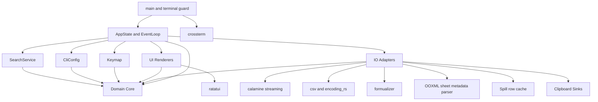
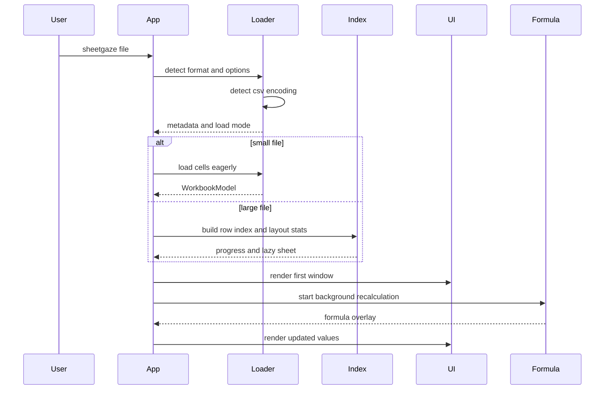
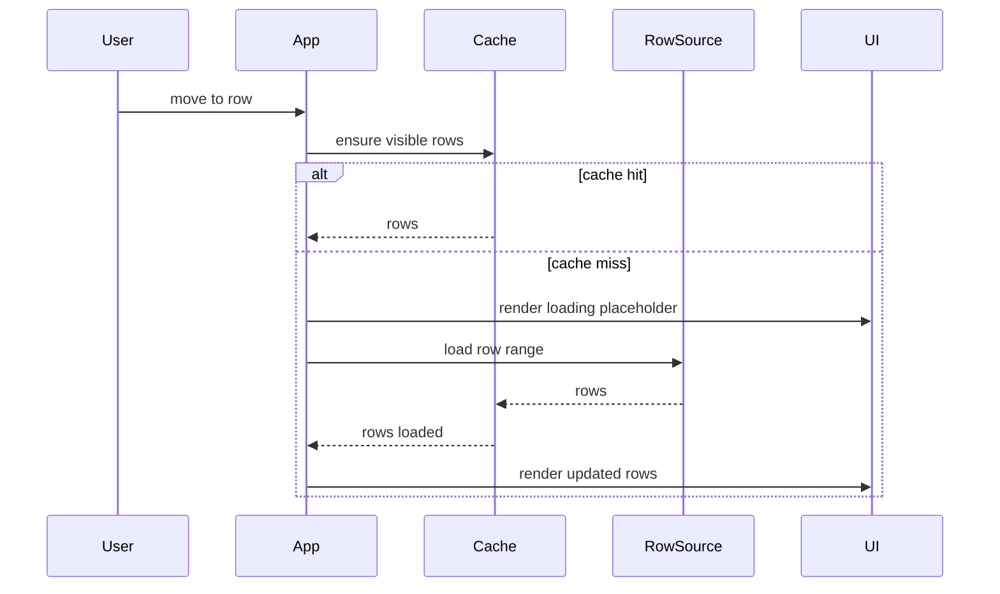
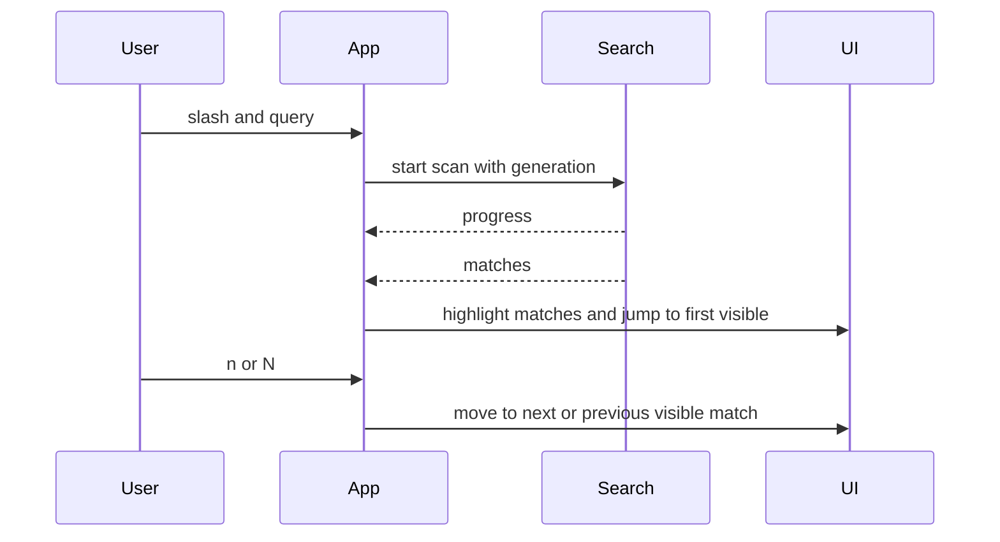
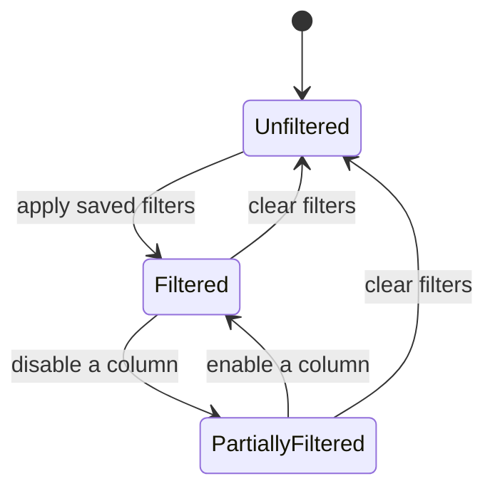

# Design Document

## Overview

`sheetgaze` は、xlsx / csv をターミナル上で閲覧するための表示専用 TUI である。xlsx の値・数式・結合セル・文字色・太字・セル罫線を読み込み、表示内容から列幅と行高を決めて描画する。数式は Excel 互換エンジンでバックグラウンド再計算し、計算中も閲覧・移動・コピー・終了を妨げない。

本設計ではさらに、現在シートの検索、Excel に保存されたオートフィルタの適用、Excel の行固定（フリーズペイン）の反映、csv の文字コード自動判定、大容量ファイルの行単位遅延ロードを扱う。検索・フィルタ・行固定は表示専用のビュー状態であり、元ファイルを変更しない。

**Purpose**: オフィススイートを起動できない環境でも、表計算の内容・数式結果・目的の行を素早く確認できるようにする。
**Users**: ターミナル中心で作業する開発者、運用担当者、リモートサーバー上のファイルを確認する利用者。
**Impact**: 新規プロジェクトのため既存システムへの影響はない。読み込み・表示・計算・検索・フィルタ・コピーを分離した拡張可能な基盤を確立する。

### Goals

- xlsx / csv を単一の読み取り専用モデルへ正規化し、表示・検索・コピーで一貫した値を提供する
- 数式計算を UI から分離し、計算中も操作可能な応答性を保つ
- 改行・結合セル・文字色・太字・セル罫線・はみ出しを、端末表示の制約内で予測可能に描画する
- Excel に保存されたオートフィルタを読み取り、列単位の可視マスクとして適用する
- Excel の固定ペイン（行固定、および同時に設定された列固定）を読み取り、スクロール中も固定表示する
- 現在シートの表示値と数式を検索し、一致間を Vim 風に移動できるようにする
- csv の文字コードを BOM・自動判定・明示指定の順で決定し、文字化けを防ぐ
- 大容量ファイルでは行インデックスと上限付きキャッシュを使い、メモリを総行数に比例させない
- 列幅・行高の自動調整と上限設定を、テスト可能な純粋なレイアウト計算として実装する

### Non-Goals

- セル編集、数式編集、ファイル保存、クリップボードからの貼り付け
- フィルタ条件の新規作成・変更・保存、並べ替え、色・アイコン・動的フィルタの完全対応
- 行固定・列固定の新規作成・変更・保存、分割ペイン（split pane）の再現
- 正規表現検索、シートをまたぐ検索、検索インデックスの永続化
- xls / xlsb / ods、グラフ、画像、ピボットテーブル、マクロ / VBA の実行
- Excel の列幅・行高・フォント・塗りつぶしを含む完全な表示再現（セル罫線は基本的な線種と色のみ表示し、線幅・斜線・印刷時の完全な再現は対象外）
- 外部リンクの更新、ネットワークアクセス、外部プロセスとの連携
- 動的配列のスピル範囲を個別セルとして展開する完全再現
- 複数ファイルの同時表示、タブ以外の永続的なセッション保存

## Boundary Commitments

### This Spec Owns

- xlsx / csv の読み込み、形式判定、文字コード判定、読み取り専用の `WorkbookModel` への正規化
- xlsx の数式セルを対象とした再計算の起動・進捗・結果反映（計算エンジン自体の実装は所有しない）
- Excel のワークシート / テーブルに保存されたオートフィルタの解析と、読み取り専用の可視マスク適用
- Excel の固定ペイン（`pane`）の解析と、固定行・固定列を含むグリッド表示
- 現在シートのリテラル検索、一致インデックス、一致間移動、強調表示
- セル値の表示文字列化、列幅・行高の計算、結合セル・はみ出し・切り詰めの描画規則
- 大容量ファイルの行インデックス構築、スピルファイル、行ウィンドウキャッシュ、eager / lazy の切り替え
- ターミナル上のナビゲーション、選択、詳細表示、ヘルプ、ステータス表示
- 単一セル・範囲のコピー用シリアライズと、OSC 52 / OS クリップボードへの書き込み
- 端末の raw mode / alternate screen の復元を含むアプリケーションライフサイクル

### Out of Boundary

- スプレッドシートの編集・保存・変換、数式の入力・変更
- フィルタ条件の編集・保存、Excel の並べ替え状態の再現
- 固定ペインの編集・保存、split pane / frozenSplit の再現
- 色・アイコン・動的フィルタ、日付グループの完全対応
- 正規表現検索、全シート検索、検索結果の永続キャッシュ
- xlsx 以外の Excel 形式、ods、マクロ付きワークブックの実行
- 外部リンクの取得・更新、数式からのネットワークアクセス
- Excel の書式（塗りつぶし、フォントファミリ、インデント、回転、縮小表示、斜線、罫線の完全な線種再現）の完全再現
- 画像・グラフ・ピボット・コメント・入力規則・条件付き書式の描画
- クリップボードからの貼り付け、OS クリップボードの監視
- 設定ファイル、履歴、ブックマークなどの永続化

### Allowed Dependencies

- 読み込み: `calamine` 0.38（xlsx、`XlsxCellReader` によるストリーミング）、`csv` 1.4（csv）
- 文字コード: `chardetng` 1.0（自動判定）、`encoding_rs` 0.8（BOM・デコード）
- 計算: `formualizer` 0.14（`xlsx-recalc`、ネイティブ Rust）
- シートメタデータ: `quick-xml` 0.42 + `zip` 9.5（OOXML `autoFilter` / `pane` の解析）
- 遅延ロード: `tempfile` 3.27（スピルファイル）、`postcard` 1.1（行キャッシュ）、`serde` 1.0（キャッシュ DTO の derive）
- TUI: `ratatui` 0.30.2、`crossterm` 0.29
- 表示計算: `unicode-width` 0.2、`textwrap` 0.16
- クリップボード: `base64` 0.23（OSC 52）、`arboard` 3.7（OS クリップボード）
- CLI / エラー / 日付: `clap` 4.6、`thiserror` 2.0、`chrono` 0.4
- 開発時: `rust_xlsxwriter` 0.102（fixture 生成）、`insta` 1.49（スナップショット）、`assert_cmd` 2.2（CLI テスト）
- 実行環境: Rust 2024 edition、MSRV 1.88。外部オフィススイート、外部プロセス、非 Rust ランタイムには依存しない

### Revalidation Triggers

- `calamine` の `worksheet_cells_reader` / `XlsxCellReader` / `StyleRange` / 結合範囲 API、または座標系の変更
- `formualizer` の読み込み API、数式評価結果、エラー表現、外部リンクポリシーの変更
- OOXML `autoFilter` / `pane` の対応条件、テーブルフィルタ・固定ペインの解析方法の変更
- `chardetng` / `encoding_rs` の判定・デコード挙動、対応文字コードの変更
- 行キャッシュ形式、スピルファイルのライフサイクル、LRU 上限の変更
- 検索の対象（表示値 / 数式）、スマートケース、フィルタとの相互作用の変更
- コピー形式（TSV の引用規則、改行コード、結合セル・非表示行の扱い）の変更
- レイアウト上限の既定値、はみ出し規則、切り詰め表示の変更
- クリップボード戦略（OSC 52 / OS クリップボード）の既定値変更
- 端末の色・UTF-8・最小サイズに関する前提の変更

## Architecture

### Existing Architecture Analysis

新規プロジェクトであり、既存実装はない。`.kiro/steering/` のレイヤード方針に従い、`domain` を外部 I/O・TUI から独立させる。既存の互換性制約はなく、後続の機能追加（編集、別形式）を妨げない境界を最初に固定する。

### Architecture Pattern & Boundary Map

**Selected pattern**: レイヤード + 小さな trait 境界。表示専用アプリに対してフル Hexagonal は過剰だが、ローダー・数式計算・検索・フィルタ・行キャッシュ・クリップボード・描画の境界は trait / 純粋関数で分離する。



**Architecture Integration**:
- Selected pattern: レイヤード + trait 境界。`domain` は外部クレートの型を公開しない。
- Domain/feature boundaries: `domain` はモデル・レイアウト・選択・コピー整形・フィルタ評価・固定ペイン・検索インデックスを所有し、`io` は外部形式の変換、`ui` は描画、`app` は状態遷移と調整を所有する。
- Existing patterns preserved: steering の依存方向 `domain ← io / ui / input / config ← app ← main` を維持する。
- New components rationale: `LayoutEngine` は Excel 幅と端末幅の差異を吸収するため、`FormulaService` は計算を UI スレッドから分離するため、`FilterEngine` / `SearchIndex` は表示専用のビュー状態を純粋に保つため、`RowCache` は大容量ファイルのメモリを制限するために必要である。
- Steering compliance: 型付きエラー、`unsafe` 原則禁止、UI とロジックの分離、テスト可能な純粋関数を守る。

### Technology Stack & Alignment

| Layer | Choice / Version | Role in Feature | Notes |
|-------|------------------|-----------------|-------|
| Presentation / TUI | ratatui 0.30.2 + crossterm 0.29 | グリッド、詳細、検索プロンプト、フィルタパネル、ステータス | `TestBackend` でスナップショット検証 |
| CLI | clap 4.6.7 | ファイルパス、表示上限、色、文字コード、遅延ロード設定 | 不正値は使用法エラーで終了 |
| Domain / Layout | 独自実装 + unicode-width 0.2.3 + textwrap 0.16.4 | 表示幅、折り返し、列幅・行高、はみ出し計画 | 外部 TUI 型に依存しない |
| Data ingestion | calamine 0.38.0（ストリーミング）+ csv 1.4.0 | xlsx の値・数式・スタイル・結合、csv の解析 | xlsx は絶対座標へ正規化 |
| Encoding | chardetng 1.0.0 + encoding_rs 0.8.44 | csv の BOM 優先・自動判定・デコード | 判定結果を `SourceInfo` に保持 |
| Filter | quick-xml 0.42.0 + zip 9.5.1 + 独自 `FilterEngine` | OOXML `autoFilter` の解析と可視マスク | ワークシート / テーブル対応 |
| Lazy loading | tempfile 3.27.0 + postcard 1.1.3 | 行キャッシュのスピルと LRU | 閾値以下は eager |
| Calculation | formualizer 0.14.0（`xlsx-recalc`） | 数式の再計算、Excel エラー、外部リンクのキャッシュ扱い | 別スレッドで実行 |
| Clipboard | base64 0.23.1 + arboard 3.7.0 | OSC 52 / OS クリップボード | 環境に応じて自動選択 |
| Runtime | Rust 2024 edition、MSRV 1.88 | 単一バイナリ、ネイティブ実行 | 非同期ランタイム不要 |
| Errors / Dates | thiserror 2.0.21 + chrono 0.4 | ドメイン別エラー、日時表示 | 日時は calamine の `chrono` feature 経由 |

`formualizer` は `default-features = false` とし、`xlsx-recalc` と `system-clock` を有効にする。`calamine` は `chrono` feature を有効にする。`arboard` はプラットフォーム API を Rust クレート経由で利用するが、外部プロセスや非 Rust ランタイムは要求しない。

## File Structure Plan

### Directory Structure

```
Cargo.toml                         # 依存、feature、MSRV、profile
rust-toolchain.toml                # stable / MSRV の固定
src/
├── main.rs                        # CLI 起動、TerminalGuard、イベントループ開始
├── lib.rs                         # 公開モジュール、run エントリ
├── config.rs                      # CliConfig、RuntimeConfig、LayoutLimits、LazyConfig
├── app/
│   ├── mod.rs
│   ├── action.rs                  # Action / Effect / Motion / SearchAction
│   ├── state.rs                   # AppState、状態遷移、選択・詳細・検索・フィルタ・ステータス
│   ├── keymap.rs                  # キー列（gg）とモード別マッピング
│   ├── event_loop.rs              # crossterm 入力、tick、計算・検索・行読み込みの受信
│   ├── error.rs                   # AppError
│   └── terminal.rs                # TerminalGuard、raw mode、panic hook、TerminalError
├── domain/
│   ├── mod.rs
│   ├── addr.rs                    # CellAddr、CellRange、A1 変換
│   ├── cell.rs                    # Cell、CellValue
│   ├── formula.rs                 # FormulaInfo、FormulaStatus、FormulaOverlay
│   ├── mode.rs                    # Mode、共有表示状態
│   ├── task.rs                    # CancelToken、Generation
│   ├── sheet.rs                   # Sheet、SheetData、CellStore、SheetMeta
│   ├── workbook.rs                # WorkbookModel、シート切り替え、結果反映
│   ├── merge.rs                   # MergeRegion、MergeIndex、結合解決
│   ├── style.rs                   # CellStyle、CellBorders、BorderLine、RgbColor、表示スタイル
│   ├── format.rs                  # CellFormatter、日付・数値・エラー表示
│   ├── layout.rs                  # LayoutEngine、LayoutSnapshot、RenderPlan
│   ├── selection.rs               # Selection、矩形・行選択
│   ├── copy.rs                    # CopyEncoder、CopySession、TSV 引用規則
│   ├── filter.rs                  # FilterDefinition、FilterEngine、VisibilityMap
│   ├── freeze.rs                  # FreezePane、固定行・列の検証
│   ├── search.rs                  # SearchQuery、SearchIndex、SearchMatch
│   ├── row_store.rs               # RowSource、RowWindowCache、RowIndex、LazySheet
│   └── error.rs                   # DomainError、CopyError、FreezeWarning
├── io/
│   ├── mod.rs
│   ├── xlsx.rs                    # XlsxLoader、XlsxIndexer、calamine ストリーミング変換
│   ├── csv.rs                     # CsvLoader、CsvIndexer、BOM・引用符内改行・可変列
│   ├── encoding.rs                # EncodingDetector、BOM・chardetng・encoding_rs
│   ├── sheet_meta.rs              # SheetMetadataParser、autoFilter / pane / テーブル条件解析
│   ├── copy.rs                    # CopyService、CopySource、CopySourceFactory、範囲コピーのジョブ管理
│   ├── row_cache.rs               # SpillRowCache、postcard シリアライズ、行オフセット
│   ├── search.rs                  # SearchService、バックグラウンド走査、進捗
│   ├── formula.rs                 # FormulaService、FormualizerCalculator、結果メッセージ
│   ├── clipboard.rs               # ClipboardService、Osc52Sink、SystemClipboardSink
│   └── error.rs                   # LoadError、FormulaError、ClipboardError、SearchError、EncodingError、MetadataError
└── ui/
    ├── mod.rs
    ├── view.rs                    # ScreenView / StatusView / DetailView などの読み取り専用 ViewModel
    ├── screen.rs                  # 画面全体のレイアウト、最小サイズ判定
    ├── grid.rs                    # GridRenderer、ヘッダー、タブ、選択、はみ出し描画
    ├── detail.rs                  # DetailRenderer、スクロール、全文表示
    ├── help.rs                    # HelpRenderer、キーバインド一覧
    ├── status.rs                  # StatusBar、モード・数式・検索・フィルタ・ロード状態
    ├── filter_panel.rs            # FilterPanel、列ごとの条件と適用状態
    ├── search_prompt.rs           # SearchPrompt、入力・一致件数・進捗
    └── theme.rs                   # Theme、ColorProfile、ANSI 近似
tests/
├── fixtures/
│   ├── basic.xlsx                 # 値・数式・改行
│   ├── merged_styled.xlsx         # 結合・太字・文字色
│   ├── formulas.xlsx              # クロスシート・エラー・循環
│   ├── filters.xlsx               # 値リスト・カスタム・Top10・未対応条件
│   ├── freeze_panes.xlsx          # 行固定・行列出固定・結合交差・不正ペイン
│   ├── multiline.csv              # BOM・引用符内改行・可変列
│   ├── encodings/                 # Shift_JIS / CP932 / EUC-JP / UTF-16
│   └── large/                     # 1 万〜100 万行の生成 fixture
├── generate_fixtures.rs           # rust_xlsxwriter による fixture 生成（#[ignore]）
├── loader_xlsx.rs
├── loader_csv.rs
├── encoding.rs
├── layout.rs
├── copy.rs
├── filter.rs
├── freeze.rs
├── search.rs
├── lazy.rs
├── formula.rs
├── tui_snapshots.rs
└── cli.rs
benches/
├── layout.rs                      # 10 万セルのレイアウト計算
├── lazy_index.rs                  # 大容量ファイルのインデックス構築
├── search.rs                      # 検索走査
└── render.rs                      # 80x24 のフレーム描画
```

### Modified Files

- なし（グリーンフィールド）。`Cargo.toml`、`rust-toolchain.toml`、`src/`、`tests/`、`benches/` を新規作成する。

> すべてのコンポーネントは上記のいずれかのファイルに対応する。UI の `Screen` / `Theme` / `StatusBar` / `HelpRenderer` / `FilterPanel` / `SearchPrompt` は表示専用であり、ビジネスロジックを持たない。
>
> 型の所有: `EffectiveCell` / `CellRead` は `domain/cell.rs`、`FormulaInfo` / `FormulaStatus` / `FormulaOverlay` は `domain/formula.rs`、`Mode` は `domain/mode.rs`、`CancelToken` / `Generation` は `domain/task.rs`、`CopyEncoder` / `CopySession` は `domain/copy.rs` に置く。エラー型は `domain/error.rs`（`DomainError` / `CopyError` / `FilterError` / `FreezeWarning`）、`io/error.rs`（`LoadError` / `FormulaError` / `ClipboardError` / `SearchError` / `EncodingError` / `MetadataError`）、`app/error.rs`（`AppError`）、`app/terminal.rs`（`TerminalError`）、`config.rs`（`CliError`）に分ける。`CopyService` / `CopySource` / `CopySourceFactory` は `io/copy.rs`。`ui` は `domain` の型と `ui/view.rs` の ViewModel のみを参照し、`AppState` を参照しない。
>
> 大容量 fixture は `cargo test --test generate_fixtures -- --ignored` で生成し、`tests/fixtures/large/` に配置する。通常の `cargo test` では生成しない。

## System Flows

### 起動・読み込み・モード選択



`--lazy auto` では、ファイルサイズまたは使用セル数が閾値を超えた場合に lazy モードを選ぶ。lazy モードでは行インデックス構築の進捗を表示し、キャンセル要求に応答する。数式再計算はどちらのモードでもバックグラウンドで開始する。

### 遅延行アクセス



行キャッシュは LRU で上限行数を管理する。表示範囲に加えて `prefetch_rows` 分を先読みし、未読み込み行は行番号とローディング表示を描画する。インデックス構築中もシートタブとメタデータは表示する。

### 検索



検索は現在シートのみを対象とし、一致アドレスのみを保持する。フィルタ適用中は可視行の一致へ移動し、非表示の一致件数をステータスに表示する。

### フィルタ適用



フィルタ条件は読み込み時に列ごとのマスクとして評価し、適用・解除はマスクの合成だけを変更する。ファイルは変更しない。非表示行はナビゲーション・検索移動・コピーから除外する。

### 固定ペイン

固定ペインはシートメタデータとして読み込む。`state="frozen"` の `ySplit` / `xSplit` を固定行数・固定列数とし、`LayoutEngine` は `RenderPlan` を `frozen_rows` と `scroll_rows` に分割する。`GridRenderer` は固定領域を上部・左部に描画し、スクロール領域をその下・右に描画する。固定境界ははみ出しのクリッピング境界として扱い、固定領域とスクロール領域で同じセルを二重に描画しない。

固定領域が表示領域を超える場合は、スクロール領域を最低 3 行・3 列残すように固定領域を制限し、ステータスに制限を表示する。固定境界が結合範囲と交差する場合、または `split` / `frozenSplit` の場合は、該当シートの固定を無効化して警告する。

## Requirements Traceability

| Requirement | Summary | Components | Interfaces | Flows |
|-------------|---------|------------|------------|-------|
| 1.1, 1.2 | 形式判定・xlsx の値/数式/スタイル/結合読み込み | CliConfig, XlsxLoader, WorkbookModel | WorkbookLoader, XlsxLoader | 起動・読み込み |
| 1.3, 1.4 | csv 読み込み・エラー時終了と端末復元 | CsvLoader, EncodingDetector, TerminalGuard | CsvLoader, EncodingDetector | 起動・読み込み |
| 1.5, 1.6 | シート一覧・切り替え、csv の数式風文字列 | WorkbookModel, CsvLoader, Screen | WorkbookModel | 起動・読み込み |
| 2.1, 2.2, 2.3 | グリッド、改行、列幅・行高の自動調整 | LayoutEngine, CellFormatter, GridRenderer | LayoutEngine | 描画 |
| 2.4, 2.5, 2.6 | はみ出し、切り詰め、結合セル | LayoutEngine, MergeIndex, GridRenderer | RenderPlan, MergeIndex | 描画 |
| 2.7, 2.8, 2.9 | 太字・色、リサイズ、切り詰め表示 | Theme, Screen, DetailRenderer | ThemeMapper, RenderPlan | 描画・詳細 |
| 3.1, 3.2, 3.3 | 数式評価、キャッシュ表示、参照解決 | FormulaService, WorkbookModel | FormulaCalculator | 数式 |
| 3.4, 3.5 | エラー・未対応・循環・外部リンク、数式詳細 | FormulaService, CellFormatter, DetailRenderer | FormulaStatus, DetailState | 数式・詳細 |
| 3.6, 3.7, 3.8, 3.9 | 再計算中の操作、状態維持、読込失敗、auto スキップ | EventLoop, AppState, FormulaService, LayoutEngine | Action, Effect, FormulaResults, RecalcConfig | 数式・入力 |
| 4.1, 4.2, 4.3 | 移動キー、結合範囲の論理セル、Vim スクロール | Keymap, AppState, MergeIndex | Keymap | 入力 |
| 4.4, 4.5, 4.6 | v / V 選択、Esc 解除 | Keymap, Selection, AppState | Selection | 入力・選択 |
| 4.7, 4.8, 4.9 | フォーカス維持、ヘルプ、終了 | AppState, Screen, HelpRenderer, TerminalGuard | Viewport, Keymap | 入力・終了 |
| 5.1, 5.2 | セル詳細の全項目、長文・改行のスクロール | DetailRenderer, CellFormatter, WorkbookModel | DetailState | 詳細 |
| 5.3, 5.4 | 詳細を閉じた後の復元、j/k スクロール | AppState, DetailRenderer, Keymap | DetailState | 詳細 |
| 6.1, 6.2, 6.3 | 単一コピー、範囲 TSV、引用規則 | CopyEncoder, ClipboardService | CopyEncoder | コピー |
| 6.4, 6.5 | 結合セル、クリップボード失敗 | CopyEncoder, MergeIndex, ClipboardService | CopyEncoder, ClipboardSink | コピー |
| 6.6, 6.7, 6.8 | コピー成功表示、詳細表示中の全文コピー、上限超過 | AppState, StatusBar, CopyEncoder, ClipboardService | CopyResult, CopyError | コピー・詳細 |
| 7.1, 7.2, 7.3 | CLI オプション、help/version、不正値 | CliConfig, EventLoop | CliConfig | 起動 |
| 7.4, 7.5, 7.6 | 既定動作、--no-recalc、--recalc ポリシー | CliConfig, FormulaService | LayoutLimits, RecalcConfig | 起動・数式 |
| 8.1, 8.2 | 純粋 Rust、10 万セルの初期表示目標 | Stack, XlsxLoader, LayoutEngine | Performance targets | 全体・読み込み |
| 8.3, 8.4, 8.5 | 可視領域のみ描画、最小サイズ、メッセージ | GridRenderer, Screen | RenderPlan, Layout | 描画 |
| 8.6, 8.7 | 端末復元、マクロ・外部リンク・ネットワーク禁止 | TerminalGuard, XlsxLoader, FormulaService | TerminalGuard | 終了・読み込み |
| 8.8, 8.9 | UTF-8 表示幅、不正データのセル単位処理 | CellFormatter, LayoutEngine, Error types | DisplayWidth, Error types | 描画・読み込み |
| 9.1, 9.2, 9.3 | 検索プロンプト、表示値/数式、スマートケース | SearchPrompt, SearchService, SearchIndex | SearchQuery | 検索 |
| 9.4, 9.5, 9.6 | 最初の一致、n/N、検索中の操作 | AppState, SearchIndex, SearchService | SearchIndex, SearchResults | 検索 |
| 9.7, 9.8, 9.9, 9.10 | フィルタ連動、強調表示、不一致、解除 | FilterEngine, SearchIndex, StatusBar, Keymap | VisibilityMap, SearchIndex | 検索・フィルタ |
| 10.1, 10.2, 10.3 | フィルタ読込、既定適用、値/カスタム/Top10 | SheetMetadataParser, FilterEngine, SheetData | FilterDefinition, FilterEngine | フィルタ |
| 10.4, 10.5, 10.6 | 未対応条件、フィルタパネル、列単位切替 | FilterEngine, FilterPanel, AppState | FilterState | フィルタ |
| 10.7, 10.8, 10.9, 10.10 | --no-filter、可視行のみ、矛盾時無効化、csv | CliConfig, VisibilityMap, CopyEncoder, CsvLoader | VisibilityMap, CopyEncoder | フィルタ・コピー |
| 11.1, 11.2, 11.3 | BOM/自動判定、対象文字コード、判定結果表示 | EncodingDetector, CsvLoader, StatusBar | EncodingInfo | csv 読み込み |
| 11.4, 11.5, 11.6, 11.7 | 上書き、指定不正、曖昧時の警告、ストリーミング | CliConfig, EncodingDetector, CsvLoader | EncodingInfo, EncodingError | csv 読み込み |
| 12.1, 12.2, 12.3 | 閾値判定、メタデータ先行、LRU キャッシュ | CliConfig, SheetData, RowWindowCache | LazyConfig, RowSource | 遅延ロード |
| 12.4, 12.5, 12.6 | 未読込行、遅延時の全機能、CLI 設定 | AppState, RowWindowCache, LayoutEngine | RowRange, LazyConfig | 遅延ロード |
| 12.7, 12.8 | インデックス進捗、シート単位エラー | EventLoop, RowWindowCache, Error types | IndexProgress, LoadError | 遅延ロード |
| 12.9, 12.10 | 数式オーバーレイ、メモリ比例 | FormulaService, WorkbookModel, RowWindowCache | FormulaOverlay | 遅延ロード・数式 |
| 13.1, 13.2, 13.3 | 固定ペイン読込、固定行の維持、行列出固定 | SheetMetadataParser, FreezePane, LayoutEngine | FreezePane, RenderPlan | 固定ペイン・描画 |
| 13.4, 13.5, 13.6 | 固定セルの操作、表示領域超過、無効化 | AppState, GridRenderer, FilterEngine | Selection, RenderPlan | 固定ペイン・入力 |
| 13.7, 13.8, 13.9 | リサイズ、フィルタ連動、状態表示 | Screen, FilterEngine, StatusBar | VisibilityMap, FreezePane | 固定ペイン・描画 |
| 13.10, 13.11 | csv 非適用、固定/スクロール混在コピー | CsvLoader, CopyEncoder | CopyEncoder | 固定ペイン・コピー |

## Components & Interface Contracts

| Component | Domain/Layer | Intent | Req Coverage | Key Dependencies (P0/P1) | Contracts |
|-----------|--------------|--------|--------------|--------------------------|-----------|
| CliConfig | Config | CLI 引数と実行時設定へ変換 | 1.1, 1.4, 2.3, 7.1-7.6, 10.7, 11.4, 12.1, 12.6 | clap (P0), LazyConfig (P0), RecalcConfig (P0) | Config |
| XlsxLoader | IO | xlsx を eager / lazy モデルへ変換 | 1.1, 1.2, 3.1, 8.1, 8.2, 8.7, 8.9, 12.2, 12.7 | calamine (P0), CellFormatter (P1) | Loader |
| CsvLoader | IO | csv を単一シートへ変換 | 1.3, 1.6, 8.9, 11.1-11.7, 12.2, 13.10 | csv (P0), EncodingDetector (P0) | Loader |
| EncodingDetector | IO | BOM・自動判定・上書き | 11.1-11.7 | chardetng (P0), encoding_rs (P0) | Service |
| SheetMetadataParser | IO | OOXML の autoFilter / pane を定義へ変換 | 10.1, 10.3, 10.4, 10.9, 13.1, 13.6 | quick-xml (P0), zip (P0), calamine (P1) | Service |
| FormulaService | IO | バックグラウンド数式再計算、auto スキップ | 3.1-3.9, 7.5, 8.2, 8.7, 8.9, 12.9 | formualizer (P0), RecalcConfig (P0) | Service, Event |
| ClipboardService | IO | OSC 52 / OS クリップボードへの書き込み | 6.1, 6.2, 6.5, 6.6, 6.7, 10.8 | base64 (P0), arboard (P1) | Service |
| SearchService | IO | 現在シートのバックグラウンド検索 | 9.1-9.10 | SearchIndex (P0), SearchSourceFactory (P0) | Service, Event |
| WorkbookModel | Domain | シート・セル・数式・フィルタ・検索状態の集約 | 1.2, 1.5, 3.1, 3.7, 4.2, 9.7, 10.2, 10.8, 12.9 | Sheet (P0), MergeIndex (P0) | State |
| SheetData / RowWindowCache | Domain | eager / lazy の行データと LRU キャッシュ | 2.5, 9.7, 10.8, 12.1-12.10 | RowSource (P0), LayoutEngine (P1) | State |
| LayoutEngine | Domain | 列幅・行高・はみ出し・固定領域・罫線位置を含む描画計画 | 2.1-2.12, 3.7, 4.7, 8.2, 8.3, 8.8, 12.5, 13.2, 13.3, 13.5, 13.7 | CellFormatter (P0), MergeIndex (P0), FreezePane (P0) | Service, State |
| CellFormatter | Domain | 生値から表示文字列への変換 | 1.2, 2.2, 3.4, 5.1, 8.8, 8.9 | CellValue (P0), chrono (P1) | Service |
| MergeIndex | Domain | 結合範囲の解決と妨害判定 | 1.2, 2.4-2.6, 4.2, 6.4 | CellAddr (P0) | State |
| FreezePane | Domain | 固定行・列の検証と表示境界 | 13.1-13.9 | CellRange (P0), MergeIndex (P0) | State |
| Selection | Domain | 矩形・行選択の正規化 | 4.4-4.6, 6.2-6.4, 10.8 | CellRange (P0) | State |
| CopyEncoder / CopySession | Domain | 単一・TSV フィールド生成、範囲 TSV のストリーミング構築 | 6.1-6.4, 6.7, 6.8, 10.8, 13.11 | EffectiveCell (P0), MergeIndex (P0) | Service |
| CopyService / CopySource | IO | 範囲コピーのジョブ管理と行供給 | 6.2, 6.4, 6.8, 12.5 | CopySession (P0), CopySourceFactory (P0) | Service |
| FilterEngine | Domain | フィルタ条件の評価と可視マスク合成 | 9.7, 10.2-10.4, 10.8, 10.9 | FilterDefinition (P0), CellValue (P0) | Service, State |
| SearchIndex | Domain | 検索語・一致アドレス・現在位置の管理 | 9.1-9.10 | SearchQuery (P0), VisibilityMap (P1) | State |
| AppState | Application | 状態機械と Effect 生成 | 1.4, 1.5, 2.8, 3.2, 3.6-3.8, 4.1-4.9, 5.3, 6.6, 9.4-9.7, 10.5-10.8, 12.4, 12.9, 13.4 | WorkbookModel (P0), Selection (P0), Keymap (P1) | State |
| Keymap | Application | モード別キー解釈 | 4.1-4.9, 5.4, 9.1, 9.5, 9.10, 10.5 | crossterm (P0) | Service |
| EventLoop | Application | 入力・tick・計算・検索・行読込の統合 | 1.1, 1.4, 3.6, 4.9, 8.6, 12.4, 12.7 | crossterm (P0), FormulaService (P0) | Service |
| TerminalGuard | Application | 端末初期化・復元 | 1.4, 4.9, 8.6 | crossterm (P0) | State |
| ScreenView / StatusView | UI | UI に渡す所有型の読み取り専用 ViewModel | 1.5, 2.8, 3.2, 4.7, 5.1, 6.6, 9.4, 10.5, 11.3, 12.7, 13.9 | RenderPlan (P0), Selection (P1) | State |
| Screen | UI | 画面全体のレイアウトと最小サイズ | 1.5, 2.8, 4.7, 8.3-8.5, 12.4 | ScreenView (P0), GridRenderer (P0), StatusBar (P1) | Service |
| GridRenderer | UI | グリッド・ヘッダー・タブ・選択・検索強調・固定領域・罫線 | 2.1-2.12, 3.7, 8.3, 8.4, 8.8, 9.8, 10.2, 13.2-13.7 | LayoutEngine (P0), Theme (P0), SearchIndex (P1) | Service |
| DetailRenderer | UI | セル詳細の全文・スクロール描画 | 2.9, 3.5, 5.1-5.4, 6.7 | DetailView (P0), CellFormatter (P0), Theme (P1) | Service |
| HelpRenderer | UI | キーバインド一覧の描画 | 4.8 | HelpView (P0), Theme (P1) | Service |
| StatusBar | UI | モード・数式・検索・フィルタ・固定・読込状態の表示 | 1.5, 3.2, 3.8, 6.5, 6.6, 9.4, 9.7, 10.5, 11.3, 12.7, 13.9 | StatusView (P0) | Service |
| FilterPanel | UI | フィルタ条件・適用状態・表示行数の表示 | 10.5, 10.6 | FilterState (P0), Theme (P1) | Service |
| SearchPrompt | UI | 検索語入力・一致件数・進捗の表示 | 9.1, 9.4, 9.6 | SearchIndex (P0), Theme (P1) | Service |
| Theme | UI | ドメインスタイルから ratatui スタイルへの変換 | 2.7, 2.10-2.12, 8.8, 9.8 | CellStyle (P0), ratatui (P0) | Service |

### Domain

#### WorkbookModel / SheetData

**Intent**: 読み取り専用ワークブックの集約ルート。シート、アクティブシート、ソース情報、文字コード、数式オーバーレイを所有する。
**Requirements**: 1.2, 1.5, 3.1, 3.7, 4.2, 9.7, 10.2, 10.8, 12.9
**Contracts**: State

```rust
pub struct WorkbookModel {
    pub source: SourceInfo,
    pub sheets: Vec<Sheet>,
    pub active_sheet: usize,
}

pub struct Sheet {
    pub name: String,
    pub meta: SheetMeta,
    pub used_range: CellRange,
    pub data: SheetData,
    pub merges: MergeIndex,
    pub layout: LayoutSnapshot,
    pub freeze: FreezePane,
    pub filters: Vec<FilterDefinition>,
    pub filter_state: FilterState,
    pub visibility: VisibilityMap,
}

pub enum SheetData {
    Eager(CellStore),
    Lazy(LazySheet),
}

pub struct EffectiveCell {
    pub value: CellValue,
    pub display: String,
    pub style: CellStyle,
    pub formula: Option<FormulaInfo>,
    pub formula_status: FormulaStatus,
}

pub enum CellRead {
    Loaded(EffectiveCell),
    Pending,
    Missing,
}

impl WorkbookModel {
    pub fn sheet(&self, index: usize) -> Option<&Sheet>;
    pub fn read_cell(&self, sheet: usize, addr: CellAddr) -> CellRead;
    pub fn effective_cell(&self, sheet: usize, addr: CellAddr) -> Option<EffectiveCell>;
    pub fn formula_overlay(&self, sheet: usize) -> Arc<FormulaOverlay>;
    pub fn resolve_anchor(&self, sheet: usize, addr: CellAddr) -> CellAddr;
    pub fn ensure_rows(&mut self, sheet: usize, range: RowRange) -> Result<(), LoadError>;
    pub fn apply_formula_results(&mut self, results: FormulaResults) -> LayoutInvalidation;
}
```

- `FreezePane` は `Sheet` が所有し、固定行数・固定列数と有効/無効理由を保持する。固定行は `VisibilityMap` で常に可視とする。
- 固定境界が結合範囲と交差する場合、`FreezePane` は無効状態となり警告を保持する。
- セル座標は 0 始まり、表示用 A1 は 1 始まり。読み込み後のセル編集 API は公開しない。
- `VisibilityMap` の長さはシート行数と一致し、ヘッダー行は常に可視。lazy の `row_heights` は全行分を保持する。
- 数式結果は `FormulaOverlay` に保持し、`read_cell` / `effective_cell` が **読み取り時に** 生セルと overlay を合成した `EffectiveCell` を返す。表示・検索・フィルタ・コピー・詳細はすべて `EffectiveCell` を使う。
- `CellRead::Pending` は lazy の未読み込み行を表し、空セルとは区別する。app は `ensure_rows` 後に再読み取りする。

#### LayoutEngine

**Intent**: 表示内容から列幅・行高・はみ出し・描画計画を決定する。
**Requirements**: 2.1-2.12, 3.7, 4.7, 8.2, 8.3, 8.8, 12.5
**Contracts**: Service, State

```rust
pub struct LayoutLimits {
    pub max_col_width: u16,     // 65
    pub max_row_lines: u16,     // 10
    pub min_col_width: u16,     // 3
    pub default_col_width: u16, // 8
}

pub struct LayoutSnapshot {
    pub column_widths: Vec<u16>,
    pub row_heights: Vec<u8>,
    pub truncated_cells: HashSet<CellAddr>,
}

pub struct LayoutStatsBuilder {
    // 列幅要求、行高要求、切り詰め候補を蓄積する
}

impl LayoutStatsBuilder {
    pub fn new(limits: &LayoutLimits) -> Self;
    pub fn observe(&mut self, row: u32, col: u32, display: &str, wrap_text: bool);
    pub fn finish(self, merges: &MergeIndex) -> LayoutSnapshot;
}

pub struct RenderPlan {
    pub frozen_rows: Vec<RenderRow>,
    pub scroll_rows: Vec<RenderRow>,
    pub frozen_cols: u32,
    pub scroll_left_col: u32,
}

pub struct RenderRow {
    pub row: u32,
    pub height: u16,
    pub cells: Vec<RenderCell>,
}

pub struct RenderCell {
    pub addr: CellAddr,
    pub x: u16,
    pub width: u16,
    pub slot_width: u16,
    pub lines: Vec<StyledLine>,
    pub style: CellStyle,
    pub overflow: bool,
    pub truncated: bool,
    pub selected: bool,
    pub cursor: bool,
    pub merge_span: Option<CellRange>,
}

pub struct StyledLine {
    pub spans: Vec<StyledSpan>,
}

pub struct StyledSpan {
    pub text: String,
    pub style: CellStyle,
}

pub struct Viewport {
    pub top_visible_row: u32, // VisibilityMap 上の可視行インデックス
    pub left_col: u32,
    pub height: u16,
    pub width: u16,
}

impl LayoutEngine {
    pub fn compute(sheet: &Sheet, limits: &LayoutLimits) -> LayoutSnapshot;
    pub fn plan(
        sheet: &Sheet,
        viewport: &Viewport,
        selection: Option<&Selection>,
        search: Option<&SearchIndex>,
    ) -> RenderPlan;
}
```

- eager も lazy も `LayoutStatsBuilder::observe` に表示文字列を渡し、同じ規則で列幅・行高を計算する。結合アンカーはスパン数で要求を均等配分する。規則の二重実装を避ける。
- lazy はインデックス構築時に `LayoutStatsBuilder` を更新し、数式結果で幅・高さが増える場合だけ grow-only で更新する。
- はみ出しは単一行セルに限定し、隣接セルに値または結合範囲がある場合は停止する。可視行は `VisibilityMap` で元の行番号へ解決する。明示的な罫線がある境界でもはみ出しを停止する。
- セル罫線は `CellStyle.borders`（`CellBorders` / `BorderLine`）に保持し、読み込み時に calamine の `border` から変換する。値を持たない空セルの罫線と、結合範囲の外枠も保持する。`RenderCell` は罫線描画用に `slot_width`（はみ出しを含まないセル幅）を持つ。
- 各列の右側に `CELL_GUTTER`（1 表示列）のガターを確保し、明示的な縦罫線と既定グリッド線を描く。横罫線は行の最下行に下線（underline）として描き、行数を増やさない。結合範囲の内部にある横グリッド線は描かない。
- 複数行結合セルは、結合範囲全体の高さに折り返し行を分配し、各表示行の `RenderCell` にスライスして描画する。`used_range` は結合範囲の終端まで拡張し、アンカー行が画面外でも表示中の行に対応する文章を描画する。
- `LayoutEngine::plan` は `EffectiveCell` から表示文字列・スタイル・結合スパン・はみ出し・切り詰め・選択・カーソルを `RenderRow` / `RenderCell` に埋め、`GridRenderer` が `RenderPlan` だけで描画できるようにする。
- `FreezePane` が有効な場合、`RenderPlan` を固定行・固定列とスクロール領域に分割する。固定境界ははみ出しのクリッピング境界とし、固定領域をスクロール領域へ重複描画しない。
- 固定領域が表示領域を超える場合、スクロール領域を最低 3 行・3 列残すように固定領域を制限し、`FreezePane` の警告として返す。

#### FilterEngine / VisibilityMap

**Intent**: Excel のフィルタ条件を列ごとの可視マスクへ変換し、表示・移動・コピーに適用する。
**Requirements**: 9.7, 10.2-10.4, 10.8, 10.9
**Contracts**: Service, State

```rust
pub enum FilterSource {
    Worksheet,
    Table { name: String },
}

pub struct FilterDefinition {
    pub source: FilterSource,
    pub range: CellRange,
    pub header_row: u32,
    pub data_range: CellRange,
    pub columns: Vec<FilterColumnDef>,
}

pub enum FilterCriterion {
    ValueList { values: Vec<FilterValue>, include_blank: bool },
    Custom { and: bool, conditions: Vec<CustomCondition> },
    Top10 { top: bool, percent: bool, value: f64 },
    Unsupported { kind: String },
}

pub struct FilterState {
    pub enabled: bool,
    pub column_enabled: Vec<bool>,
}

pub enum FilterWarning {
    Unsupported { column: u32, kind: String },
    InconsistentRange { sheet: String, message: String },
}

impl FilterDefinition {
    pub fn has_criteria(&self) -> bool;
    pub fn validate(&self, used: CellRange, merges: &MergeIndex) -> Result<(), FilterWarning>;
}

impl FilterEngine {
    pub fn evaluate(def: &FilterDefinition, rows: &mut dyn RowAccess) -> Result<FilterMasks, FilterError>;
    pub fn combine(defs: &[FilterDefinition], masks: &[FilterMasks], state: &FilterState) -> VisibilityMap;
}
```

- 値リスト、カスタム AND/OR、比較演算子、`*` / `?` ワイルドカード、Top10 を評価する。
- 未対応条件の列は全行可視として警告を返す。フィルタ範囲外の行は常に可視。
- 保存条件がある場合、`FilterState` は `enabled = true` で開始する。`--no-filter` では全列を無効化して全行を表示する。Excel は適用状態を明示しないため、`filterColumn` の条件が存在することを「保存済み適用状態」とみなす。
- `FilterDefinition::validate` が使用範囲・結合範囲との矛盾を検査し、ローダーがフィルタを有効化する前に呼ぶ。矛盾時は `FilterWarning` を返す。
- 列マスクはインデックス構築時に計算し、UI の切替はビット演算で行う。ファイルは変更しない。
- 数式再計算でフィルタ対象列の値が変わった場合、該当列のマスクをバックグラウンドで再評価する。検索結果は破棄し、必要なら再検索する。

#### SearchIndex

**Intent**: 検索語と一致アドレスを管理し、可視一致間の移動を提供する。
**Requirements**: 9.1-9.10
**Contracts**: State

```rust
pub struct SearchQuery {
    pub text: String,
    pub case_sensitive: bool,
}

pub struct SearchMatch {
    pub addr: CellAddr,
    pub source: MatchSource, // Display | Formula
}

pub struct SearchIndex {
    pub query: SearchQuery,
    pub matches: Vec<SearchMatch>,
    pub current: Option<usize>,
    pub hidden_matches: usize,
}

impl SearchIndex {
    pub fn next_visible(&self, visibility: &VisibilityMap) -> Option<SearchMatch>;
    pub fn previous_visible(&self, visibility: &VisibilityMap) -> Option<SearchMatch>;
    pub fn is_match(&self, addr: CellAddr) -> bool;
    pub fn current_match(&self) -> Option<SearchMatch>;
}
```

- 検索語に大文字が含まれる場合のみ `case_sensitive = true` とする（スマートケース）。
- 一致は行・列順。`n` / `N` は可視一致を前後に移動し、端で折り返す。
- フィルタ適用中は非表示行の一致を移動対象から除外し、`hidden_matches` に数える。
- シート切り替え・新しい検索・Esc で結果を破棄する。一致アドレスのみ保持する。

#### RowWindowCache / RowSource

**Intent**: 大容量シートの行データを上限付きキャッシュで供給する。
**Requirements**: 2.5, 9.7, 10.8, 12.1-12.10
**Contracts**: Service, State

```rust
pub struct RowRange {
    pub start: u32,
    pub end: u32, // exclusive
}

pub trait RowSource: Send {
    fn row_count(&self) -> u32;
    fn load_range(&mut self, range: RowRange) -> Result<Vec<Row>, LoadError>;
    fn scan_all(
        &mut self,
        visitor: &mut dyn FnMut(&Row) -> std::ops::ControlFlow<()>,
    ) -> Result<(), LoadError>;
}

pub trait RowAccess {
    fn row_count(&self) -> u32;
    fn effective_cell(&self, row: u32, col: u32) -> Option<EffectiveCell>;
}

pub struct LazyConfig {
    pub mode: LazyMode,             // Auto | Always | Never
    pub threshold_cells: u64,       // default 200_000
    pub threshold_bytes: u64,       // default 16 MiB
    pub row_cache_rows: usize,      // default 2_000
    pub prefetch_rows: usize,       // default 200
}

pub struct RowWindowCache {
    capacity_rows: usize,
    prefetch_rows: usize,
    rows: HashMap<u32, Arc<Row>>,
    lru: VecDeque<u32>,
}

impl RowWindowCache {
    pub fn ensure(&mut self, source: &mut dyn RowSource, range: RowRange) -> Result<(), LoadError>;
    pub fn get(&self, row: u32) -> Option<&Row>;
    pub fn evict_to_capacity(&mut self);
    pub fn resident_rows(&self) -> usize;
}
```

- LRU で `capacity_rows` 以下に保ち、可視範囲 + `prefetch_rows` を先読みする。
- ミス時はローディング状態を返し、UI をブロックしない。`scan_all` はキャッシュを汚さず検索・フィルタ評価に使う。
- 行オフセットはスピルファイル内で単調増加する。

#### CellFormatter / MergeIndex / Selection / CopyEncoder

**Intent**: 表示文字列、結合解決、選択、コピー整形の純粋ロジック。
**Requirements**: 1.2, 2.2, 2.4-2.6, 3.4, 4.2, 4.4-4.6, 5.1, 6.1-6.4, 6.7, 8.8, 8.9, 10.8

```rust
impl CellFormatter {
    pub fn display(value: &CellValue, style: &CellStyle) -> String;
    pub fn lines(display: &str) -> impl Iterator<Item = &str>;
    pub fn detail_text(cell: &EffectiveCell) -> String;
}

impl MergeIndex {
    pub fn anchor_for(&self, addr: CellAddr) -> CellAddr;
    pub fn region_at(&self, addr: CellAddr) -> Option<&MergeRegion>;
    pub fn is_covered(&self, addr: CellAddr) -> bool;
}

impl Selection {
    pub fn range(&self, sheet: &Sheet) -> CellRange;
    pub fn contains(&self, sheet: &Sheet, addr: CellAddr) -> bool;
}

pub struct CopyLimits {
    pub max_cells: usize, // default 200_000
}

pub enum CopyError {
    TooLarge { cells: usize, limit: usize },
    Source { sheet: String, message: String },
}

impl CopyEncoder {
    pub fn single(cell: &EffectiveCell) -> CopyPayload;
    pub fn quote_tsv_field(value: &str) -> String;
}

pub trait CopySource: Send {
    fn scan_range(
        &mut self,
        range: RowRange,
        overlay: &FormulaOverlay,
        visitor: &mut dyn FnMut(&EffectiveCell),
    ) -> Result<(), LoadError>;
}

pub trait CopySourceFactory: Send + Sync {
    fn open(
        &self,
        sheet: &str,
        overlay: Arc<FormulaOverlay>,
    ) -> Result<Box<dyn CopySource>, LoadError>;
}

pub struct CopySession {
    // 選択範囲、結合、可視マスク、TSV バッファ
}

impl CopySession {
    pub fn start(
        sheet: &Sheet,
        selection: &Selection,
        merges: &MergeIndex,
        visibility: &VisibilityMap,
        limits: &CopyLimits,
    ) -> Result<Self, CopyError>;
    pub fn feed_row(&mut self, row: u32, cells: &[EffectiveCell]) -> Result<(), CopyError>;
    pub fn finish(self) -> Result<CopyPayload, CopyError>;
}

impl CopyService {
    pub fn start(
        factory: Box<dyn CopySourceFactory>,
        request: CopyRequest,
        overlay: Arc<FormulaOverlay>,
    ) -> CopyHandle;
}
```

- 数値は General 風、真偽値は TRUE/FALSE、日時は ISO 風、エラーは Excel 表記。数値書式の完全解釈はしない。
- 詳細表示は `EffectiveCell` を受け取り、生値・表示値・数式・キャッシュ値・計算値・評価状態を一貫して表示する。`DetailView` も `EffectiveCell` から構築する。
- `CopySession::feed_row` はシート上の行番号を受け取り、可視マスクで非表示の行をスキップしても出力順と行対応を維持する。
- 結合範囲は重複せず、非アンカーはコピーで空フィールド。非表示行はコピーから除外する。
- TSV は CRLF / タブ区切り。タブ・改行・引用符を含むフィールドは引用符で囲み、内部引用符を二重化する。
- 範囲コピーは `CopySession` が専用の `CopySource` から行をストリーミングし、TSV を逐次構築する。LRU 行キャッシュを経由しないため、`row_cache_rows` を超える選択でも収束する。
- `CopyLimits.max_cells` を超える場合は `TooLarge` を返し、範囲を狭めるよう案内する。OSC 52 のペイロード上限は `ClipboardService` / `Osc52Sink` が検査し、system clipboard 利用時には適用しない。
- 単一セル・詳細表示のコピーは `EffectiveCell` を使い、数式の計算値も反映する。

#### FreezePane

**Intent**: Excel の固定行・固定列を検証し、表示境界として提供する。
**Requirements**: 13.1-13.9
**Contracts**: State

```rust
pub struct FreezePane {
    pub frozen_rows: u32,
    pub frozen_cols: u32,
    pub disabled_reason: Option<FreezeWarning>,
}

impl FreezePane {
    pub fn none() -> Self;
    pub fn is_active(&self) -> bool;
    pub fn validate(&self, used: CellRange, merges: &MergeIndex) -> Result<(), FreezeWarning>;
}
```

- `state="frozen"` の `ySplit` / `xSplit` を固定行数・列数とする。`split` / `frozenSplit` は無効化して警告する。
- 固定境界が結合範囲と交差する場合、または固定行・列が使用範囲外の場合は無効化する。
- 固定行は `VisibilityMap` で常に可視とし、フィルタの非表示対象にしない。
- 固定行・列はナビゲーション、検索、選択、コピー、詳細表示では通常のセルとして扱う。
- 表示領域を超える場合は、固定領域を制限し、`FreezeWarning::AreaLimited` を保持する。

### IO

#### XlsxLoader / XlsxRowSource

**Intent**: xlsx を eager / lazy の表示モデルへ変換する。
**Requirements**: 1.1, 1.2, 3.1, 8.1, 8.2, 8.7, 8.9, 12.2, 12.7
**Contracts**: Service, Event

```rust
pub struct SourceSpec {
    pub path: PathBuf,
    pub fingerprint: FileFingerprint,
}

pub trait WorkbookLoader {
    fn load(
        &self,
        source: &SourceSpec,
        limits: &LayoutLimits,
        lazy: &LazyConfig,
    ) -> Result<WorkbookModel, LoadError>;
}
```

- calamine の `worksheet_cells_reader` と `next_cell_with_style_id` で値・スタイル ID をストリーミングする。`styles()[id]` から `CellStyle` を作り、`style.borders` を `CellBorders` へ変換する。空セルでも罫線があれば行キャッシュに保持する。eager 読み込みではスタイル範囲を走査して空セルの罫線を補完し、結合範囲の外枠罫線を集約する。
- eager は `CellStore` に格納する。lazy は行ごとに `postcard` でスピルファイルへ書き、`Vec<u64>` のオフセットを保持する。
- 数式文字列は `next_formula` / `worksheet_formula` で収集し、数式セルのみのマップにする。`load_merged_regions` を `MergeIndex` へ変換する。
- `SheetMetadataParser` のフィルタ定義は、`MergeIndex` 構築後に `FilterDefinition::validate(used_range, merges)` で検証してから有効化する。
- 遅延時は `ScanProgress` を送り、キャンセルトークンを確認する。マクロ・VBA・外部リンクは実行しない。

#### CsvLoader / CsvRowSource

**Intent**: csv を文字コード判定付きで単一シートへ変換する。
**Requirements**: 1.3, 1.6, 8.9, 11.1-11.7, 12.2
**Contracts**: Service, Event

```rust
pub struct CsvLoader;

impl WorkbookLoader for CsvLoader {
    fn load(
        &self,
        source: &SourceSpec,
        limits: &LayoutLimits,
        lazy: &LazyConfig,
    ) -> Result<WorkbookModel, LoadError>;
}
```

- `EncodingDetector` で BOM・自動判定・上書きを決定し、`encoding_rs` でストリーミングデコードする。
- 大容量時は UTF-8 スピルファイルに書き、レコードオフセットを保持する。`csv::ReaderBuilder::flexible(true).has_headers(false)` を使う。
- 値はすべて `CellValue::Text`。`=` で始まる値も数式評価しない。可変列は最大列数に合わせて空で埋める。
- csv は `FreezePane::none()`、空の `MergeIndex`、空のフィルタ定義を持つ。

#### EncodingDetector / SheetMetadataParser

**Intent**: csv の文字コード決定と、OOXML `autoFilter` / `pane` の解析。
**Requirements**: 9.7, 10.1, 10.3, 10.4, 10.9, 11.1-11.7, 13.1, 13.6
**Contracts**: Service

```rust
pub struct SheetMetadata {
    pub filters: Vec<FilterDefinition>,
    pub freeze: FreezePane,
    pub warnings: Vec<MetadataWarning>,
}

pub enum MetadataWarning {
    Filter(FilterWarning),
    Freeze(FreezeWarning),
}

impl EncodingDetector {
    pub fn detect(sample: &[u8], override_label: Option<&str>) -> Result<EncodingInfo, EncodingError>;
    pub fn decoder(info: &EncodingInfo) -> Result<Decoder, EncodingError>;
}

impl SheetMetadataParser {
    pub fn parse(
        path: &Path,
        sheet_names: &[String],
    ) -> Result<Vec<(String, SheetMetadata)>, MetadataError>;
}
```

- BOM を最優先し、次に `--encoding`、最後に `chardetng` のサンプル判定（既定 64 KiB）を使う。BOM なし UTF-16 は NUL バイト分布のヒューリスティックで判定する。
- 自動判定の不正バイトは置換文字で継続し `had_errors` を立てる。明示指定の失敗は致命的エラー。
- `autoFilter` は `zip` + `quick-xml` でワークシートとテーブルの両方を解析する。色・アイコン・動的フィルタ・日付グループは `Unsupported` として警告する。
- 同じワークシートスキャンで `<pane>` を解析し、`state="frozen"` の `ySplit` / `xSplit` から `FreezePane` を作る。`split` / `frozenSplit` は警告して無効化する。
- テーブルの `autoFilter` とワークシートの `autoFilter` は別定義として保持し、シート単位で合成する。

#### FormulaService

**Intent**: xlsx 数式のバックグラウンド再計算と結果配信。
**Requirements**: 3.1-3.9, 7.5, 7.6, 8.2, 8.7, 8.9, 12.9
**Contracts**: Service, Event

```rust
pub struct FormulaResults {
    pub generation: u64,
    pub updates: Vec<FormulaCellResult>,
    pub elapsed: Duration,
}

pub struct FormulaOverlay {
    pub values: HashMap<(String, CellAddr), FormulaCellResult>,
}

pub enum RecalcPolicy {
    Auto,
    Always,
    Never,
}

pub struct RecalcConfig {
    pub policy: RecalcPolicy,   // default Auto
    pub max_cells: u64,         // default 500_000
    pub max_bytes: u64,         // default 64 MiB
}

pub trait FormulaCalculator: Send + Sync {
    fn recalculate(
        &self,
        source: &SourceSpec,
        formula_cells: &[FormulaCellRef],
        cancel: CancelToken,
    ) -> Result<FormulaResults, FormulaError>;
}

impl FormulaService {
    pub fn should_recalculate(
        source: &SourceInfo,
        sheet_meta: &SheetMeta,
        config: &RecalcConfig,
    ) -> bool;
    pub fn start(
        &self,
        source: SourceSpec,
        cells: Vec<FormulaCellRef>,
        generation: u64,
    ) -> FormulaHandle;
}
```

- 別スレッドで formualizer の `Workbook` を構築し、`evaluate_all()` 後に `get_value(sheet, row + 1, col + 1)` を呼ぶ。
- 結果は世代番号付きでバッチ送信し、lazy では `FormulaOverlay` に保持する。配列は左上スカラー + サイズを詳細に記録する。
- 失敗・未対応・循環・外部リンクは `FormulaStatus` に分類し、キャッシュ値へフォールバックする。
- フィルタ対象列に数式セルが含まれる場合、結果適用後にフィルタマスクを再評価する。検索結果は無効化し、ユーザーが再検索できるようにする。
- formualizer はワークブック全体をメモリに読み込むため、`RecalcPolicy::Auto` では lazy シートのセル数・バイト数が `max_cells` / `max_bytes` を超える場合に再計算をスキップし、キャッシュ値とスキップ理由を表示する。`Always` は明示的な上書き、`Never` は `--no-recalc` と同等である。判定は `should_recalculate(source, sheet_meta, config)` が行う。
- 再計算をスキップしても、数式セルのキャッシュ値・数式文字列・詳細表示は維持する。`FormulaStatus::CachedOnly` にスキップ理由を付与する。

#### ClipboardService / SearchService

**Intent**: クリップボード書き込みと、現在シートのバックグラウンド検索。
**Requirements**: 6.1, 6.2, 6.5-6.7, 9.1-9.10, 10.8
**Contracts**: Service, Event

```rust
pub trait ClipboardSink: Send {
    fn write(&mut self, text: &str) -> Result<(), ClipboardError>;
    fn name(&self) -> &'static str;
}

impl ClipboardService {
    pub fn from_mode(mode: ClipboardMode) -> Self;
    pub fn write(&mut self, payload: &CopyPayload) -> Result<CopyResult, ClipboardError>;
}

pub trait SearchSource: Send {
    fn scan_cells(
        &mut self,
        overlay: &FormulaOverlay,
        visitor: &mut dyn FnMut(CellAddr, &EffectiveCell),
    ) -> Result<(), LoadError>;
}

pub trait SearchSourceFactory: Send + Sync {
    fn open(
        &self,
        sheet: &str,
        overlay: Arc<FormulaOverlay>,
    ) -> Result<Box<dyn SearchSource>, LoadError>;
}

impl SearchService {
    pub fn start(
        &self,
        factory: Box<dyn SearchSourceFactory>,
        sheet_name: String,
        query: SearchQuery,
        generation: u64,
        cancel: CancelToken,
    ) -> SearchHandle;
}
```

- クリップボードは `auto` で SSH / tmux なら OSC 52、ローカルなら system を試し、失敗時に OSC 52 へフォールバックする。
- OSC 52 は base64 で `ESC ] 52 ; c ; <payload> BEL` を書き、tmux では passthrough で包む。
- `osc52_max_bytes` は `Osc52Sink` が検査する。超過時は system clipboard が使えればそちらへ切り替え、使えなければ `ClipboardError::Osc52PayloadTooLarge` を返す。
- 検索はスマートケースのリテラル部分一致。表示値と数式文字列を対象に `SearchSourceFactory` が開いた専用の `SearchSource` を走査し、一致アドレスのみ返す。lazy の `RowSource` を UI スレッドと共有しない。
- `SearchSourceFactory` は `SourceSpec` / `FileFingerprint` を検証し、eager では `CellStore`、lazy ではスピルファイルを読む独立した source を返す。`FormulaOverlay` を渡し、検索対象も計算後の実効値にする。
- 検索はキャッシュを汚さず、世代番号とキャンセルトークンで古い結果を破棄する。

### Application

#### CliConfig

**Intent**: CLI 引数を検証し、ドメイン設定へ変換する。
**Requirements**: 1.1, 1.4, 2.3, 7.1-7.6, 10.7, 11.4, 12.1, 12.6
**Contracts**: Config

```rust
pub struct CliConfig {
    pub path: PathBuf,
    pub max_col_width: u16,        // --max-col-width, default 65
    pub max_row_lines: u16,        // --max-row-lines, default 10
    pub initial_sheet: Option<String>, // --sheet
    pub color: ColorMode,          // --color auto|truecolor|ansi256|ansi16|mono
    pub clipboard: ClipboardMode,  // --clipboard auto|osc52|system|none
    pub encoding: Option<String>,  // --encoding
    pub lazy: LazyConfig,          // --lazy, --lazy-threshold-cells, --lazy-threshold-bytes
    pub row_cache_rows: usize,     // --row-cache-rows
    pub prefetch_rows: usize,      // --prefetch-rows
    pub recalc: RecalcConfig,      // --recalc auto|always|never, --no-recalc
    pub no_filter: bool,           // --no-filter
    pub max_copy_cells: usize,     // --max-copy-cells, default 200_000
    pub osc52_max_bytes: usize,    // --osc52-max-bytes, default 262_144
}
```

- 数値オプションは 1 以上、列幅は 3〜500、行数は 1〜100 の範囲で検証する。
- `--no-recalc` は `--recalc never` の別名とし、同時指定時は `--recalc` を優先する。
- `--encoding` は `encoding_rs::Encoding::for_label` で解決できるラベルのみ受け付ける。
- `--color` は環境変数推定を上書きする。`--clipboard` は sink の選択を上書きする。

#### AppState / Keymap / EventLoop / TerminalGuard

**Intent**: 状態機械、キー解釈、イベント統合、端末ライフサイクル。
**Requirements**: 1.4, 1.5, 2.8, 3.2, 3.6-3.8, 4.1-4.9, 5.3, 6.6, 9.4-9.7, 10.5-10.8, 12.4, 12.7, 12.9
**Contracts**: Service, Event, State

`Mode` は `domain/mode.rs` の共有表示状態 enum（`Normal` / `Visual` / `Detail` / `Help` / `Search` / `Filter`）を使い、app と ui の双方が domain 経由で参照する。

```rust
pub enum Action {
    Move(Motion),
    Extend(Motion),
    ToggleVisual,
    ToggleLineVisual,
    Copy,
    OpenDetail,
    CloseDetail,
    ScrollDetail(i32),
    SwitchSheet(i32),
    SearchOpen,
    SearchInput(char),
    SearchBackspace,
    SearchSubmit,
    SearchNext,
    SearchPrevious,
    SearchCancel,
    FilterOpen,
    FilterMove(i32),
    FilterToggle,
    FilterToggleAll,
    FilterClear,
    FilterClose,
    NextMatch,
    PreviousMatch,
    Resize(u16, u16),
    FormulaResults(FormulaResults),
    FormulaFailed(FormulaFailure),
    SearchResults(SearchResults),
    RowsLoaded(RowsLoaded),
    CopyReady(CopyPayload),
    CopyFailed(CopyError),
    Quit,
}

pub enum Effect {
    WriteClipboard(CopyPayload),
    StartCopyJob(CopyRequest),
    StartFormulaJob,
    StartSearchJob(SearchQuery),
    LoadRows(RowRange),
    CancelBackgroundJob,
    Quit,
    SetStatus(StatusMessage),
}

pub enum PendingAction {
    Copy(CellRange),
    Detail(CellAddr),
}

impl AppState {
    pub fn apply(&mut self, action: Action) -> Vec<Effect>;
    pub fn ensure_focus_visible(&mut self);
    pub fn rebuild_layout(&mut self);
    pub fn view(&self, plan: RenderPlan) -> ScreenView;
}

impl Keymap {
    pub fn translate(&mut self, key: KeyEvent, mode: Mode) -> Option<Action>;
    pub fn reset(&mut self);
}
```

- フォーカス、選択、モード、ビューポート、詳細、検索、フィルタ、ステータス、数式・行ロード状態、`PendingAction` を所有する。I/O は直接実行しない。
- `Action::Copy` は単一セルなら `read_cell` を確認し、未読み込みなら `Effect::LoadRows` と `PendingAction::Copy` を設定する。範囲コピーは `Effect::StartCopyJob` で `CopySession` を起動し、`CopyReady` / `CopyFailed` を受ける。LRU を経由しない。
- `Action::OpenDetail` は対象セルが未読み込みなら `Effect::LoadRows` と `PendingAction::Detail` を設定し、`RowsLoaded` 後に詳細を開く。
- `ScreenView` は所有型の ViewModel として `view()` で構築し、ui 層へ `AppState` を渡さない。
- Normal: `h/j/k/l`、矢印、`gg/G/0/$`、`Ctrl-d/u`、`PageUp/PageDown`、`v/V`、`y`、`Enter/d`、`/`、`n/N`、`f`、`?`、`q`、`Tab/Shift-Tab`。
- Search: 文字入力、Backspace、Enter、Esc。Filter: `j/k`、Space、`a`、`c`、Esc。
- 固定ペインはキー操作を追加せず、`Sheet.freeze` に従って自動的に表示する。`ensure_focus_visible` は固定行・固定列を差し引いたスクロール領域でフォーカスを可視化する。
- `EventLoop` は 50ms の `poll` でキー・リサイズ・`mpsc` の数式/検索/行ロード結果を統合する。終了時にキャンセルトークンを立てる。
- `TerminalGuard` は raw mode / alternate screen を初期化し、Drop と panic hook で復元する。

### UI

#### Screen / GridRenderer / DetailRenderer / HelpRenderer / StatusBar

**Intent**: 画面全体、グリッド、詳細、ヘルプ、検索・フィルタ・固定・ロード状態の描画。
**Requirements**: 1.5, 2.1-2.12, 3.2, 3.5, 3.8, 4.7, 4.8, 5.1-5.4, 6.5-6.7, 8.3-8.5, 8.8, 9.8, 10.2, 10.5, 11.3, 12.4, 12.7, 13.2-13.9
**Contracts**: Service

```rust
pub struct ScreenView {
    pub mode: Mode,
    pub tabs: Vec<String>,
    pub active_sheet: usize,
    pub focus: CellAddr,
    pub viewport: Viewport,
    pub plan: RenderPlan,
    pub selection: Option<Selection>,
    pub search: Option<SearchHighlight>,
    pub status: StatusView,
    pub detail: Option<DetailView>,
    pub help: Option<HelpView>,
    pub search_prompt: Option<SearchPromptView>,
    pub filter_panel: Option<FilterPanelView>,
}

pub struct HelpView {
    pub bindings: Vec<(String, String)>,
}

pub struct SearchHighlight {
    pub matches: Vec<CellAddr>,
    pub current: Option<CellAddr>,
}

pub struct StatusView {
    pub file_name: String,
    pub sheet_name: String,
    pub cell_label: String,
    pub mode_label: String,
    pub selection_count: usize,
    pub formula_label: String,
    pub search_label: String,
    pub filter_label: String,
    pub freeze_label: String,
    pub load_label: String,
    pub encoding_label: Option<String>,
    pub message: Option<String>,
}

impl Screen {
    pub fn render(frame: &mut Frame, view: &ScreenView, theme: &Theme);
}

impl GridRenderer {
    pub fn render(area: Rect, view: &ScreenView, theme: &Theme, buf: &mut Buffer);
}
```

- `ScreenView` は所有型の読み取り専用 ViewModel であり、`AppState` もライフタイム付きの借用も持たない。`RenderPlan`・`StatusView`・`DetailView` などを所有する。
- `AppState::view(&self, plan: RenderPlan) -> ScreenView` が描画直前に構築する。UI は `domain` の表示型と `ui/view.rs` のみを参照する。
- `Screen` は上部ステータス、中央グリッド、下部シートタブ／ステータスの領域を計算する。最小サイズ未満では必要サイズを表示する。
- `GridRenderer` は `RenderPlan` を描画し、ヘッダー、結合セル、はみ出し、選択、カーソル、検索一致の強調、セル罫線、既定グリッド線を表現する。固定行は上部、固定列は左部に描画し、固定境界を越えるはみ出しをクリップする。縦罫線は各列右側の1表示列ガターに box-drawing 文字で描き、横罫線は行最下行の下線色で描く。結合セルの外枠は結合範囲全体の高さ・幅に伸ばす。
- `DetailRenderer` は全文・メタデータ・スクロールを表示する。`StatusBar` はファイル、シート、セル、モード、選択数、数式・検索・フィルタ・固定・ロード状態、文字コードを表示する。
- `FilterPanel` は列名・条件要約・適用状態・可視行数を表示する。`SearchPrompt` は検索語・一致件数・現在位置・進捗を表示する。どちらも状態を変更しない。

#### Theme

**Intent**: ドメインスタイルから端末向けの色・装飾への変換。
**Requirements**: 2.7, 2.10-2.12, 8.8, 9.8
**Contracts**: Service

- `ColorProfile` は truecolor / 256 色 / 16 色 / モノクロ。`COLORTERM` / `TERM` / `NO_COLOR` から推定する。
- ほぼ黒・ほぼ白の文字色は `Color::Reset` へマップし、暗色背景での可読性を保つ。それ以外は最近色へ近似する。
- 太字は `Modifier::BOLD`。検索一致・現在一致・選択・カーソルの高コントラストスタイルを提供する。
- 罫線は `BorderLine` の線種と色から box-drawing 文字（`│` / `┃` / `║` / `┆`）と下線色へ変換する。既定グリッド線は淡色、明示罫線は濃色で描き、モノクロ時は色を抑制する。

## Data Models

### Domain Model

- **Aggregate Root**: `WorkbookModel`。シートの集合、アクティブシート、ソース情報を所有する。
- **Entity**: `Sheet`。セルデータ（eager / lazy）、結合、レイアウト、固定ペイン、フィルタ定義、可視マスクを持つ。
- **Entity**: `Cell`。生値、表示文字列、数式情報、スタイル（太字・文字色・罫線・折り返し）、折り返しフラグを持つ。
- **Entity**: `LazySheet`。行インデックス、行キャッシュ、数式オーバーレイを持つ。
- **Value Objects**: `CellAddr`、`CellRange`、`CellStyle`、`CellBorders`、`BorderLine`、`BorderStyle`、`FormulaStatus`、`Selection`、`LayoutSnapshot`、`FreezePane`、`FilterDefinition`、`FilterCriterion`、`VisibilityMap`、`SearchQuery`、`SearchIndex`、`EncodingInfo`。
- **Domain Events**: なし（表示専用）。数式・検索・行ロード結果はアプリケーション内メッセージとして扱う。

**Invariants**:
- すべてのセルアドレスは 0 始まりで、表示時に A1 形式へ変換する。
- 結合範囲は重複せず、アンカーは左上セルである。
- `Sheet.used_range` は値・結合範囲・数式セルを含む最小の矩形である。
- `LayoutSnapshot` の列幅・行高は `LayoutLimits` の範囲内である。
- `FreezePane` の固定行・列は使用範囲内で、固定境界は結合範囲と交差しない。無効時は理由を保持する。
- `VisibilityMap` の長さはシートの行数と一致し、ヘッダー行と固定行は常に可視である。
- `FilterMasks` の各列マスクはデータ行数と一致し、適用列の論理積が `VisibilityMap` になる。
- `SearchIndex.matches` は行・列順で、現在位置は可視一致を指す。
- `EncodingInfo` は `SourceInfo` に保持され、csv のデコード結果と一致する。
- lazy シートの行キャッシュは `capacity_rows` 以下で、行オフセットは単調増加する。

### Logical Data Model

| Entity | Attributes | Rules |
|--------|------------|-------|
| WorkbookModel | source, sheets, active_sheet | sheets は 1 件以上。active_sheet は有効範囲内。 |
| SourceInfo | path, fingerprint, encoding, format | encoding は csv のみ。fingerprint はサイズ・更新時刻。 |
| Sheet | name, meta, used_range, data, merges, merge_borders, layout, freeze, filters, filter_state, visibility | name はワークブック内で一意。merge_borders は結合範囲の外枠罫線。filter_state は既定で保存条件を適用。 |
| SheetMeta | dimensions, row_count, column_count | lazy では行数・列数をインデックスから保持。 |
| SheetData | Eager(CellStore) / Lazy(LazySheet) | UI からは同じ `Sheet` API で参照。 |
| Cell | raw, display, formula, style, wrap_text | display は raw から導出。formula は数式セルのみ。style は太字・文字色・罫線を含む。 |
| CellStyle | bold, color, wrap_text, borders | borders は上下左右の `BorderLine`。 |
| BorderLine | style, color | 線種と任意の RGB 色。未設定は `BorderStyle::None`。 |
| LazySheet | index, cache, formula_overlay | cache は LRU。formula_overlay は数式セルのみ。 |
| MergeRegion | anchor, range | range は anchor を含み、他範囲と重複しない。 |
| FreezePane | frozen_rows, frozen_cols, disabled_reason | 固定境界は結合範囲と交差しない。無効時は理由を保持。 |
| FormulaInfo | expression, cached, evaluated, status, array_shape | status と値の有無が一致する。 |
| FilterDefinition | source, range, header_row, data_range, columns | data_range は header を除く。 |
| FilterCriterion | ValueList / Custom / Top10 / Unsupported | 未対応は列を未適用にする。 |
| VisibilityMap | bits, rank_blocks | 行数と一致。ヘッダー行と固定行は可視。 |
| SearchIndex | query, matches, current, hidden_matches | matches は行・列順。 |
| EncodingInfo | label, source, had_errors | BOM / Detected / Override。 |

**CellValue の対応**:

| Source | Domain | Display |
|--------|--------|---------|
| calamine `DataRef::Empty` | `CellValue::Empty` | 空文字 |
| calamine `DataRef::String` | `CellValue::Text` | そのまま |
| calamine `DataRef::Float` / `Int` | `CellValue::Number` | General 風 |
| calamine `DataRef::Bool` | `CellValue::Bool` | TRUE / FALSE |
| calamine `DataRef::DateTime` / `DateTimeIso` | `CellValue::DateTime` | ISO 風の日時 |
| calamine `DataRef::Error` | `CellValue::Error` | Excel エラー表記 |
| formualizer `LiteralValue::Int/Number` | `CellValue::Number` | 計算値 |
| formualizer `LiteralValue::Text/Boolean/Date/DateTime/Time/Duration` | 対応する `CellValue` | 計算値 |
| formualizer `LiteralValue::Empty` | `CellValue::Empty` | 空文字 |
| formualizer `LiteralValue::Error` | `CellValue::Error` | Excel エラー表記 |
| formualizer `LiteralValue::Array` | `CellValue::ArraySummary` | 左上スカラー + 配列サイズ |
| csv の全フィールド | `CellValue::Text` | そのまま |

### Data Contracts & Integration

#### Clipboard TSV

- 行区切り: CRLF (`\r\n`)、列区切り: タブ (`\t`)。
- フィールドにタブ、CR、LF、ダブルクォートが含まれる場合、`"` で囲み、内部の `"` を `""` に変換する。
- 単一セルコピーは TSV ではなく、表示文字列そのもの（改行保持）を書き込む。
- 結合範囲の非アンカーは空文字。アンカーの値は左上に 1 回だけ出力する。
- フィルタ適用時は可視行のみを出力する。選択矩形の末尾の空セルも保持する。

#### Formula Message

| Field | Type | Description |
|-------|------|-------------|
| generation | u64 | 再計算ジョブの世代。古い結果を破棄する。 |
| sheet | String | シート名。 |
| addr | CellAddr | 0 始まり座標。 |
| value | CellValue | 計算値またはフォールバック値。 |
| status | FormulaStatus | Calculated / CachedOnly / Error / Unsupported / Array |
| elapsed | Duration | 計算時間。ステータス表示に使用。 |

#### Search Message

| Field | Type | Description |
|-------|------|-------------|
| generation | u64 | 検索ジョブの世代。 |
| query | SearchQuery | 検索語とスマートケース状態。 |
| matches | Vec<SearchMatch> | 一致アドレスと種別（表示値 / 数式）。 |
| elapsed | Duration | 検索時間。 |

#### Index Progress

| Field | Type | Description |
|-------|------|-------------|
| sheet | String | 構築中のシート名。 |
| rows_done | u32 | 処理済み行数。 |
| rows_total | Option<u32> | 既知の場合の総行数。 |
| bytes_done | u64 | 処理済みバイト数。 |
| phase | IndexPhase | Reading / Layout / Filter / Finalizing |

#### File Fingerprint

- 読み込み時の `path`、`len`、`modified` を保持する。
- 数式再計算・検索・行読み込みの開始前に一致を確認する。不一致の場合はバックグラウンド処理を中止し、キャッシュ値表示を継続する。
- ファイル変更の監視は行わない（表示専用）。

### Physical Data Model

- 永続ストレージは持たない。すべてメモリ上または一時ファイルに保持する。
- eager の `Sheet.cells` は `HashMap<CellAddr, Cell>` の疎構造とし、使用範囲は別途保持する。
- lazy の行キャッシュは `tempfile` のスピルファイルに行単位の `postcard` レコードを書き、`Vec<u64>` のオフセットで読み出す。メモリ上には LRU の `RowWindowCache` のみを保持する。
- `LayoutSnapshot.row_heights` は `Vec<u8>`（1〜10）、`VisibilityMap` はビット列 + ブロックランクで保持する。
- `FreezePane` は固定行数・列数と無効理由のみを保持し、固定領域の描画計画は `RenderPlan` に含める。
- `FilterMasks` はフィルタ列ごとのビット列を保持する。フィルタ列数は通常数個〜数十個であり、行数に比例するのはビット列のみである。
- `SearchIndex` は一致アドレスのみを保持する。
- `FormulaOverlay` は数式セルのみの `HashMap` とし、未読み込み行でも表示時に参照する。
- 10 万セル規模の eager、数百万行規模の lazy を想定し、セルごとの過剰な `Vec<String>` 保持を避ける。

## Error Handling

### Error Strategy

- **起動前の致命的エラー**（CLI、ファイル、初期化）: stderr へパスと理由を表示し、端末を復元して終了する。CLI 使用法エラーは終了コード 2、ファイル・実行エラーは 1。
- **実行中の回復可能エラー**（数式、検索、フィルタ、固定ペイン、クリップボード、一部セル、行読み込み）: ステータスバーまたは詳細に表示し、アプリを継続する。
- **遅延モードのシート単位エラー**: 該当シートをエラー表示し、他シートの閲覧を継続する。
- **パニック**: `TerminalGuard` の panic hook で端末を復元し、元の panic hook を呼ぶ。

### Error Categories and Responses

**User Errors**:
- 不正な CLI オプション → オプション名・許容範囲・`--help` の案内。終了コード 2。
- 存在しないファイル / 未対応形式 → パスと対応形式の案内。終了コード 1。
- 不正な文字コード指定 / デコード失敗 → `--encoding` の候補と再実行の案内。終了コード 1。
- クリップボード失敗 → sink 名、原因、`--clipboard` の代替案内。アプリ継続。

**System Errors**:
- xlsx / csv の解析失敗 → シート名・セルがあれば付記し、読み込みを中止。終了コード 1。
- オートフィルタ解析失敗 → フィルタなしで読み込みを継続し、警告を表示。
- 数式エンジンの読み込み失敗 → キャッシュ値で継続し、状態バーに「再計算失敗」を表示。
- 検索・行読み込みの失敗 → 該当処理を中止し、状態バーに理由を表示。閲覧は継続。
- 端末初期化失敗 → 元の状態へ戻し、stderr に表示。終了コード 1。

**Business Logic Errors**:
- 未対応関数・循環参照・外部リンク → `FormulaStatus::Unsupported` / `Error` / `CachedOnly`。グリッドはエラー値またはキャッシュ値、詳細は理由を表示。
- 未対応フィルタ条件（色・アイコン・動的） → 該当列を未適用にし、フィルタパネルとステータスに警告。無言で全行表示しない。
- 結合範囲とフィルタ範囲の矛盾 → 該当フィルタを無効化し、警告を表示。
- 固定ペインの無効条件（split / frozenSplit、結合交差、範囲外） → 該当シートの固定を無効化し、警告を表示して読み込みを継続。
- 固定領域が表示領域を超える → 固定領域を制限し、状態バーに制限を表示。
- 結合範囲の不整合 → ローダーで検出し、該当範囲を無視して読み込みを継続（警告をステータスに表示）。

### Error Type Hierarchy

```rust
pub enum AppError {
    Config(CliError),
    Load(LoadError),
    Formula(FormulaError),
    Clipboard(ClipboardError),
    Search(SearchError),
    Filter(FilterError),
    Terminal(TerminalError),
}

pub enum LoadError {
    Io { path: PathBuf, source: std::io::Error },
    UnsupportedFormat { path: PathBuf },
    Xlsx { path: PathBuf, message: String },
    Csv { path: PathBuf, message: String },
    InvalidUtf8 { path: PathBuf },
    EmptyWorkbook { path: PathBuf },
    RowCache { path: PathBuf, message: String },
    SheetIndex { sheet: String, message: String },
}

pub enum EncodingError {
    UnknownLabel(String),
    DecodeFailed { label: String, offset: u64 },
    Io(std::io::Error),
}

pub enum FilterError {
    Parse { sheet: String, message: String },
    Unsupported { column: u32, kind: String },
    InconsistentRange { sheet: String, message: String },
}

pub enum FreezeWarning {
    UnsupportedPaneState { sheet: String, state: String },
    InvalidSplit { sheet: String, message: String },
    MergeBoundary { sheet: String, range: CellRange },
    AreaLimited { sheet: String },
}

pub enum MetadataError {
    Parse { sheet: String, message: String },
    Io(std::io::Error),
}

pub enum FormulaErrorKind {
    Load,
    Evaluate,
    Unsupported,
    Circular,
    ExternalLink,
    Cancelled,
}
```

### Monitoring

- 外部ログ基盤は持たない。状態バー、詳細画面、検索プロンプト、フィルタパネル、エラーメッセージで利用者に状態を提示する。
- 数式再計算の経過時間・更新セル数・失敗理由を `FormulaResults` / `FormulaFailure` に含める。
- 検索の一致件数・非表示一致件数・経過時間を `SearchResults` に含める。
- 遅延インデックスの進捗・行キャッシュの resident 行数・フィルタ警告・固定ペインの警告を状態バーに表示する。
- 開発時は `RUST_BACKTRACE=1` と panic hook で原因を確認できる。

## Testing Strategy

### Unit Tests

1. `CellAddr` / `CellRange` の A1 変換、列ラベル（A, Z, AA）、範囲正規化。
2. `LayoutEngine` の列幅・行高上限、改行、`wrap_text`、結合範囲の均等配分、全角文字幅、可視行マッピング、罫線によるはみ出し停止、ガター幅。
3. はみ出し判定: 空セルへの拡張、値・結合範囲での停止、複数行セルの非はみ出し。
4. `CopyEncoder` の単一セル、TSV 引用符、改行、結合セル、非表示行、末尾空セル。
5. `Keymap` の `gg` シーケンス、検索モード、フィルタモード、モード別キー、矢印と Vim キーの等価性。
6. `EncodingDetector` の BOM、UTF-8、Shift_JIS、CP932、EUC-JP、UTF-16、不正ラベル、置換文字。
7. `FilterEngine` の値リスト、カスタム AND/OR、ワイルドカード、Top10、未対応条件、範囲外行。
8. `SearchIndex` のスマートケース、部分一致、数式一致、折り返し、フィルタ連動、0 件。
9. `RowWindowCache` のキャッシュヒット・ミス、LRU、先読み、キャンセル。
10. `FormulaService` の 0 始まり / 1 始まり変換、エラー・配列・キャッシュフォールバック、lazy オーバーレイ。
11. `FreezePane` の固定行・列、split / frozenSplit の無効化、結合境界、範囲外、表示領域制限。
12. `RecalcPolicy::Auto` の上限判定、`Always` / `Never` の上書き、スキップ理由の `FormulaStatus`。
13. `CopySession` のストリーミング、`CopyError::TooLarge`、所有型 `ScreenView` の構築、`SearchSourceFactory` の fingerprint 検証。

### Integration Tests

1. `basic.xlsx`: 値、数式、改行、複数シートを読み込み、`WorkbookModel` を検証する。
2. `merged_styled.xlsx`: 結合範囲、太字、文字色、結合セルのコピーを検証する。
3. `borders.xlsx`: 細線・太線・二重線・破線・色付き罫線、空セルの罫線、結合範囲の外枠、罫線によるはみ出し停止を検証する。
4. `formulas.xlsx`: クロスシート参照、SUM、エラー、循環、未対応関数、`--no-recalc` を検証する。
5. `filters.xlsx`: 値リスト、カスタム条件、Top10、未対応条件、テーブルフィルタ、`--no-filter` を検証する。
6. `encodings/*.csv`: BOM、Shift_JIS、CP932、EUC-JP、UTF-16、`--encoding` 上書き、不正バイトを検証する。
7. `large/*`: lazy 閾値、行キャッシュ、可視行マッピング、検索・フィルタ・コピー・数式オーバーレイを検証する。
8. `ClipboardService`: fake sink で OSC 52 / system の成功・失敗・フォールバックを検証する。
9. CLI: `--help`、`--version`、不正値、存在しないファイル、`--lazy` / `--encoding` の終了コードとメッセージ。
10. `freeze_panes.xlsx`: 行固定、行列出固定、結合交差、split / 不正ペイン、フィルタとの併用を検証する。
11. lazy の未読み込み行を含むコピー・詳細・検索が、行ロード後に正しく完了することを検証する。
12. `--recalc auto|always|never`、`--max-copy-cells`、`--osc52-max-bytes`、`--color`、`--sheet` の CLI 契約を検証する。

### E2E / UI Tests

1. `TestBackend` で通常グリッド、ヘッダー、シートタブ、ステータス、既定グリッド線をスナップショット検証する。
2. 結合セル、はみ出し、省略記号、選択範囲、カーソル、検索一致の強調、明示罫線（縦線・下線）を検証する。
3. 詳細モーダルの長文・改行・スクロール・全文コピーを検証する。
4. 検索プロンプトの入力、一致件数、進捗、0 件、`n` / `N` の折り返しを検証する。
5. フィルタパネルの条件表示、列単位切替、全解除、csv の「定義なし」を検証する。
6. lazy のローディングプレースホルダ、進捗、読み込み完了後の再描画を検証する。
7. ヘルプ表示、最小サイズ（40x10）、リサイズ後のフォーカス維持を検証する。
8. 固定行・固定列のスクロール追従、固定境界のはみ出しクリップ、固定/スクロール混在コピーを検証する。
9. `ScreenView` を使った描画で、`AppState` を構築せずにスナップショットを取得できることを検証する。
10. lazy のローディングプレースホルダからコピー・詳細を要求した場合、ロード完了後に実行されることを検証する。

### Performance / Load Tests

1. 10 万セルの xlsx を release ビルドで読み込み、初期画面表示が 2 秒以内であることを計測する。
2. 80x24 のビューポートで 1 フレームの描画計画生成が 16ms 以内であることを計測する。
3. 100 万行の csv / xlsx を lazy モードで開き、行キャッシュが上限内に収まることを計測する。
4. 数式再計算中にキー入力・検索・コピー・終了が応答することを確認する。
5. 検索・フィルタの全行走査がバックグラウンドで進捗を出し、UI をブロックしないことを確認する。
6. `benches/layout.rs`、`benches/lazy_index.rs`、`benches/search.rs`、`benches/render.rs` で回帰を検出する。

## Security Considerations

- **マクロ・外部コード**: xlsx の VBA / マクロを実行しない。calamine は読み取りのみ、formualizer は数式評価のみを行う。
- **外部リンク**: formualizer は外部リンクのキャッシュ値のみを読み、更新しない。ネットワークアクセスは行わない。
- **外部プロセス**: シェル、オフィススイート、クリップボード CLI を起動しない。OS クリップボードは Rust クレート経由で利用する。
- **ファイルアクセス**: CLI で指定されたパスのみを読む。読み込み後にファイルを書き換えない。フィルタ・検索は読み取り専用。
- **OOXML 解析**: `autoFilter` の解析は `zip` / `quick-xml` の読み取り API に限定し、外部実体参照や DTD を解決しない。解析失敗はフィルタなしで継続する。
- **リソース枯渇**: 数式・検索・インデックス構築は別スレッドで実行し、終了時にキャンセルする。formualizer の読み込み上限を使用し、極端な zip / XML はエラーとして扱う。
- **一時ファイル**: `tempfile` の安全な一時領域に 0600 相当の権限で作成し、Drop で削除する。パスをログや画面に露出しない。
- **コピー**: 利用者の明示操作によってのみクリップボードへ書き込む。機密データのマスキングは行わない。
- **CSV インジェクション**: CSV の値を数式として評価しない。コピーは表示値をそのまま渡す。
- **検索**: 検索語はリテラルとして扱い、正規表現エンジンや外部コマンドに渡さない。

## Performance & Scalability

- **Eager target**: 10 MiB / 10 万セル以下の xlsx で初期画面 2 秒以内（参照環境）。数式再計算はバックグラウンドで開始し、初期表示を待たせない。
- **Lazy threshold**: 既定は 200,000 セルまたは 16 MiB。`--lazy auto|always|never`、`--lazy-threshold-cells`、`--lazy-threshold-bytes` で調整する。
- **Lazy index**: 1 パスで行オフセット、列幅・行高統計、フィルタ列マスク、数式文字列を収集する。行キャッシュは `tempfile` にスピルし、メモリはキャッシュ行数に比例させる。
- **Row cache**: 既定 2,000 行、先読み 200 行。`--row-cache-rows`、`--prefetch-rows` で調整する。LRU で解放する。
- **Layout**: eager は全セルから 2 パスで計算する。lazy はインデックス構築時に同じ統計を収集し、数式結果で幅・高さが増える場合だけ grow-only で更新する。
- **Rendering**: `RenderPlan` は可視範囲のみを生成し、ratatui の差分描画に渡す。固定ペインは `frozen_rows` / `frozen_cols` として別領域に描画し、スクロール時の再計算を表示領域に限定する。
- **Recalculation**: `RecalcPolicy::Auto` は lazy シートのセル数・バイト数が `max_cells` / `max_bytes` を超えると再計算をスキップし、formualizer の全読み込みメモリを回避する。`Always` / `Never` で明示的に上書きできる。
- **Search**: 現在シートをバックグラウンドで走査し、一致アドレスのみを保持する。検索中も UI は操作可能。
- **Filter**: 列マスクはインデックス構築時に計算し、UI の切替はビット演算で行う。Top10 は列ごとに全行走査する。
- **Memory**: eager のセルは疎な `HashMap`、lazy の行は LRU キャッシュ、結合は行スパン分のインデックス、レイアウトは `Vec<u16>` / `Vec<u8>`、可視マスクはビット列で保持する。

## Migration Strategy

新規プロジェクトのため、データ移行・段階的ロールアウトは不要である。後続で編集機能や別形式を追加する場合は、`WorkbookModel` の書き込み API と `io` アダプタを追加する形で拡張する。lazy の行キャッシュ形式はバージョン番号を持ち、将来の変更時に再構築できるようにする。

## Supporting References

- [calamine](https://github.com/tafia/calamine) — xlsx の値・数式・スタイル・結合範囲・ストリーミングセルリーダー。
- [formualizer](https://github.com/psu3d0/formualizer) — Excel 互換の数式評価とバックグラウンド再計算。
- [ratatui](https://ratatui.rs/) — TUI 描画と `TestBackend`。
- [crossterm](https://github.com/crossterm-rs/crossterm) — 端末入力・raw mode・代替画面。
- [csv](https://github.com/BurntSushi/rust-csv) — RFC 4180 の CSV 解析。
- [chardetng](https://github.com/hsivonen/chardetng) — 文字コード自動判定。
- [encoding_rs](https://github.com/hsivonen/encoding_rs) — 文字コードのデコード / エンコード。
- [unicode-width](https://github.com/unicode-rs/unicode-width) — 表示幅計算。
- [textwrap](https://github.com/mgeisler/textwrap) — Unicode 対応の折り返し。
- [arboard](https://github.com/1Password/arboard) — OS クリップボード。
- [OSC 52](https://tpoe.dev/blog/osc52) — 端末経由のクリップボード更新。
- [OOXML AutoFilter](https://c-rex.net/samples/ooxml/e1/Part3/OOXML_P3_Primer_AutoFilter_topic_ID0EYLGK.html) — オートフィルタの XML 構造。
- [OOXML freeze panes](https://www.bennadel.com/blog/467-freezing-row-column-panes-in-excel-xml.htm) — `pane` の `xSplit` / `ySplit` / `state`。
- [openpyxl filters](https://openpyxl.readthedocs.io/en/stable/filters.html) — 値リスト・カスタム条件・Top10・動的フィルタの整理。
- [tempfile](https://github.com/Stebalien/tempfile) — スピルファイル。
- [postcard](https://github.com/jamesmunns/postcard) — 行キャッシュのシリアライズ。
