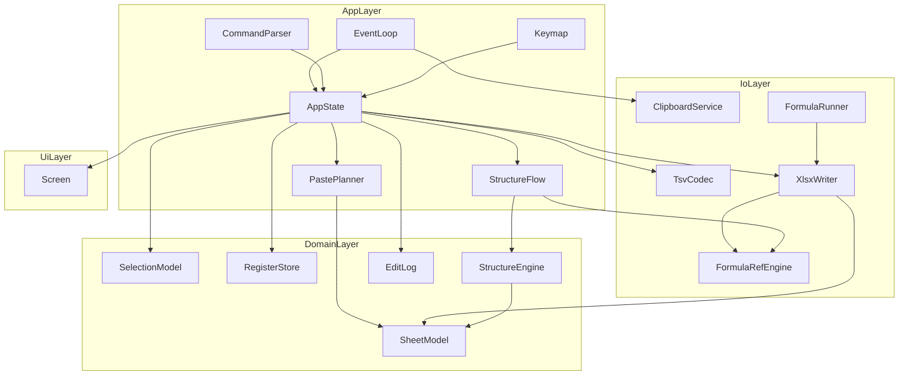
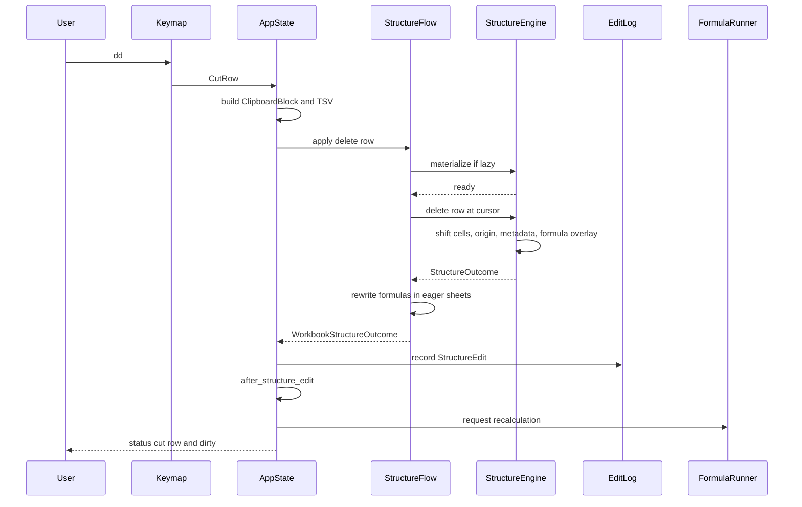
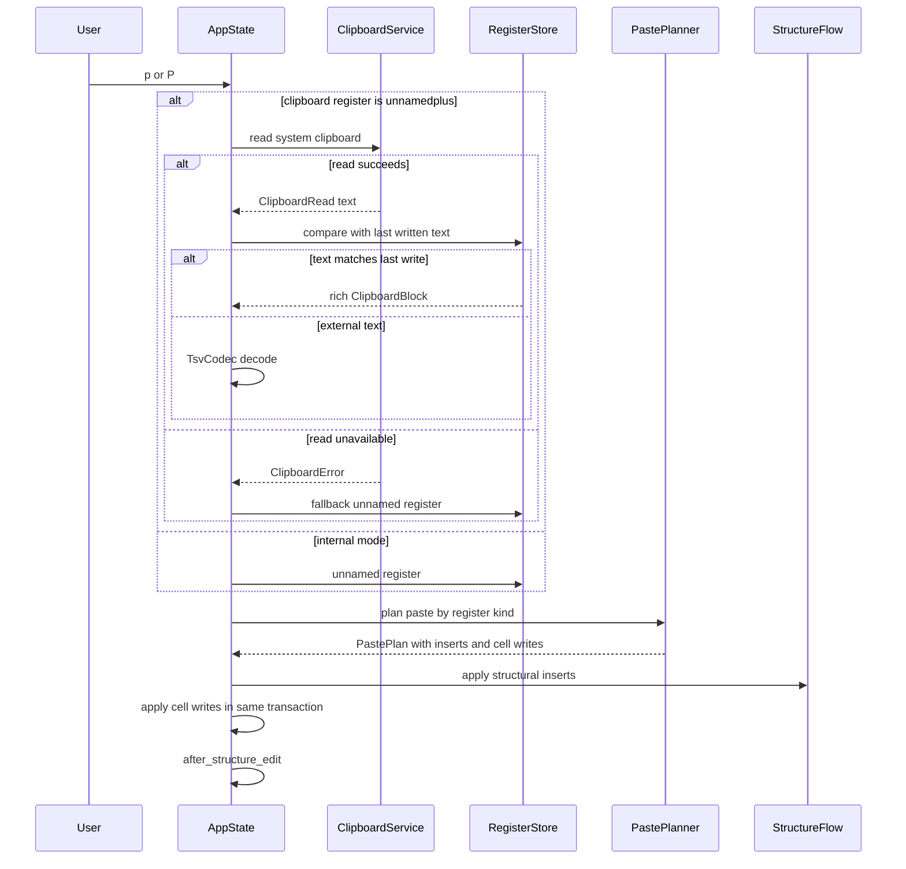
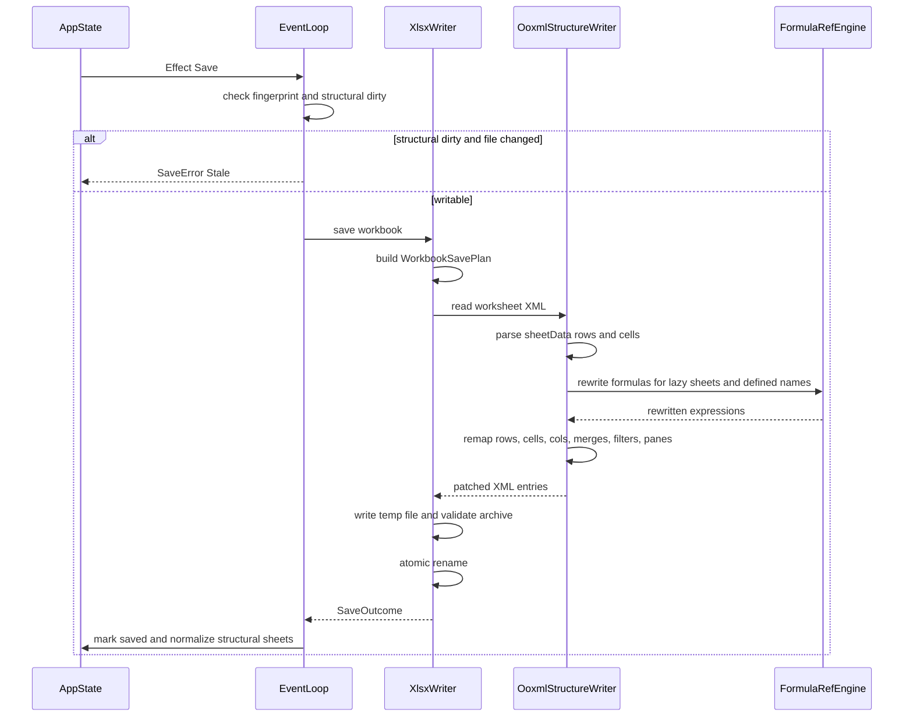
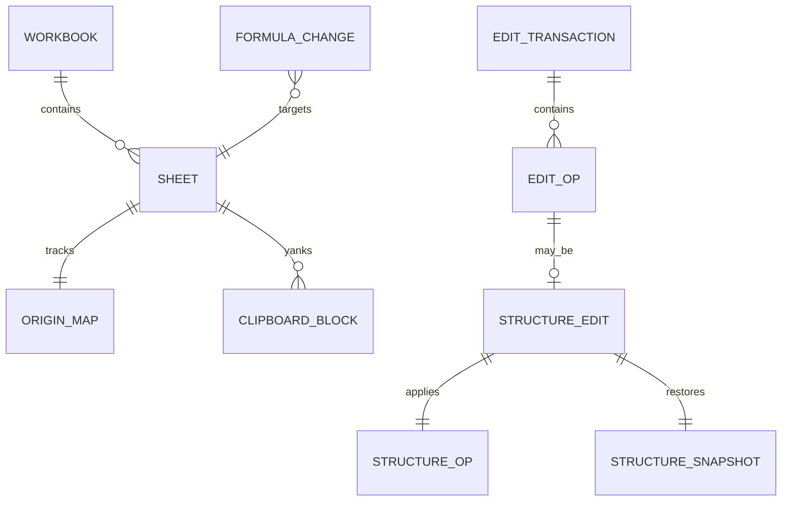

# Design Document

## Overview

**Purpose**: xlsx の行・列構造を Vim 風の操作で編集し、ヤンク／切り取り／ペーストを `clipboard=unnamedplus` に近い形で提供する。構造変更は既存のセル編集と同じ安全な保存経路に統合し、値・数式・書式・結合・フィルタ・固定ペインを保持する。

**Users**: ターミナルで表を調査しながら、行・列の追加、データの移動、外部クリップボードとの受け渡しを行う開発者・運用担当者。

**Impact**: `Sheet` に構造変換と元座標追跡を追加し、`EditTransaction` を構造変更へ拡張する。`xlsx_write` は変更セルだけでなく行・列参照と関連 OOXML 範囲を変換する。`AppState` はレジスタ、クリップボード読み取り、構造操作を調停する。非 Mono 配色は別 spec `non-mono-theme` が所有し、本 spec は変更しない。

### Goals

- 行・列・矩形選択と、行・列の挿入／構造削除を一貫したキーで提供する。
- ヤンク／切り取り／ペーストを `unnamedplus` 既定で動作させ、外部クリップボードと内部レジスタを併用する。
- 構造変更を xlsx へ保存し、値・数式・書式・結合・フィルタ・固定ペイン・レイアウトを保持する。
- 構造変更を undo / redo でき、既存の dirty・保存・再読み込みガードと整合させる。
- 遅延ロード、大容量シート、読み取り専用、CSV の既存挙動を壊さない。

### Non-Goals

- Excel のすべての OOXML 機能の完全再現。共有数式・配列数式・テーブル列数式など安全に変換できない構造は保存を拒否する。
- CSV への書き戻し、xlsx 以外の形式変換。
- OSC 52 によるクリップボード読み取り。OSC 52 は書き込み専用として扱う。
- クリップボード画像、永続レジスタ、複数範囲選択、行・列の非表示やサイズ変更そのもの。
- マクロ・画像・グラフ・ピボット・VBA の編集。
- 行・列のドラッグ移動や任意のセル範囲の構造移動。矩形切り取りは内容クリアとして扱う。
- 非 Mono モードの既定配色（別 spec `non-mono-theme`）。

## Boundary Commitments

### This Spec Owns

- `SelectionMode` の拡張（行・列・矩形）と選択範囲の算出。
- 名前なしレジスタ、ヤンク専用レジスタ、TSV エンコード／デコード、`unnamedplus` の貼り付け優先順位。
- 行・列の挿入／構造削除を表す `StructureOp` と、`Sheet` の eager 化・座標移動・メタデータ追従。
- 構造変更の xlsx 保存変換（`sheetData`、行・列属性、結合、フィルタ、条件付き書式、固定ペイン、定義名、数式参照）。
- 構造変更を含む `EditTransaction` と undo / redo。
- 保存後の状態正規化、監視基準更新、再計算用ワークブックの構造反映。
- 関連するキーバインド、Ex コマンド、ヘルプ、README。

### Out of Boundary

- CSV の構造編集・保存、xlsx 以外の形式への変換。
- 共有数式・配列数式・テーブルパーツ・テーブル列数式の変換（検出時は保存拒否）。
- 行・列の非表示、サイズ変更、アウトライン、グループ化。
- クリップボードの画像・HTML・リッチテキスト形式。
- マクロ、画像、グラフ、ピボット、VBA、外部リンクの更新。
- 複数シートにまたがる同時構造編集。構造操作はアクティブシートに対して 1 つずつ適用する。
- 永続レジスタ、レジスタ番号 1〜9 の削除履歴、Vim の完全なレジスタモデル。
- 非 Mono モードの既定配色（`non-mono-theme` spec）。

### Allowed Dependencies

- 既存の `ratatui` / `crossterm` / `calamine` / `formualizer` / `zip` / `quick-xml` / `csv` / `tempfile` / `arboard`（optional feature）。
- `formualizer::parse` の AST とトークンスパン API。新規外部クレートは追加しない。
- 既存の `Sheet` / `WorkbookModel` / `EditLog` / `FormulaRunner` / `ReloadHandle` / `ClipboardService`。
- 依存方向は `domain` ← `io` / `ui` / `config` ← `app` ← `main` を維持する。`formualizer` / `csv` を使う実装は `io` に置く。

### Revalidation Triggers

- `SheetData`、`Sheet::cell` / `read_cell` / `collect_cells` の契約変更。
- `WorkbookModel` のシート読み込み・世代管理・再計算要求の変更。
- `xlsx_write` の zip エントリ構成、`sheetData` パース、`calcChain` / `calcPr` の扱いの変更。
- `Selection::range` の呼び出し規約変更。
- `EditTransaction` / `EditLog` の履歴形式変更。
- `formualizer` のパーサー API 変更。
- クリップボードの転送方式・feature 構成の変更。

## Architecture

### Existing Architecture Analysis

- `domain` は外部クレートに依存せず、`Sheet` が eager / lazy のセルデータ、編集オーバーレイ、結合、フィルタ、レイアウト、固定ペイン、数式オーバーレイを保持する。
- `app` の `AppState` がキー入力を `Action` に変換し、`EditLog`、`WorkbookModel`、`Effect` を調停する。
- `io` の `xlsx_write` は変更セルだけを `sheetData` にパッチし、他の zip エントリを保持する。
- `Selection` はセル範囲と行範囲のみを表現し、`Selection::range` は列数だけを受け取る。
- `ClipboardService` は書き込みのみを提供し、OSC 52 と OS クリップボードを sink として抽象化する。
- `EditTransaction` はセル変更のみを保持し、構造変更を表現できない。
- `xlsx_write::save_workbook` は `edits` が空のシートを除外するため、構造変更だけのシートを保存できない。

### Architecture Pattern & Boundary Map



**Architecture Integration**:
- Selected pattern: 既存のレイヤード構成を維持し、構造操作を `domain` の `StructureEngine`、数式参照更新を `io` の `FormulaRefEngine`、両者の調停を `app` の `StructureFlow` に分ける。
- Domain/feature boundaries: 選択・レジスタ・構造変換・undo は domain、キー解釈・トランザクション調停・保存後正規化は app、TSV・数式・OOXML・クリップボードは io。
- Existing patterns preserved: `SheetData` の eager / lazy、`EditLog` のトランザクション、`Effect` による副作用分離、`FormulaRunner` の一時 xlsx 再計算。
- New components rationale:
  - `StructureEngine`: 行・列操作を純粋なドメイン操作として扱い、表示・保存の双方から再利用する。
  - `FormulaRefEngine`: A1 参照の書き換えを io に閉じ込め、domain の外部クレート非依存を守る。
  - `StructureFlow`: 構造操作と数式更新を 1 つのユースケースとして順序付ける。
  - `PastePlanner`: レジスタ種別と貼り付け位置から、構造挿入とセル書き込みの計画を組み立てる。
  - `RegisterStore` / `TsvCodec`: Vim 風レジスタと TSV の契約を分離する。
- Steering compliance: `domain` は外部クレートの型を公開せず、`ui` はビジネスロジックを持たない。

### Technology Stack

| Layer | Choice / Version | Role in Feature | Notes |
|-------|------------------|-----------------|-------|
| Domain | Rust 2024 | 選択・レジスタ・構造変換・undo | 外部型を公開しない |
| App | Rust 2024 / crossterm 0.29 | キー、コマンド、状態遷移、Effect | 既存の `Keymap` / `AppState` を拡張 |
| IO | zip 9.5 / quick-xml 0.42 | 構造 XML 変換、atomic save | 既存 `xlsx_write` を拡張 |
| Formula | formualizer 0.14 / formualizer-parse 4.2 | 数式 AST と参照スパン | `io/formula_ref.rs` に配置 |
| Clipboard | arboard 3.7 optional / OSC 52 | 読み取り・書き込み | OSC 52 は書き込みのみ |
| CSV/TSV | csv 1.4 | TSV の引用符・改行処理 | `io/tsv.rs` に配置 |
| UI | ratatui 0.30.2 | 選択表示、ステータス | 配色は `non-mono-theme` |

## File Structure Plan

### Directory Structure

```text
src/
├── domain/
│   ├── register.rs          # RegisterKind / ClipboardBlock / RegisterStore
│   ├── structure.rs         # Axis / StructureOp / OriginMap / StructureEngine
│   ├── selection.rs         # Column / Block 選択、range(rows, cols)
│   ├── sheet.rs             # 構造変換、eager 化、origin 追跡、メタデータ更新
│   ├── workbook.rs          # シート構造の適用、影響シートの追跡
│   ├── edit.rs              # EditOp::Structure、undo / redo
│   ├── command.rs           # :irow / :icol / :drow / :dcol / :put
│   ├── copy.rs              # Selection::range 呼び出しと TSV 出力の更新
│   ├── layout.rs            # Selection::range 呼び出し更新
│   ├── merge.rs             # 結合範囲の変換ヘルパ
│   └── filter.rs            # フィルタ範囲・列の変換ヘルパ
├── app/
│   ├── action.rs            # 選択・切り取り・挿入・ペースト・クリップボード読み取り
│   ├── keymap.rs            # Ctrl-V / C / o / O / p / P / " プレフィックス
│   ├── structure_flow.rs    # 構造操作と数式更新の調停
│   ├── paste.rs             # PastePlanner、PastePlan、CellWrite
│   ├── state.rs             # レジスタ、構造操作、ペースト、保存後正規化
│   └── event_loop.rs        # Effect::ReadClipboard / WriteClipboard の処理
├── io/
│   ├── clipboard.rs         # ClipboardSink::read、OS クリップボード読み取り
│   ├── formula_ref.rs       # A1 参照のスパン差し替え
│   ├── tsv.rs               # TSV エンコード／デコード
│   └── xlsx_write.rs        # 構造 XML 変換、数式参照更新、atomic save
├── ui/
│   ├── status.rs            # 選択種別・レジスタ表示
│   └── help.rs              # 新しいキーの説明
└── config.rs                # --clipboard-register / --structural-max-cells
```

### Modified Files

- `src/domain/selection.rs` — `SelectionMode::Column` / `Block`、`range(rows, cols)`。
- `src/domain/sheet.rs` — `origin_rows` / `origin_cols`、`structural_dirty`、`formula_rewrites`、`materialize_for_structure`、`apply_structure`、`normalize_after_structural_save`。
- `src/domain/workbook.rs` — `has_structural_changes`、影響シート追跡、保存対象判定。
- `src/domain/edit.rs` — `EditOp`、`StructureEdit`、`apply_changes` の構造対応。
- `src/domain/command.rs` — 構造操作と `:put` のパース。
- `src/domain/copy.rs` / `src/domain/layout.rs` / `src/domain/merge.rs` / `src/domain/filter.rs` — 選択範囲 API と呼び出しの更新、範囲変換ヘルパ。
- `src/app/action.rs` / `src/app/keymap.rs` / `src/app/state.rs` / `src/app/event_loop.rs` — 操作、レジスタ、クリップボード読み取り、構造トランザクション。
- `src/app/structure_flow.rs` — 新規。構造操作と数式更新の調停。
- `src/app/paste.rs` — 新規。`PastePlanner`、`PastePlan`、`CellWrite`。
- `src/io/clipboard.rs` — `read` と `ClipboardRead`。
- `src/io/tsv.rs` — 新規。TSV エンコード／デコード。
- `src/io/formula_ref.rs` — 新規。A1 参照のスパン差し替え。
- `src/io/xlsx_write.rs` — `WorkbookSavePlan`、`patch_sheet_xml_structural`、行・列・結合・フィルタ・条件付き書式・固定ペイン・定義名の変換、保存後正規化。
- `src/ui/status.rs` / `src/ui/help.rs` / `src/ui/view.rs` — 選択種別、レジスタ、ヘルプ表示。
- `src/ui/grid.rs` — 既存の選択描画を維持し、`Selection::range(rows, cols)` の戻り値をそのまま使用する。選択種別のヘッダ強調が必要な場合のみ変更する。
- `src/config.rs` — `ClipboardRegisterMode`、`structural_max_cells`、バリデーション。
- `README.md` — キー、設定、`dd` の挙動変更、制限事項。配色に関する追記は `non-mono-theme` spec が担当し、本 spec はキー・クリップボード・`--structural-max-cells` の節を更新する。
- `tests/app.rs` / `tests/editing.rs` / `tests/tui.rs` / `tests/integration.rs` — 構造編集・クリップボード・保存のテスト。

## System Flows

### 行の切り取りと挿入



構造操作は `StructureFlow` が domain の構造変換と io の数式更新を順に呼ぶ。挿入時も同じ流れで `StructureMode::Insert` を使用する。

### システムクリップボードからのペースト



`"+p` はシステム読み取りのみ、`"0p` は内部ヤンクレジスタのみを使用する。読み取り失敗時のフォールバックは `unnamedplus` の `p` / `P` に限る。

### 構造変更の保存



構造変更だけのシートも保存対象に含める。保存成功後は構造 dirty なシートの origin を identity に戻し、`edits` を base に統合して二重変換を防ぐ。

## Requirements Traceability

| Requirement | Summary | Components | Interfaces | Flows |
|-------------|---------|------------|------------|-------|
| 1.1, 1.2, 1.3, 1.4, 1.5, 1.6, 1.7, 1.8 | 行・列・矩形選択 | SelectionModel, Keymap, GridWidget | `Selection::range`, `Action::Toggle*Visual` | 選択操作 |
| 2.1, 2.2, 2.3, 2.4, 2.5, 2.6, 2.7, 2.8, 2.9, 2.10, 2.11 | ヤンク・切り取り・レジスタ・クリップボード | RegisterStore, TsvCodec, ClipboardService, AppState, Keymap | `ClipboardBlock`, `ClipboardRead`, `Effect::ReadClipboard` | ペーストフロー |
| 3.1, 3.2, 3.3, 3.4, 3.5, 3.6, 3.7, 3.8, 3.9, 3.10 | 行・列挿入 | StructureFlow, StructureEngine, AppState, CommandParser, Keymap, XlsxWriter | `StructureOp`, `:irow`, `:icol` | 切り取りと挿入 |
| 4.1, 4.2, 4.3, 4.4, 4.5, 4.6, 4.7, 4.8, 4.9, 4.10, 4.11 | ペースト | RegisterStore, PastePlanner, StructureFlow, TsvCodec, EditLog | `PastePlan`, `Action::Paste` | ペーストフロー |
| 5.1, 5.2, 5.3, 5.4, 5.5, 5.6, 5.7, 5.8, 5.9, 5.10 | 構造変更の xlsx 保存 | XlsxWriter, OoxmlStructureWriter, FormulaRefEngine, StructureFlow | `WorkbookSavePlan`, `patch_sheet_xml_structural` | 保存フロー |
| 6.1, 6.2, 6.3, 6.4, 6.5, 6.6 | Undo / Redo / Dirty | EditLog, StructureEdit, AppState | `EditOp::Structure`, `apply_changes` | 切り取りと挿入 |
| 7.1, 7.2, 7.3, 7.4, 7.5, 7.6, 7.7, 7.8, 7.9, 7.10, 7.11, 7.12 | キー・コマンド・ドキュメント | Keymap, CommandParser, Help, README | `ExCommand`, `Action` | 全フロー |
| 8.1, 8.2, 8.3, 8.4, 8.5 | 遅延ロード・サイズ制限 | StructureEngine, Config, RegisterStore | `materialize`, `structural_max_cells` | 切り取りと挿入 |
| 9.1, 9.2, 9.3, 9.4, 9.5, 9.6, 9.7 | 表示・検索・フィルタ整合性 | AppState, Sheet, Search, Viewport, JumpList, FormulaRunner, Reload | `after_structure_edit` | 切り取りと挿入 |
| 10.1, 10.2, 10.3, 10.4, 10.5, 10.6 | エラー処理と保護 | StructureEngine, XlsxWriter, ClipboardService, AppState | エラー enum とステータス | 全フロー |

## Components and Interfaces

| Component | Domain/Layer | Intent | Req Coverage | Key Dependencies | Contracts |
|-----------|--------------|--------|--------------|------------------|-----------|
| SelectionModel | Domain | 行・列・矩形・セル選択の範囲算出 | 1.1, 1.2, 1.3, 1.4, 1.5, 1.6, 1.7, 1.8 | CellRange | State |
| RegisterStore | Domain | 名前なし／ヤンクレジスタの保持 | 2.1, 2.2, 2.3, 2.4, 2.5, 2.6, 2.7, 2.8, 4.1, 4.2, 4.3, 4.4, 4.5, 4.6, 4.7, 4.8, 4.9, 4.10 | ClipboardBlock | State |
| StructureEngine | Domain | 行・列の挿入削除、eager 化、座標変換 | 3.1, 3.2, 3.3, 3.4, 3.5, 3.6, 3.7, 3.8, 3.9, 3.10, 4.1, 4.2, 4.3, 4.4, 4.5, 4.6, 5.2, 8.1, 8.2, 8.3, 8.4 | Sheet, OriginMap, Merge | Service |
| EditLog Extension | Domain | 構造変更の undo / redo | 6.1, 6.2, 6.3, 6.4, 6.5, 6.6 | Sheet, StructureEngine | State |
| TsvCodec | IO | レジスタと TSV の相互変換 | 2.10, 4.11 | csv, CopyEncoder | Service |
| FormulaRefEngine | IO | A1 参照のスパン差し替え | 5.3, 5.4 | formualizer parse | Service |
| StructureFlow | App | 構造操作と数式更新の調停 | 3.1, 3.2, 3.3, 3.4, 3.5, 3.6, 3.7, 3.8, 3.9, 3.10, 5.3, 5.4, 9.5 | StructureEngine, FormulaRefEngine | Service |
| PastePlanner | App | レジスタ種別から貼り付け計画を構築 | 4.1, 4.2, 4.3, 4.4, 4.5, 4.6, 4.7, 4.8, 4.9 | RegisterStore, Sheet | Service |
| OoxmlStructureWriter | IO | 構造変更の xlsx 変換と保存 | 5.1, 5.2, 5.3, 5.4, 5.5, 5.6, 5.7, 5.8, 5.9, 5.10, 10.3, 10.5 | zip, quick-xml, FormulaRefEngine | Batch |
| ClipboardAdapter | IO | システムクリップボード読み書き | 2.1, 2.5, 2.7, 2.8, 2.9, 10.2 | arboard, OSC 52 | Service |
| GridWidget | UI | 選択範囲の強調表示 | 1.8 | SelectionModel | State |
| AppState / Keymap / Command | App | 操作調停、キー、Ex コマンド、保存後正規化 | 1.1-1.8, 2.1-2.11, 3.1-3.10, 4.1-4.11, 6.1-6.6, 7.1-7.12, 9.1-9.7, 10.1-10.6 | 全コンポーネント | Service |

### Domain

#### SelectionModel

| Field | Detail |
|-------|--------|
| Intent | 選択形状を単一の値として表現し、描画・コピー・切り取りの対象範囲を一致させる |
| Requirements | 1.1, 1.2, 1.3, 1.4, 1.5, 1.6, 1.7, 1.8 |

**Responsibilities & Constraints**
- `SelectionMode` は `Cell` / `Row` / `Column` / `Block` を区別する。
- `Selection::range(rows, cols)` は現在のシートの使用範囲行数・列数を受け取り、モードに応じた矩形を返す。
- `Column` は選択列の全行（行 0 から使用範囲末尾）、`Row` は選択行の全列、`Block` と `Cell` はアンカーとカーソルの矩形を返す。
- 選択範囲は既存の `GridWidget` がそのまま強調表示できる `CellRange` とする。
- `selection.contains` の呼び出しも `range(rows, cols)` に合わせて更新する。

**Dependencies**
- Inbound: `AppState`, `LayoutEngine`, `CopySession` — 選択範囲の取得 (P0)
- Outbound: `CellRange` — 矩形表現 (P0)

**Contracts**: State [x]

```rust
pub enum SelectionMode { Cell, Row, Column, Block }

impl Selection {
    pub fn range(&self, rows: u32, cols: u32) -> CellRange;
    pub fn mode(&self) -> SelectionMode;
    pub fn column(anchor: CellAddr) -> Self;
    pub fn block(anchor: CellAddr) -> Self;
}
```

- Preconditions: `rows` / `cols` はシートの使用範囲以上。
- Postconditions: 返される `CellRange` は常に正規化されている。
- Invariants: `anchor` と `cursor` はシート座標内。

#### RegisterStore

| Field | Detail |
|-------|--------|
| Intent | Vim 風の名前なしレジスタとヤンク専用レジスタを保持し、貼り付け元を一元管理する |
| Requirements | 2.1, 2.2, 2.3, 2.4, 2.5, 2.6, 2.7, 2.8, 4.1, 4.2, 4.3, 4.4, 4.5, 4.6, 4.7, 4.8, 4.9, 4.10 |

**Responsibilities & Constraints**
- `ClipboardBlock` は行・列・セル・矩形の種別、論理サイズ、座標付きセル、密／疎を保持する。
- 行・列レジスタは非空セルのみを `BTreeMap<(row, col), Cell>` に保持し、座標を失わない。
- `cells` のキーはブロック内のローカル座標（`0..width`, `0..height`）とする。貼り付け時に `PastePlanner` が現在セルへオフセットする。
- 矩形レジスタは `complete = true` とし、存在しない座標は空セルとして扱う。
- `RegisterStore` は `unnamed` と `yank`、直前に書き込みに成功した TSV を保持する。
- `last_text` は `Effect::WriteClipboard` の成功通知後にだけ更新する。TSV 変換は AppState が `TsvCodec` を呼び、RegisterStore は io に依存しない。

**Dependencies**
- Inbound: `AppState` — ヤンク・切り取り・ペースト (P0)
- Outbound: `Cell` — 値・数式・書式の保持 (P0)

**Contracts**: State [x]

```rust
pub enum RegisterKind { Cells, Rows, Columns }
pub enum PasteSource { Unnamed, Yank, System }

pub struct ClipboardBlock {
    pub kind: RegisterKind,
    pub width: u32,
    pub height: u32,
    pub complete: bool,
    pub cells: BTreeMap<(u32, u32), Cell>,
}

pub struct RegisterStore {
    unnamed: Option<ClipboardBlock>,
    yank: Option<ClipboardBlock>,
    last_written_text: Option<String>,
}

impl RegisterStore {
    pub fn set_yank(&mut self, block: ClipboardBlock);
    pub fn set_cut(&mut self, block: ClipboardBlock);
    pub fn get(&self, source: PasteSource) -> Option<&ClipboardBlock>;
    pub fn note_write_success(&mut self, text: String);
    pub fn last_text_matches(&self, text: &str) -> bool;
}
```

- Preconditions: `width` / `height` は 1 以上。
- Postconditions: `set_yank` は `unnamed` と `yank` を更新し、`set_cut` は `unnamed` のみ更新する。
- Invariants: 空のレジスタは `None`。`PasteSource::System` は `RegisterStore` ではなく `ClipboardService` から取得する。

#### StructureEngine

| Field | Detail |
|-------|--------|
| Intent | 行・列の構造操作、eager 化、座標・メタデータ変換を一貫して実行する |
| Requirements | 3.1, 3.2, 3.3, 3.4, 3.5, 3.6, 3.7, 3.8, 3.9, 3.10, 4.1, 4.2, 4.3, 4.4, 4.5, 4.6, 5.2, 8.1, 8.2, 8.3, 8.4 |

**Responsibilities & Constraints**
- `StructureOp` は軸（行／列）、モード（挿入／削除）、開始位置、件数を保持する。
- `materialize` は `SheetData::Lazy` を `SheetData::Eager` へ変換し、`--structural-max-cells` を検査する。既に eager のシートも同じ検査を行う。
- `apply` は `SheetData` と `edits` のキー、`origin_rows` / `origin_cols`、`formula_overlay`、結合、フィルタ、レイアウト、固定ペイン、条件付き書式、数式セル一覧を更新する。
- 削除時は削除セルを `RemovedCells` として返し、undo で復元できるようにする。
- 結合・フィルタの衝突は可能な範囲で変換し、`StructureOutcome::warnings` に記録する。操作全体を継続できない場合だけ `StructureError` を返す。
- Excel の最大行数（1,048,576）・最大列数（16,384）を超える操作は `OutOfBounds` とする。
- `transform_range` は元範囲を現在範囲へ写像し、完全に削除された場合は `None` を返す。

**Dependencies**
- Inbound: `StructureFlow`, `XlsxWriter` — 構造操作と範囲変換 (P0)
- Outbound: `Sheet` — セルデータとメタデータ (P0)
- Outbound: `MergeIndex`, `FilterDefinition`, `LayoutSnapshot`, `FreezePane`, `ConditionalFormat` — メタデータ更新 (P0)

**Contracts**: Service [x]

```rust
pub enum Axis { Row, Column }
pub enum StructureMode { Insert, Delete }

pub struct StructureOp {
    pub axis: Axis,
    pub mode: StructureMode,
    pub index: u32,
    pub count: u32,
}

pub struct OriginMap {
    pub origin_rows: Vec<Option<u32>>,
    pub origin_cols: Vec<Option<u32>>,
}

pub struct StructureOutcome {
    pub removed: RemovedCells,
    pub warnings: Vec<StructureWarning>,
    pub before: StructureSnapshot,
    pub after: StructureSnapshot,
}

impl StructureEngine {
    pub fn materialize(sheet: &mut Sheet, max_cells: u64) -> Result<(), StructureError>;
    pub fn apply(sheet: &mut Sheet, op: StructureOp) -> Result<StructureOutcome, StructureError>;
    pub fn transform_range(range: CellRange, origin: &OriginMap) -> Option<CellRange>;
}
```

- Preconditions: `index` は現在の行数／列数以内、`count > 0`、最大行・列数を超えない。
- Postconditions: `origin_rows.len() == meta.row_count`、`origin_cols.len() == meta.column_count`。
- Invariants: 挿入された行・列の origin は `None`。削除された行・列のセルは `RemovedCells` にのみ存在する。
- Atomicity: `apply` はすべての前提条件を検証してから変更を開始し、変更開始後はエラーを返さない。結合・フィルタの調整は `warnings` に記録する。数式更新の失敗は `StructureFlow` が事前検証で防ぐ。

**Structure data contracts**

```rust
pub enum StructureError {
    TooLarge { cells: u64, limit: u64 },
    InvalidCount { count: u32 },
    OutOfBounds { axis: Axis, index: u32, count: u32 },
    ReadOnly,
    UnsupportedFormula { sheet: String, addr: CellAddr, message: String },
    Sheet(String),
}

pub enum StructureWarning {
    MergeAdjusted { before: CellRange, after: Option<CellRange> },
    FilterAdjusted { before: CellRange, after: Option<CellRange> },
    SkippedCoveredCell { addr: CellAddr },
    FormulaLeftUnchanged { sheet: String, addr: CellAddr, reason: String },
}

pub struct RemovedCells {
    pub base: Vec<(CellAddr, Cell)>,
    pub edits: Vec<(CellAddr, Cell)>,
    pub formula_overlay: Vec<(CellAddr, FormulaCellResult)>,
}

pub struct StructureSnapshot {
    pub origin_rows: Vec<Option<u32>>,
    pub origin_cols: Vec<Option<u32>>,
    pub merges: Vec<MergeRegion>,
    pub merge_borders: HashMap<CellAddr, CellBorders>,
    pub filters: Vec<FilterDefinition>,
    pub filter_state: FilterState,
    pub layout: LayoutSnapshot,
    pub freeze: FreezePane,
    pub conditional_formats: Vec<ConditionalFormat>,
    pub used_range: CellRange,
    pub meta: SheetMeta,
    pub data_rows: Option<(u32, u32)>,
    pub formula_cells: Vec<CellAddr>,
    pub formula_overlay: Vec<(CellAddr, FormulaCellResult)>,
}

pub struct FormulaChange {
    pub sheet: usize,
    pub addr: CellAddr,
    pub before: Option<String>,
    pub after: Option<String>,
}
```

#### EditLog Extension

| Field | Detail |
|-------|--------|
| Intent | 構造変更をセル変更と同じ undo / redo 履歴で扱う |
| Requirements | 6.1, 6.2, 6.3, 6.4, 6.5, 6.6 |

**Responsibilities & Constraints**
- `EditOp` は `Cell(EditChange)` と `Structure(StructureEdit)` を持つ。
- `StructureEdit` は操作、削除セル、変更前後のメタデータスナップショット、数式参照の変更前後を保持する。
- セルデータは削除セルとセル変更の差分だけを保持し、シート全体のコピーは保存しない。
- メタデータスナップショットは O(行数 + 列数) で、セル数には比例しない。
- undo は逆順に適用し、構造変更ではメタデータ復元と削除セルの再挿入を行う。
- 1 回の切り取り／ペーストは、構造挿入・削除とセル変更を同じ `EditTransaction` にまとめる。
- `EditTransaction::summary` はセル数と構造操作数を返す。
- 既存の `transaction.changes` 前提の `EditLog::record` / `apply_changes` / `AppState::undo` / `redo` は `transaction.ops` へ移行し、`is_empty` / `cell_count` / `summary` を新しい契約に合わせる。

**Dependencies**
- Inbound: `AppState` — 記録・undo / redo (P0)
- Outbound: `WorkbookModel`, `StructureEngine` — 状態復元 (P0)

**Contracts**: State [x]

```rust
pub enum EditOp {
    Cell(EditChange),
    Structure(StructureEdit),
}

pub struct EditTransaction {
    pub ops: Vec<EditOp>,
}

pub struct StructureEdit {
    pub sheet: usize,
    pub op: StructureOp,
    pub removed: RemovedCells,
    pub before: StructureSnapshot,
    pub after: StructureSnapshot,
    pub formula_before: Vec<FormulaChange>,
    pub formula_after: Vec<FormulaChange>,
}

impl EditLog {
    pub fn record(&mut self, transaction: EditTransaction);
    pub fn undo(&mut self, workbook: &mut WorkbookModel) -> Option<EditTransaction>;
    pub fn redo(&mut self, workbook: &mut WorkbookModel) -> Option<EditTransaction>;
}
```

### IO

#### TsvCodec

| Field | Detail |
|-------|--------|
| Intent | レジスタ内容と TSV テキストを相互変換し、引用符・改行・空フィールドを保持する |
| Requirements | 2.10, 4.11 |

**Responsibilities & Constraints**
- エンコードは既存の `CopyEncoder::quote_tsv_field` と同じ規則を使用する。
- デコードは `csv` クレートを `delimiter(b'\t')`、ヘッダなし、可変長レコードで使用する。
- デコード結果は `RegisterKind::Cells`、`complete = true` の `ClipboardBlock` とし、各フィールドを `parse_cell_input` で値・数値・真偽値・数式として解釈する。
- 疎な行・列レジスタのエンコード時は、論理サイズに合わせて空セルを補完した TSV を生成する。
- `--max-copy-cells` を超える入力は `RegisterError::TooLarge` とする。

**Dependencies**
- Inbound: `AppState` — TSV 変換 (P0)
- Outbound: `CopyEncoder` — TSV フィールド引用 (P1)
- External: `csv` 1.4 — TSV パース (P1)

**Contracts**: Service [x]

```rust
pub struct RegisterLimits {
    pub max_cells: usize,
}

pub enum RegisterError {
    TooLarge { cells: usize, limit: usize },
    Empty,
    InvalidTsv { message: String },
}

impl TsvCodec {
    pub fn encode(block: &ClipboardBlock) -> Result<String, RegisterError>;
    pub fn decode(text: &str, limits: &RegisterLimits) -> Result<ClipboardBlock, RegisterError>;
}
```

- 空文字列のデコードは `RegisterError::Empty`。
- 可変長レコードは最大列数を `width` とし、不足フィールドは空セルで補完する。
- 上限超過時は内部レジスタを変更しない。

#### FormulaRefEngine

| Field | Detail |
|-------|--------|
| Intent | 構造変更に合わせて数式内の A1 参照だけを安全に書き換える |
| Requirements | 5.3, 5.4 |

**Responsibilities & Constraints**
- `formualizer::parse` で数式を AST 化し、参照ノードの `source_token` スパンを使って元の式の該当部分だけを置換する。
- 同一シート参照、シート修飾参照、絶対参照、範囲参照、行全体・列全体を扱う。
- パース不能、構造化参照、テーブル参照、外部参照は `Unsupported` として返し、保存側で拒否する。
- 数式全体の pretty print は行わない。
- `xml_escape` は呼び出し側の `xlsx_write` で行い、`FormulaRefEngine` は生の式文字列を返す。

**Dependencies**
- Inbound: `StructureFlow`, `XlsxWriter` — 参照更新 (P0)
- External: `formualizer::parse` — AST とスパン (P0)

**Contracts**: Service [x]

```rust
pub struct FormulaContext {
    /// シート名から、そのシートに適用された構造変換への写像。
    pub transforms: BTreeMap<String, OriginMap>,
}

pub enum RewriteStatus {
    Unchanged,
    Rewritten(String),
    Unsupported(String),
}

impl FormulaRefEngine {
    /// `source_sheet` は数式が書かれているシート名。
    /// シート修飾のない参照は `source_sheet` の変換を適用する。
    pub fn rewrite_for_sheet(
        expression: &str,
        source_sheet: &str,
        context: &FormulaContext,
    ) -> RewriteStatus;

    /// 定義名の式を、対象シートの変換を使って書き換える。
    pub fn rewrite_defined_name(
        expression: &str,
        context: &FormulaContext,
    ) -> RewriteStatus;
}
```

#### OoxmlStructureWriter

| Field | Detail |
|-------|--------|
| Intent | 構造変更を元の OOXML の生データを保ったまま xlsx に保存する |
| Requirements | 5.1, 5.2, 5.3, 5.4, 5.5, 5.6, 5.7, 5.8, 5.9, 5.10, 10.3, 10.5 |

**Responsibilities & Constraints**
- `WorkbookSavePlan` は全シートの `SheetSavePlan`、共有 `FormulaContext`、シートごとの数式書き換えマップ、定義名の変更計画、書き換え済みセル集合を保持する。
- `save_workbook` と `write_temp_workbook` は `structural_dirty || !edits.is_empty() || !formula_overlay.values.is_empty()` のシートを対象に含める。未変更シートは元の zip エントリをそのままコピーする。
- lazy シートや他シートの数式は、そのシート名を `source_sheet` として `FormulaRefEngine::rewrite_for_sheet` を呼び、保存時に書き換える。
- 定義名は `xl/workbook.xml` の `definedNames` を走査し、`DefinedNameChange` に従って `<definedName>` の内容を置換する。構造化参照やパース不能な定義名は保存拒否とする。
- `sheetData` を行・セル単位でパースし、元のセル XML とスタイル属性を保持したまま現在座標へ再配置する。
- 挿入行・列は空として出力し、削除行・列は出力しない。
- `<dimension>`、`<cols>`、行属性、`<mergeCells>`、`<autoFilter>`、`<conditionalFormatting>`、`<dataValidations>`、`<hyperlink>`、`<pane>`、改ページ、定義名を変換する。
- 共有数式・配列数式・テーブルパーツ・構造化参照を検出した場合は `SaveError::UnsupportedStructure` を返す。
- 数式の `<f>` へ書き込む際は `xml_escape` を適用する。
- 構造 dirty なシートの保存前に fingerprint が変わっている場合は `SaveError::Stale` を返し、`:w!` でも上書きしない。
- 一時ファイルに書き、zip を再オープンして XML を検証してから atomic rename する。
- 保存成功後、`AppState` は構造 dirty なシートを `normalize_after_structural_save` で正規化する。

**Dependencies**
- Inbound: `AppState`, `FormulaRunner` — 保存・一時ワークブック (P0)
- Outbound: `FormulaRefEngine` — 数式参照更新 (P0)
- External: `zip` 9.5, `quick-xml` 0.42 — OOXML 操作 (P0)

**Contracts**: Batch [x]

```rust
pub struct WorkbookSavePlan<'a> {
    pub sheets: Vec<SheetSavePlan<'a>>,
    pub formula_context: FormulaContext,
    pub defined_names: Vec<DefinedNameChange>,
    pub rewritten_cells: BTreeSet<(String, CellAddr)>,
}

pub struct SheetSavePlan<'a> {
    pub sheet: &'a Sheet,
    pub origin: &'a OriginMap,
    pub formula_rewrites: &'a BTreeMap<CellAddr, String>,
    pub structural_dirty: bool,
}

pub struct DefinedNameChange {
    pub name: String,
    pub before: String,
    pub after: String,
}

fn patch_sheet_xml_structural(
    xml: &str,
    source_sheet: &str,
    plan: &SheetSavePlan<'_>,
    formula_context: &FormulaContext,
    rewritten_cells: &BTreeSet<(String, CellAddr)>,
) -> Result<String, SaveError>;

fn patch_workbook_defined_names(
    xml: &str,
    changes: &[DefinedNameChange],
) -> Result<String, SaveError>;
```

`rewritten_cells` は `StructureFlow` が eager シートで既に更新したセルを表し、保存時の二重書き換えを防ぐ。lazy シートのセルは含まれないため、保存時に `FormulaContext` を使って書き換える。

- Trigger: `:w` / `:wq` / `ZZ` / 自動保存要求。
- Input: `WorkbookModel` の全シート。
- Output: 一時ファイル + atomic rename。
- Idempotency & recovery: 失敗時は元ファイルを変更せず、dirty を維持する。成功時は origin を identity に戻す。

#### ClipboardAdapter

| Field | Detail |
|-------|--------|
| Intent | システムクリップボードの読み書きと、利用可否の明示を行う |
| Requirements | 2.1, 2.5, 2.7, 2.8, 2.9, 10.2 |

**Responsibilities & Constraints**
- `ClipboardSink` に `read` を追加する。
- `SystemClipboardSink` は `arboard::Clipboard::get_text()` を使用する。
- `Osc52Sink` の `read` は `ClipboardError::ReadUnavailable` を返す。
- `ClipboardService::read` は利用可能な sink を順に試し、`ClipboardRead { text, sink }` を返す。
- `ClipboardRegisterMode` は `AppState` の貼り付け方針にのみ影響し、転送方式は既存の `--clipboard` に従う。
- `Effect::WriteClipboard` は書き込み元の `ClipboardWriteOrigin`（レジスタ由来か単純コピーか）を持ち、レジスタ由来の書き込みが成功したときだけ `RegisterStore::note_write_success` を呼ぶ。失敗時は `last_text` を更新しない。

**Contracts**: Service [x]

```rust
pub trait ClipboardSink {
    fn write(&mut self, text: &str) -> Result<(), ClipboardError>;
    fn read(&mut self) -> Result<String, ClipboardError>;
    fn name(&self) -> &'static str;
}

pub struct ClipboardRead {
    pub text: String,
    pub sink: &'static str,
}

pub enum ClipboardRegisterMode { UnnamedPlus, Internal }

impl ClipboardService {
    pub fn read(&mut self) -> Result<ClipboardRead, ClipboardError>;
}
```

### App

#### StructureFlow

| Field | Detail |
|-------|--------|
| Intent | 構造操作と数式参照更新を 1 つのユースケースとして調停する |
| Requirements | 3.1-3.10, 4.1-4.6, 5.3, 5.4, 9.5 |

**Responsibilities & Constraints**
- 対象シートを `StructureEngine::materialize` で eager 化し、`StructureEngine::apply` を呼ぶ。
- 変更前に、対象シートと eager な他シートの数式を `FormulaRefEngine` で検証する。`Unsupported` が 1 つでもあれば構造変更を適用せず `StructureError::UnsupportedFormula` を返す。
- 検証済みの数式を `FormulaRefEngine` で更新し、`Sheet.formula_rewrites` に記録する。
- lazy な他シートの数式は保存時の XML 変換に委ねる。保存時に `Unsupported` が見つかった場合は保存全体を拒否する。
- `WorkbookStructureOutcome` に `StructureOutcome`（削除セル・変更前後スナップショット）、影響シート、数式変更、警告、再計算要否をまとめる。
- 構造変更後に `generation` を進める。

**Dependencies**
- Inbound: `AppState` — 構造操作 (P0)
- Outbound: `StructureEngine`, `FormulaRefEngine` — 変換 (P0)

**Contracts**: Service [x]

```rust
pub struct WorkbookStructureOutcome {
    pub structure: StructureOutcome,
    pub affected_sheets: Vec<usize>,
    pub formula_changes: Vec<FormulaChange>,
    pub warnings: Vec<StructureWarning>,
    pub recalc_required: bool,
}

impl StructureFlow {
    pub fn apply(
        workbook: &mut WorkbookModel,
        sheet: usize,
        op: StructureOp,
    ) -> Result<WorkbookStructureOutcome, StructureError>;
}
```

`WorkbookStructureOutcome.structure` は `StructureEdit` の `removed` / `before` / `after` を作るために使う。`formula_changes` は undo / redo の数式復元に使う。

#### PastePlanner

| Field | Detail |
|-------|--------|
| Intent | レジスタ種別と貼り付け位置から、構造挿入とセル書き込みの計画を構築する |
| Requirements | 4.1, 4.2, 4.3, 4.4, 4.5, 4.6, 4.7, 4.8, 4.9 |

**Responsibilities & Constraints**
- `PastePlan` は対象シート、構造挿入のリスト、セル書き込みのリスト、警告、貼り付け後のフォーカスを持つ。
- 行レジスタは `p` で現在行の下、`P` で現在行の上に `height` 行を挿入し、列 0 から書き込む。
- 列レジスタは `p` で現在列の右、`P` で現在列の左に `width` 列を挿入し、行 0 から書き込む。
- セル・矩形レジスタは現在セルを左上として上書きし、構造挿入を行わない。
- `ClipboardBlock.cells` のローカル座標に `(origin_row, origin_col)` を足して絶対座標へ変換する。
- 結合セルの被覆セルへの書き込みはスキップし、`StructureWarning::SkippedCoveredCell` を追加する。
- `PastePlan` は副作用を持たず、`AppState` が `StructureFlow` とセル書き込みで適用する。

**Contracts**: Service [x]

```rust
pub struct CellWrite {
    pub addr: CellAddr,
    pub cell: Cell,
}

pub struct PastePlan {
    pub sheet: usize,
    pub inserts: Vec<StructureOp>,
    pub writes: Vec<CellWrite>,
    pub warnings: Vec<StructureWarning>,
    pub focus: CellAddr,
}

impl PastePlanner {
    pub fn plan(
        sheet: &Sheet,
        sheet_index: usize,
        focus: CellAddr,
        before: bool,
        block: &ClipboardBlock,
    ) -> Result<PastePlan, RegisterError>;
}
```

#### AppState / Keymap / Command

| Field | Detail |
|-------|--------|
| Intent | キー・コマンド・構造操作・レジスタ・クリップボードを調停する |
| Requirements | 1.1-1.8, 2.1-2.11, 3.1-3.10, 4.1-4.11, 6.1-6.6, 7.1-7.12, 9.1-9.7, 10.1-10.6 |

**Responsibilities & Constraints**
- `Keymap` は `Ctrl-V`、`C`、`o`、`O`、`gI`、`gA`、`p`、`P`、`x`、`"` プレフィックスを解釈する。
- `AppState` は `RegisterStore` を保持し、ヤンク／切り取り時に `ClipboardBlock` を構築する。
- `Action::Paste` は `ClipboardRegisterMode` に応じて `Effect::ReadClipboard` を返すか、内部レジスタを直接貼り付ける。
- `Effect::ReadClipboard` はイベントループで処理し、成功時は `AppState::paste_text`、失敗時はフォールバックまたはエラー表示を行う。
- `Effect::WriteClipboard` の成功／失敗を `AppState::note_clipboard_write` に通知する。
- `after_structure_edit` は検索索引の無効化、カーソル・選択のクランプ、ジャンプ履歴の整理、フィルタ可視性の再評価、ビューポート調整、再計算要求を行う。
- `normalize_after_structural_save` は構造 dirty なシートの `edits` を base に統合し、`edits` を空にし、`origin_rows` / `origin_cols` を現在サイズの identity に戻し、`formula_rewrites` と `structural_dirty` をクリアする。`formula_overlay` は現在の計算結果を保持する。
- `Sheet::extend_bounds` / `set_edit_cell` は使用範囲を拡張したとき、`origin_rows` / `origin_cols` を `None` で伸ばし、`origin` の長さ不変条件を維持する。
- `CommandParser` は `:irow`、`:irow!`、`:icol`、`:icol!`、`:drow`、`:drow!`、`:dcol`、`:dcol!`、`:put`、`:put!` を解釈する。
- `:drow [count]` / `:dcol [count]` は現在行・列を含めて後方へ削除し、`!` 付きは現在行・列の前方へ削除する。件数省略時は 1。
- `x` はセル・矩形では内容クリア、行・列では構造切り取りとして扱う。
- `StatusView` に `selection_kind: Option<SelectionMode>` を追加し、`selection_count` とともにステータス行へ表示する。
- `src/ui/grid.rs` は `Selection::range` の戻り値をそのまま使い、追加の変更を不要にする。選択種別のヘッダ強調を実装する場合だけ変更する。

**Contracts**: Service [x]

```rust
pub enum Action {
    ToggleColumnVisual,
    ToggleBlockVisual,
    CutSelection,
    CutRow,
    YankRow,
    Paste { before: bool, source: PasteSource },
    InsertRows { before: bool, enter_insert: bool, count: u32 },
    InsertColumns { before: bool, enter_insert: bool, count: u32 },
    DeleteRows { before: bool, count: u32 },
    DeleteColumns { before: bool, count: u32 },
    // existing variants remain
}

pub enum ExCommand {
    InsertRows { before: bool, count: u32 },
    InsertColumns { before: bool, count: u32 },
    DeleteRows { before: bool, count: u32 },
    DeleteColumns { before: bool, count: u32 },
    Put { before: bool, source: PasteSource },
    // existing variants remain
}

pub enum ClipboardWriteOrigin {
    Register { kind: RegisterKind },
    PlainCopy,
}

pub enum Effect {
    WriteClipboard { text: String, origin: ClipboardWriteOrigin },
    ReadClipboard { before: bool, fallback: bool, source: PasteSource },
    // existing variants remain
}
```

## Data Models

### Domain Model

- **Selection**: シート上の 1 つの連続範囲。モード（セル・行・列・矩形）とアンカー、カーソルを持つ。
- **ClipboardBlock**: ヤンク／切り取り結果。種別（セル・行・列）、論理サイズ、密／疎、座標付きセル情報を持つ。
- **StructureOp**: 行・列の挿入／削除。軸、モード、開始位置、件数を持つ。
- **OriginMap**: 現在の行・列から元の xlsx 行・列への写像。挿入された行・列は `None`。
- **StructureSnapshot**: 構造変更前後の結合、フィルタ、レイアウト、固定ペイン、条件付き書式、使用範囲、origin を保持する。セルデータは含まない。
- **EditTransaction**: セル変更と構造変更を順序付きで保持する。



### Logical Data Model

**ClipboardBlock**
- `kind`: `Cells` / `Rows` / `Columns`
- `width`, `height`: 論理サイズ。行・列レジスタでも全幅・全高を保持する。
- `complete`: 矩形は `true`、行・列は `false`。
- `cells`: ブロック内のローカル座標 `(0..width, 0..height)` をキーとする座標付きセル。疎な行・列では非空セルのみ、矩形では存在しない座標を空セルとして扱う。
- 貼り付け時は `PastePlanner` がローカル座標へ貼り付け先の絶対座標を足す。

**RegisterStore**
- `unnamed`: ヤンク／切り取りの最新内容。
- `yank`: `yy` / `Y` の内容。`"0p` で使用する。
- `last_written_text`: `Effect::WriteClipboard` が成功した TSV。リッチ貼り付けの判定に使う。

**OriginMap**
- `origin_rows.len() == meta.row_count`
- `origin_cols.len() == meta.column_count`
- 現在座標 `r` の元行が `origin_rows[r]`。挿入行は `None`。
- 削除行は配列から除去され、以降の行が前に詰まる。

**StructureSnapshot**
- `origin_rows` / `origin_cols`
- `merges`, `merge_borders`
- `filters`, `filter_state`
- `layout`
- `freeze`
- `conditional_formats`
- `used_range`, `meta`, `data_rows`
- `formula_cells`
- `formula_overlay`（数式セルの計算結果のみ。undo で表示を復元する）
- セルデータ全体は含まない。削除セルは `RemovedCells`、セル変更は `EditOp::Cell` が保持する。

**EditOp**
- `Cell(EditChange)`: 既存のセル変更。
- `Structure(StructureEdit)`: 構造操作、削除セル、変更前後スナップショット、数式変更。

### Consistency & Integrity

- すべての構造操作は `Sheet` のメタデータ更新と `origin` 更新を同一トランザクション内で行う。
- `StructureOutcome` は削除セルと警告を返し、`EditTransaction` に記録されるまで状態を確定しない。
- 保存は `WorkbookModel` の現在状態を読み取り専用で変換し、成功時だけ元ファイルを置き換える。
- 共有数式・配列数式・テーブルパーツ・安全でないテーブル構造を検出した場合、保存は fail closed とする。
- 構造 dirty なシートの保存前に fingerprint が変わっている場合、`:w!` でも保存しない。

## Error Handling

### Error Strategy

- 入力エラーは状態を変更せず、ステータス行に理由を表示する。
- 結合・フィルタの衝突は可能な範囲で変換し、スキップ・削除した項目を警告する。操作全体を継続できない場合だけエラーにする。
- 保存失敗時は一時ファイルを破棄し、元ファイルと dirty 状態を維持する。
- クリップボード読み取り不能は `unnamedplus` では内部レジスタへフォールバックし、明示操作ではエラーにする。

### Error Categories and Responses

| Error | Category | Response |
|-------|----------|----------|
| `StructureError::TooLarge` | User error | シートサイズと `--structural-max-cells` を表示し、変更しない |
| `StructureError::InvalidCount` | User error | 1〜1000 の範囲を表示し、変更しない |
| `StructureError::OutOfBounds` | User error | 操作がシート範囲外であることを表示し、変更しない |
| `StructureError::UnsupportedFormula` | Business rule | 構造変更を適用せず、対象セルと理由を表示する |
| `StructureError::ReadOnly` | User error | 読み取り専用または CSV であることを表示 |
| `StructureWarning::MergeAdjusted` | Business rule | 変換可能な範囲で処理し、調整した結合を警告 |
| `StructureWarning::FilterAdjusted` | Business rule | フィルタ範囲を縮小または削除し、警告 |
| `RegisterError::TooLarge` | User error | `--max-copy-cells` を表示し、クリップボード書き込みを中断 |
| `RegisterError::Empty` | User error | 貼り付ける内容がないことを表示 |
| `RegisterError::InvalidTsv` | User error | TSV の解析エラー位置を表示 |
| `ClipboardError::ReadUnavailable` | Environment | `unnamedplus` は内部レジスタへフォールバック、`"+p` はエラー |
| `ClipboardError::Osc52PayloadTooLarge` | Environment | 内部レジスタを保持し、警告 |
| `SaveError::UnsupportedStructure` | Business rule | 保存を拒否し、未対応構造のシート・セル・定義名を表示 |
| `SaveError::Stale` | Business rule | 外部変更を検出し、再読み込みまたは破棄を促す。`:w!` でも構造保存は上書きしない |
| `SaveError::Xml` / `SaveError::Zip` / `SaveError::Io` | System | 元ファイルを変更せず、dirty を維持 |

### Monitoring

- ステータス行に操作結果（cut / yank / insert / paste / undo / redo）と対象件数を表示する。
- 保存拒否時は対象シート名、セル参照、未対応構造の種類を表示する。
- クリップボードのフォールバック時は使用したレジスタを表示する。

## Testing Strategy

### Unit Tests

- `Selection::range` のセル・行・列・矩形の範囲計算と、`CopySession` / `LayoutEngine` / `AppState` の呼び出し更新。
- `ClipboardBlock` の疎／密と座標保持、`TsvCodec` の引用符・改行・空フィールド。
- `StructureEngine::apply` の挿入・削除、`OriginMap` の更新、`formula_overlay` の移動、結合・フィルタ・レイアウト・固定ペイン・条件付き書式の変換。
- `StructureFlow` の数式事前検証。`Unsupported` 時にシートが変更されないこと。
- `PastePlanner` の行・列・セル・矩形 × `p` / `P`、結合セル、空セル、使用範囲外の計画。
- `FormulaRefEngine` の同一シート・クロスシート・絶対参照・範囲・行全体・列全体・パース不能。
- `EditLog` の構造 undo / redo とセル変更との混合トランザクション、構造のみのトランザクション、`formula_overlay` の復元。
- `WorkbookSavePlan` の対象シート選定、保存後正規化、fingerprint 不一致時の `Stale`、定義名の変更計画。
- `Sheet::set_edit_cell` で使用範囲を拡張したときの `origin` 長の維持。

### Integration Tests

- 行の切り取り→別位置へペースト→保存→再読み込みで値・書式・数式が保持される。
- 列の切り取り→ペースト→保存→再読み込みで列幅・結合・フィルタが保持される。
- 行・列の挿入だけを行い、セル入力なしで保存できる。
- 構造変更→保存→さらに構造変更→保存の連続 2 回保存で二重変換が起きない。
- 結合セル・オートフィルタ・固定ペイン・条件付き書式を含むワークブックの構造保存ラウンドトリップ。
- lazy シートの eager 化、`--structural-max-cells` 超過時の拒否、eager シートの上限検査。
- フェイク `ClipboardSink` を使った `unnamedplus`、内部フォールバック、`"+p`、リッチ貼り付け、書き込み失敗時の `last_text` 非更新、単純コピーで `last_text` を更新しないこと。
- 読み取り専用・CSV での構造操作拒否、`:drow` / `:dcol` の既定件数と現在行・列の包含、`:put` / `:put!` / `x` の挙動。
- 外部変更後の構造保存が `Stale` で拒否される。
- クロスシート数式と定義名を含む構造保存。
- 数式更新が `Unsupported` のとき、構造変更が一切適用されないこと。
- 使用範囲外への貼り付け後も `origin_rows/cols.len()` が `meta` と一致すること。

### E2E / UI Tests

- `Ctrl-V` / `C` / `V` の選択強調とステータス表示。
- `o` / `O` / `gI` / `gA` の挿入と Insert モード遷移。
- ヘルプに新しいキーと `dd` の挙動変更が表示される。
- `x`、`:drow`、`:dcol`、`:put` のステータス表示。
- `--no-ansi` のスナップショットが構造編集で文字内容だけ正しく変わる。

### Performance / Load Tests

- 100,000 セル規模の eager シートで行挿入・削除が許容時間内に完了する。
- 構造保存が数式参照更新を含めて完了し、zip が再検証される。
- 大きな行・列レジスタが座標付き疎表現でメモリを過度に消費しない。
- undo 履歴にシート全体のセルコピーが含まれないことを確認する。

## Performance & Scalability

- 構造編集は対象シートを eager 化するため、`--structural-max-cells`（既定 500,000）でメモリを制御する。eager 済みシートも同じ上限を検査する。
- `StructureOp` のセル移動は O(セル数)、eager 化は O(行数 × 列数)。構造操作は頻繁ではない前提とする。
- 行・列レジスタは非空セルのみを座標付きで保持し、巨大列のヤンクでもメモリを抑える。
- 矩形レジスタは `--max-copy-cells` で上限を設ける。
- 構造保存は元 XML の行・セル走査と数式参照更新が O(セル数 + 数式参照数)。zip 全体のコピーは既存処理と同じ。
- undo 履歴はセルデータの差分と O(行数 + 列数) のメタデータスナップショットのみを保持する。

## Security Considerations

- クリップボード由来のテキストは信頼できない入力として扱い、サイズ上限と TSV 解析エラーを設ける。
- 貼り付け時に `=` で始まるフィールドを数式として解釈するが、外部プロセスやマクロは実行しない。
- zip エントリのパスは既存の `normalize_target` と検証処理を維持し、パストラバーサルを許可しない。
- `unsafe` は追加しない。

## Risks & Mitigations

- **共有数式・配列数式・テーブルの保存**: 検出時に保存を拒否し、元ファイルを変更しない。既存の `UnsupportedFormula` を `UnsupportedStructure` に拡張する。
- **lazy シートのクロスシート数式**: eager なシートは即時更新し、lazy なシートは保存時 XML 変換で更新する。表示上の数式文字列は再読み込みまで古い可能性があることを README に記載する。
- **保存後の二重変換**: 保存成功後に `normalize_after_structural_save` で origin を identity に戻し、`edits` を base に統合する。
- **`dd` の挙動変更**: 既存の内容クリアは `d$` や `V` + `Delete` で行えることをヘルプと README に明記する。
- **クリップボード読み取りの環境差**: `system-clipboard` feature とローカル環境を前提とし、利用不可時は内部レジスタへフォールバックする。
- **外部変更後の `:w!`**: 構造 dirty なシートでは fingerprint 不一致時に `Stale` を返し、強制上書きしない。

## Supporting References

- `src/domain/selection.rs`, `src/domain/sheet.rs`, `src/domain/edit.rs` — 既存の選択・編集・undo の契約。
- `src/io/xlsx_write.rs` — 既存の OOXML 差分保存とタグ操作。
- `src/io/clipboard.rs` — OSC 52 と OS クリップボードの sink 構成。
- `formualizer-parse 4.2.0` — `Parser`, `ASTNode::visit_refs`, `Token` のスパン。
- `arboard 3.7.0` — `Clipboard::get_text`。
- Vim `:help clipboard` — `unnamedplus` の仕様。
