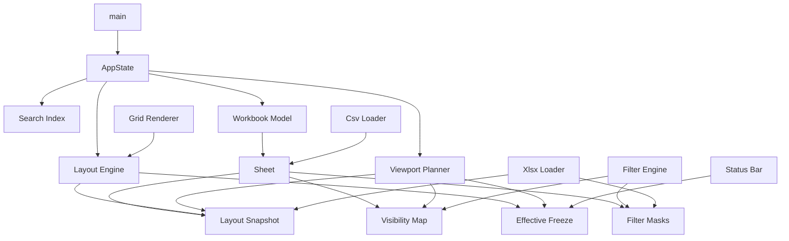
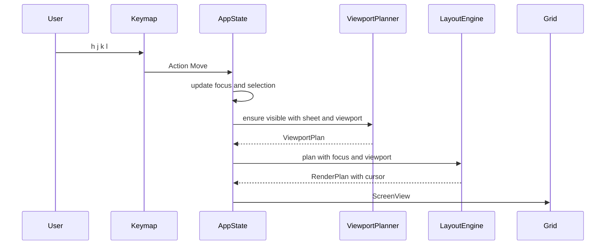
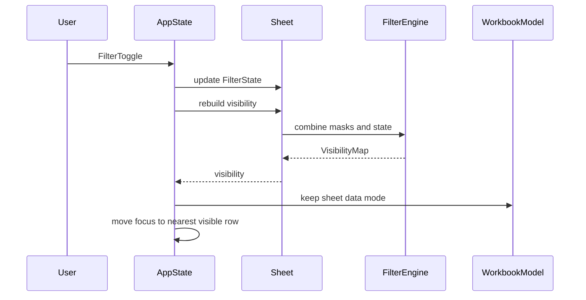
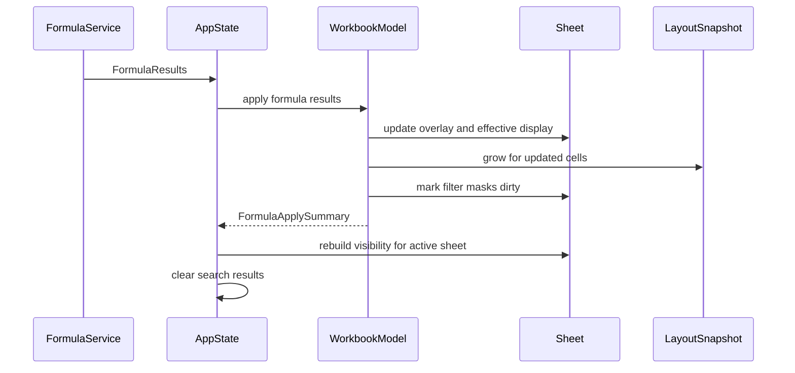

# Design Document

## Overview

`sheetgaze` は xlsx / csv をターミナルで閲覧する読み取り専用 TUI である。本設計は、既存 `spreadsheet-tui` の読み込み・数式・フィルタ・固定ペイン・検索の契約を維持したまま、表示・ビューポート・可視性の不整合を解消する。

**Purpose**: フォーカス移動、フィルタ適用、数式再計算の前後で、利用者が見ているセル・行・列と操作対象を一致させる。
**Users**: ターミナル中心の開発者、運用担当者、大容量 xlsx / csv を確認する利用者。
**Impact**: `Viewport` の更新、描画計画のフォーカス入力、固定ペインの有効判定、フィルタ可視性のキャッシュ、レイアウトの grow-only 更新を変更する。ファイル形式・CLI・コピー形式は変更しない。

### Goals

- フォーカスが横方向に移動しても、表示開始列を最小限に調整してフォーカスセルを見失わない。
- 通常モードでもフォーカスセルを視覚的に判別できる。
- 無効化された固定ペインを描画・ナビゲーション・状態表示のすべてで無効として扱う。
- 遅延シートでもフィルタ切替を高速に反映し、検索・コピー・詳細を可視行に限定する。
- `wrap_text`、結合セル、数式再計算後の表示を、グリッドと詳細で一貫させる。

### Non-Goals

- 検索と遅延インデックス構築のバックグラウンド化、進捗表示、キャンセル。
- CSV のストリーミングデコード、xlsx のセル数閾値によるストリーミング lazy 化。
- 色モードの ANSI 16 / 256 近似、テーマの拡張。
- セル編集・保存、フィルタ条件の新規作成、シートをまたぐ検索。
- xlsx の非表示行・列、グラフ・画像・ピボット・マクロの対応。
- 新しい外部クレートの追加や非同期ランタイムの導入。

## Boundary Commitments

### This Spec Owns

- フォーカス座標を入力とした縦横のビューポート調整規則（`ViewportPlanner`）。
- 描画計画におけるフォーカスセルの `cursor` メタデータと、結合範囲の論理セル解決。
- 固定ペインの有効・無効・表示上限を表す `EffectiveFreeze` と、その描画・操作への適用。
- フィルタ列マスクの構築・保持・合成、および eager / lazy 共通の可視性更新。
- 数式再計算結果による grow-only レイアウト更新と、フィルタマスクの dirty 管理。
- `wrap_text`、明示改行、結合セルを含むセル計測と切り詰め判定の共有。
- 検索結果の可視一致への同期。
- 上記の単体・統合・TUI 回帰テスト。

### Out of Boundary

- 検索走査・遅延インデックス構築の非同期化や進捗 UI。
- CSV 全読み込みの解消、`MemoryRowSource` のメモリ最適化、xlsx lazy 判定の変更。
- 色プロファイルの変換、OSC 52 以外のクリップボード戦略の変更。
- フィルタ条件の編集・保存、並べ替え、色・アイコン・動的フィルタの対応。
- セル編集、ファイル保存、xlsx / csv 以外の形式。
- 新しい依存クレート、バックグラウンドスレッドの追加。

### Allowed Dependencies

- 既存の `domain` / `io` / `ui` / `app` モジュール。
- 既存の Rust クレート: `ratatui` 0.30、`crossterm` 0.29、`textwrap` 0.16、`unicode-width` 0.2、`serde` 1.0、`postcard` 1.1、`tempfile` 3.27。
- `domain` は `ratatui` / `crossterm` / `calamine` / `formualizer` の型を公開しない。
- 依存方向は `domain` ← `io` / `ui` / `config` ← `app` ← `main` を維持する。

### Revalidation Triggers

- `Viewport`、`ViewportPlan`、`LayoutEngine::plan` のシグネチャ変更。
- `FreezePane` のフィールド・有効判定、`EffectiveFreeze` の意味変更。
- `FilterState`、`FilterMasks`、`FilterDefinition`、`VisibilityMap` の契約変更。
- `LayoutSnapshot`、`LayoutStatsBuilder`、`CellMeasure`、`LayoutInvalidation` の変更。
- `Sheet` の `filter_masks` / `layout_limits` / `filter_masks_dirty` の所有変更。
- 数式結果の適用 API と `FormulaApplySummary` の変更。
- 検索インデックスの可視性同期規則の変更。

## Architecture

### Existing Architecture Analysis

既存実装は `.kiro/steering/` のレイヤード構成に従っている。`domain` はモデル・レイアウト・選択・フィルタ・検索を所有し、`io` は calamine / csv / formualizer / OOXML を変換し、`ui` は ratatui で描画し、`app` が状態遷移とイベントループを統合する。

今回の変更で維持する既存境界:

- `LayoutEngine` は `Sheet` と `Viewport` から `RenderPlan` を作る純粋な描画計画であり、UI 型を持たない。
- `FilterEngine` はドメインの条件評価と可視マスク合成を担当し、ファイルを変更しない。
- `Sheet` は eager / lazy のデータとビュー状態を所有し、`AppState` が操作を調停する。
- `WorkbookModel` は数式オーバーレイの適用とシート横断の更新を担当する。
- `app` は `domain` / `io` / `ui` を組み立てるが、逆方向の依存は作らない。

技術的負債として、ビューポートの横方向状態が実質未使用、固定ペインの生フィールド参照が分散、フィルタの列マスクが保存されない、レイアウト統計が `wrap_text` を無視する点を本設計で解消する。

### Architecture Pattern & Boundary Map



**Architecture Integration**:

- Selected pattern: 既存のレイヤード + 純粋なドメインサービス。ビューポート調整・フィルタ合成・セル計測を UI から分離する。
- Domain/feature boundaries: `domain` が `ViewportPlanner`、`EffectiveFreeze`、`FilterMaskBuilder`、`FilterMasks`、`LayoutSnapshot`、`CellMeasure`、`SearchIndex` の規則を所有する。`io` は読み込み時にマスクとレイアウト統計を構築し、`app` は状態変更の順序を調停する。
- Existing patterns preserved: 型付き enum / newtype、`thiserror`、`unsafe` 禁止、純粋関数としてのレイアウト、UI とビジネスロジックの分離。
- New components rationale: `ViewportPlanner` は縦横の追従規則を一箇所に集約する。`EffectiveFreeze` は無効化と表示上限を単一の真実源にする。`FilterMaskBuilder` / `FilterMasks` は遅延シートでも切替を全行走査なしで行う。`CellMeasure` はグリッドと詳細の切り詰め判定を一致させる。
- Steering compliance: 依存方向、`domain` の外部型非依存、テスト可能な純粋関数を維持する。新しい外部クレートは追加しない。

### Technology Stack

| Layer | Choice / Version | Role in Feature | Notes |
| ------- | ------------------ | ----------------- | ------- |
| Language / Runtime | Rust 2024 edition、MSRV 1.88 | 既存バイナリ内の純粋ロジック | 非同期ランタイムは追加しない |
| Domain layout | 既存 `LayoutEngine` + `unicode-width` 0.2 + `textwrap` 0.16 | 折り返し行数、セル幅、切り詰め、ビューポート | `textwrap` は `unicode-width` 機能を利用 |
| TUI | ratatui 0.30.2 + crossterm 0.29 | フォーカス強調、固定領域、ヘッダー描画 | `LayoutEngine` の計画のみを描画する |
| Data ingestion | calamine 0.38、csv 1.4、encoding_rs 0.8 | フィルタマスク構築の入力、結合・行データ | 既存ローダーを変更する |
| Formula | formualizer 0.14 | 再計算結果の供給 | 結果適用側でレイアウトを grow-only 更新 |
| Testing | `cargo test`、`ratatui::backend::TestBackend` | 単体・統合・TUI | 新しいテストクレートは追加しない |

## File Structure Plan

### Directory Structure

```text
src/
├── domain/
│   ├── viewport.rs        # 新規: ViewportPlanner と ViewportPlan
│   ├── layout.rs          # focus 入力、CellMeasure、truncated_at、LayoutSnapshot の grow
│   ├── freeze.rs          # active_rows / active_cols / EffectiveFreeze
│   ├── filter.rs          # FilterValue、FilterMaskBuilder、FilterMasks、combine
│   ├── sheet.rs           # filter_masks / filter_masks_dirty / layout_limits、可視性更新
│   ├── workbook.rs        # 数式適用サマリ、レイアウト更新、マスク dirty 化
│   ├── search.rs          # 可視一致への sync_visibility
│   └── mod.rs             # viewport モジュールの追加
├── app/
│   └── state.rs           # ViewportPlanner、plan の focus、フィルタ・数式・詳細の統合
├── io/
│   ├── xlsx.rs            # フィルタマスク構築、lazy の observe_merge、layout_limits 保存
│   └── csv.rs             # 空のマスク、layout_limits 保存
└── ui/
    ├── grid.rs            # RenderPlan の cursor を描画（既存経路の確認）
    └── status.rs          # 固定領域制限・フィルタ件数の表示（既存 StatusView 経由）

tests/
├── view_consistency.rs    # 新規: planner / mask / layout / search の単体・統合
├── fixtures_smoke.rs      # plan シグネチャ更新、wrap / freeze の追加検証
├── integration.rs         # lazy フィルタ、数式結果レイアウトの追加検証
└── tui.rs                 # 通常カーソル、横スクロール、無効固定ペインの検証
```

### Modified Files

- `src/domain/viewport.rs` — 新規。`ViewportPlanner::ensure_visible` と `ViewportPlan`。
- `src/domain/layout.rs` — `LayoutEngine::plan` に focus を追加、`CellMeasure` / `truncated_at`、`LayoutSnapshot::grow_for_cell`、`LayoutStatsBuilder` の wrap 候補を追加。
- `src/domain/freeze.rs` — `active_rows` / `active_cols`、`EffectiveFreeze` を追加。
- `src/domain/filter.rs` — `FilterValue`、`FilterMaskBuilder`、`FilterMasks`、`FilterEngine::combine` を追加し、既存 `build_visibility` を置き換える。
- `src/domain/sheet.rs` — `filter_masks`、`filter_masks_dirty`、`layout_limits` を追加。`rebuild_visibility` / `refresh_filter_masks` を実装。
- `src/domain/workbook.rs` — `apply_formula_results` を `FormulaApplySummary` 返却に変更し、レイアウト更新とマスク dirty 化を追加。
- `src/domain/search.rs` — `sync_visibility` を追加。
- `src/domain/mod.rs` — `pub mod viewport;` を追加。
- `src/app/state.rs` — ビューポート調整、`plan` の focus、フィルタ可視性、数式結果、詳細の切り詰めを統合。
- `src/io/xlsx.rs` — eager / lazy のフィルタマスク構築、lazy の `observe_merge`、`layout_limits` 保存。
- `src/io/csv.rs` — 空のフィルタマスクと `layout_limits` を初期化。
- `src/ui/grid.rs` — 計画済み `cursor` の描画経路を確認し、必要ならヘッダーの可視列処理を調整する。
- `src/ui/status.rs` — 固定領域制限と可視件数の表示を確認する。
- `tests/view_consistency.rs` — 新規テスト。
- `tests/fixtures_smoke.rs` — `LayoutEngine::plan` の呼び出し更新と wrap / freeze の追加検証。
- `tests/integration.rs` — lazy フィルタと数式レイアウトの追加検証。
- `tests/tui.rs` — カーソル・横スクロール・無効固定ペインの追加検証。

## System Flows

### フォーカス移動と描画



`AppState::view` は描画前に `ensure_focus_visible` を呼び、移動・リサイズ・シート切り替え・検索移動・フィルタ変更のどの経路でも同じ計画を使う。`ViewportPlanner` は固定行・固定列を常に可視とし、フィルタ非表示行をスクロール対象から除外する。

### 遅延シートのフィルタ切替



切替時に `FilterMaskBuilder` の再走査は行わない。マスクが dirty な場合だけ `Sheet::refresh_filter_masks` が eager / lazy のデータソースを走査し、成功時以外は以前の可視性を保持する。

### 数式再計算結果の反映



可視性の再構築はフィルタが有効なアクティブシートに対して行い、他シートは切り替え時に dirty マスクを更新する。これにより、遅延シートの全行を数式結果のたびに即時走査しない。

## Requirements Traceability

| Requirement | Summary | Components | Interfaces | Flows |
| ------------- | --------- | ------------ | ------------ | ------- |
| 1.1 | 右方向の最小スクロール | ViewportPlanner, LayoutEngine | `ensure_visible`, `column_widths` | フォーカス移動 |
| 1.2 | 左方向の最小スクロール | ViewportPlanner, LayoutEngine | `ensure_visible` | フォーカス移動 |
| 1.3 | 縦方向の最小スクロール | ViewportPlanner, VisibilityMap | `ensure_visible` | フォーカス移動 |
| 1.4 | 固定列の維持と非重複描画 | EffectiveFreeze, LayoutEngine, GridRenderer | `plan`, `RenderPlan.freeze` | フォーカス移動 |
| 1.5 | リサイズ後のフォーカス維持 | AppState, ViewportPlanner | `Action::Resize`, `ensure_visible` | フォーカス移動 |
| 1.6 | 結合範囲の論理セル追従 | ViewportPlanner, MergeIndex, LayoutEngine | `region_at`, `CellMeasure` | フォーカス移動 |
| 2.1 | 通常モードのカーソル表示 | LayoutEngine, GridRenderer | `plan`, `RenderCell.cursor` | フォーカス移動 |
| 2.2 | 選択とカーソルの区別 | LayoutEngine, Selection, Theme | `selected`, `cursor` | フォーカス移動 |
| 2.3 | 結合セルのアンカー強調 | LayoutEngine, MergeIndex | `measure_cell` | フォーカス移動 |
| 3.1 | 無効固定ペインの非描画 | FreezePane, EffectiveFreeze, LayoutEngine | `active_rows`, `active_cols` | フォーカス移動 |
| 3.2 | 固定行・固定列の維持 | EffectiveFreeze, LayoutEngine, GridRenderer | `plan`, `RenderPlan.freeze` | フォーカス移動 |
| 3.3 | 固定領域の表示上限 | LayoutEngine, StatusBar | `effective_freeze`, `freeze_label` | フォーカス移動 |
| 3.4 | 固定セルの通常操作 | AppState, SearchIndex, CopySession | 既存の読み取り・選択契約 | フィルタ切替 |
| 3.5 | CSV の固定なし | CsvLoader, FreezePane | `FreezePane::none` | フィルタ切替 |
| 4.1 | 保存フィルタの eager / lazy 適用 | XlsxLoader, FilterMaskBuilder, FilterEngine | `FilterMasks`, `combine` | フィルタ切替 |
| 4.2 | 遅延シートの切替 | Sheet, FilterMasks, AppState | `rebuild_visibility` | フィルタ切替 |
| 4.3 | 可視行への操作限定 | AppState, SearchIndex, CopySession | `VisibilityMap`, `effective_cell` | フィルタ切替 |
| 4.4 | 数式再計算後の可視性 | WorkbookModel, Sheet, FilterMaskBuilder | `FormulaApplySummary`, `rebuild_visibility` | 数式再計算 |
| 4.5 | 固定行の常時表示 | EffectiveFreeze, FilterEngine, Sheet | `combine`, `force_visible` | フィルタ切替 |
| 4.6 | 検索の可視一致同期 | SearchIndex, AppState | `sync_visibility` | フィルタ切替 |
| 4.7 | 可視一致なしの扱い | SearchIndex, AppState | `sync_visibility`, status | フィルタ切替 |
| 5.1 | 明示改行の行高 | LayoutStatsBuilder, LayoutEngine | `text_metrics`, `measure_cell` | 数式再計算 |
| 5.2 | wrap_text の行高 | LayoutStatsBuilder, LayoutEngine | `wrap_demands`, `measure_cell` | 数式再計算 |
| 5.3 | 結合セルのレイアウト | XlsxLoader, LayoutStatsBuilder, LayoutSnapshot | `observe_merge`, `grow_for_cell` | 数式再計算 |
| 5.4 | 数式結果の grow-only | LayoutSnapshot, WorkbookModel | `grow_for_cell`, `FormulaApplySummary` | 数式再計算 |
| 5.5 | グリッドと詳細の切り詰め一致 | LayoutEngine, AppState, DetailRenderer | `truncated_at`, `DetailView.truncated` | 数式再計算 |
| 5.6 | はみ出し規則の維持 | LayoutEngine, MergeIndex, GridRenderer | `CellMeasure.overflow` | フォーカス移動 |
| 6.1 | マスク再利用 | FilterMasks, FilterEngine, Sheet | `combine`, `filter_masks_dirty` | フィルタ切替 |
| 6.2 | 可視領域ベースの計算 | ViewportPlanner, LayoutEngine | `ensure_visible` | フォーカス移動 |
| 6.3 | 既存契約の維持 | AppState, CLI, CopySession | 既存 CLI・キーマップ | 回帰 |
| 6.4 | 依存関係の維持 | Cargo manifest, 全コンポーネント | 既存クレートのみ | 回帰 |

## Components and Interfaces

| Component | Domain/Layer | Intent | Req Coverage | Key Dependencies (P0/P1) | Contracts |
| ----------- | -------------- | -------- | -------------- | -------------------------- | ----------- |
| ViewportPlanner | Domain | 縦横の表示開始位置をフォーカスから決定 | 1.1-1.6, 6.2 | LayoutSnapshot (P0), VisibilityMap (P0), EffectiveFreeze (P0) | Service, State |
| LayoutEngine / CellMeasure | Domain | セル計測、描画計画、切り詰め、grow | 1.4, 1.6, 2.1-2.3, 3.2-3.4, 5.1-5.6 | MergeIndex (P0), LayoutSnapshot (P0), EffectiveFreeze (P0) | Service |
| FreezePane / EffectiveFreeze | Domain | 固定ペインの有効判定と表示上限 | 3.1-3.5, 4.5 | LayoutSnapshot (P0), Viewport (P1) | State |
| FilterMaskBuilder / FilterMasks | Domain | 列ごとの一致マスク構築と合成 | 4.1-4.5, 6.1 | FilterDefinition (P0), FilterState (P0) | Service, State |
| Sheet / WorkbookModel | Domain | ビュー状態と数式適用の集約 | 4.1-4.5, 5.3-5.5 | FilterMasks (P0), LayoutSnapshot (P0) | State |
| SearchIndex | Domain | 可視一致の選択と移動 | 4.6, 4.7 | VisibilityMap (P0) | State |
| AppState | Application | 状態遷移、ビューポート、可視性、詳細の統合 | 1.1-1.5, 2.x, 3.3, 4.2-4.7, 5.4-5.5 | ViewportPlanner (P0), Sheet (P0), SearchIndex (P1) | State |
| XlsxLoader / CsvLoader | IO | 初期マスク、結合統計、layout_limits の構築 | 4.1, 5.3 | FilterMaskBuilder (P0), LayoutStatsBuilder (P0) | Service |
| GridRenderer / StatusBar | UI | 計画済み cursor と固定・フィルタ状態の表示 | 1.1-1.4, 2.1-2.3, 3.2-3.3, 4.6 | RenderPlan (P0), StatusView (P1) | Service |

### Domain

#### ViewportPlanner

| Field | Detail |
|-------|--------|
| Intent | フォーカスセルが可視領域に収まる表示開始行・列を返す |
| Requirements | 1.1, 1.2, 1.3, 1.4, 1.5, 1.6, 6.2 |

**Responsibilities & Constraints**

- 縦方向は `VisibilityMap` の可視行と `EffectiveFreeze.rows` を使い、固定行を除いたスクロール行で最小移動を行う。
- 横方向は `LayoutSnapshot.column_widths` と `EffectiveFreeze.cols` を使い、固定列を常に可視とする。
- フォーカスが結合範囲にある場合は結合範囲を一つの論理セルとして扱い、左端または全体が見える位置を優先する。
- 空シート、使用範囲外、固定領域が表示領域を超える場合はクランプし、パニックしない。
- 出力は `ViewportPlan` の値のみで、`AppState` の他の状態を変更しない。

**Dependencies**

- Inbound: `AppState` — フォーカス移動・リサイズ・シート切り替え・検索移動・フィルタ変更（P0）
- Outbound: `Sheet` — 可視行・列幅・結合範囲（P0）、`EffectiveFreeze` — 固定行・列（P0）

**Contracts**: Service [x] / State [x]

##### Service Interface

```rust
pub struct ViewportPlan {
    pub top_visible_row: u32,
    pub left_col: u32,
}

pub struct ViewportPlanner;

impl ViewportPlanner {
    pub fn ensure_visible(
        sheet: &Sheet,
        viewport: &Viewport,
        focus: CellAddr,
        freeze: EffectiveFreeze,
    ) -> ViewportPlan;
}
```

- Preconditions: `viewport.height` と `viewport.width` はデータ表示領域の大きさとして扱う。`focus` はシートの使用範囲内にクランプ済みである。
- Postconditions: 固定行・固定列は常に表示範囲に含まれる。スクロール可能な行・列が存在する場合、`focus` は表示範囲内に含まれる。
- Invariants: `left_col` は有効な固定列数以上、かつ使用範囲の最終列以下である。`top_visible_row` はフィルタ可視行のインデックスとして解釈され、固定行を含まない。

##### State Management

- State model: `AppState.viewport` を `ViewportPlan` で置き換える。`Viewport` 自体は描画計画の入力値として保持する。
- Persistence: なし。
- Concurrency: UI スレッドのみ。

**Implementation Notes**

- Integration: `AppState::ensure_focus_visible` を `ViewportPlanner` の薄いラッパーにする。`view` の冒頭で呼び、移動・リサイズ・検索・フィルタの各経路でも呼ぶ。
- Validation: 右端・左端・固定列・結合範囲・フィルタ非表示行・空シートの単体テスト。
- Risks: 結合範囲が表示幅より大きい場合は全体を表示できない。左端優先の規則をテストで固定する。

#### FreezePane / EffectiveFreeze

| Field | Detail |
|-------|--------|
| Intent | 固定ペインの要求値、無効理由、表示上限を一元化する |
| Requirements | 3.1, 3.2, 3.3, 3.4, 3.5, 4.5 |

**Responsibilities & Constraints**

- `FreezePane` は読み込んだ要求値と `disabled` を保持する。`active_rows` / `active_cols` は無効時に 0 を返す。
- `LayoutEngine::effective_freeze` は `active_*` を使用範囲と表示領域にクランプし、`rows_limited` / `cols_limited` を設定する。
- 固定行は `VisibilityMap` で常に可視とし、フィルタの非表示対象にしない。
- 固定領域を制限する場合は、スクロール可能な行と列を最低限残す。
- CSV は `FreezePane::none` を保持し、固定を有効にしない。

**Dependencies**

- Inbound: `LayoutEngine`、`AppState`、`StatusBar`（P0）
- Outbound: `LayoutSnapshot` — 行高・列幅（P0）、`Viewport` — 表示領域（P0）

**Contracts**: State [x]

##### State Management

```rust
pub struct EffectiveFreeze {
    pub rows: u32,
    pub cols: u32,
    pub rows_limited: bool,
    pub cols_limited: bool,
}

impl FreezePane {
    pub fn active_rows(&self) -> u32;
    pub fn active_cols(&self) -> u32;
}

impl LayoutEngine {
    pub fn effective_freeze(sheet: &Sheet, viewport: &Viewport) -> EffectiveFreeze;
}
```

- Preconditions: `FreezePane` は読み込み時に検証済みである。
- Postconditions: `rows` / `cols` は描画・行読み込み・ナビゲーションで共通に使われる。`disabled` の場合は 0 になる。
- Invariants: `EffectiveFreeze` は `freeze.is_active()` が false のとき必ず 0 行・0 列である。`rows_limited` / `cols_limited` は要求値より小さい場合だけ true になる。

**Implementation Notes**

- Integration: `FreezePane::is_active` の呼び出しは状態表示に限定し、描画と操作は `EffectiveFreeze` を使う。
- Validation: `freeze_merge_conflict.xlsx` で `RenderPlan.frozen_rows` が空になること、固定領域制限時に status が「limited」を示すことを確認する。
- Risks: 固定列幅の合計が表示幅を超える場合の境界条件。結合範囲との交差は既存の検証で無効化する。

#### LayoutEngine / CellMeasure / LayoutSnapshot

| Field | Detail |
|-------|--------|
| Intent | セル計測を共有し、描画計画・切り詰め・grow-only 更新を提供する |
| Requirements | 1.4, 1.6, 2.1, 2.2, 2.3, 3.2, 3.3, 3.4, 5.1, 5.2, 5.3, 5.4, 5.5, 5.6 |

**Responsibilities & Constraints**

- `plan` は `focus` を受け取り、`RenderCell.cursor` を選択状態と独立に設定する。既定列幅が必要な場合は `Sheet.layout_limits` を使う。
- `CellMeasure` は表示幅、折り返し後の行、はみ出し、切り詰め、結合スパンを返す。描画計画と詳細表示は同じ `CellMeasure` を使う。
- `LayoutStatsBuilder` は `wrap_text` の候補を保持し、列幅確定後に折り返し行数を計算する。
- `LayoutSnapshot::grow_for_cell` は列幅・行高を必要な分だけ拡大し、縮小しない。結合セルはスパンに要求を分散する。
- `truncated_at` はグリッドと同じ計測で切り詰めを判定し、詳細表示に提供する。
- `LayoutSnapshot.truncated_cells` は廃止し、静的な集合を参照しない。

**Dependencies**

- Inbound: `AppState` — plan / detail / formula（P0）、`GridRenderer` — RenderPlan（P0）
- Outbound: `MergeIndex` — 結合範囲（P0）、`LayoutSnapshot` — 幅・行高（P0）、`EffectiveFreeze` — 固定境界（P0）

**Contracts**: Service [x] / State [x]

##### Service Interface

```rust
pub struct CellMeasure {
    pub addr: CellAddr,
    pub x: u16,
    pub base_width: u16,
    pub width: u16,
    pub lines: Vec<StyledLine>,
    pub style: CellStyle,
    pub overflow: bool,
    pub truncated: bool,
    pub merge_span: Option<CellRange>,
}

pub struct RenderPlan {
    pub frozen_rows: Vec<RenderRow>,
    pub scroll_rows: Vec<RenderRow>,
    pub frozen_cols: u32,
    pub scroll_left_col: u32,
    pub freeze: EffectiveFreeze,
}

pub struct LayoutInvalidation {
    pub rows: std::collections::BTreeSet<u32>,
    pub columns: std::collections::BTreeSet<u32>,
}

impl LayoutEngine {
    pub fn plan(
        sheet: &Sheet,
        viewport: &Viewport,
        focus: CellAddr,
        selection: Option<&Selection>,
        search: Option<&SearchIndex>,
    ) -> RenderPlan;

    pub fn measure_cell(
        sheet: &Sheet,
        limits: &LayoutLimits,
        addr: CellAddr,
    ) -> CellMeasure;

    pub fn truncated_at(
        sheet: &Sheet,
        limits: &LayoutLimits,
        addr: CellAddr,
    ) -> bool;
}

impl LayoutSnapshot {
    pub fn grow_for_cell(
        &mut self,
        addr: CellAddr,
        display: &str,
        wrap_text: bool,
        merge: Option<CellRange>,
        limits: &LayoutLimits,
    ) -> LayoutInvalidation;
}
```

- Preconditions: `addr` は使用範囲内、または空セルとして扱える範囲にある。
- Postconditions: `RenderCell.cursor` は `focus` のアンカーにだけ true になる。`CellMeasure.truncated` は描画と詳細で同じ値になる。
- Invariants: 列幅は `min_col_width` 以上 `max_col_width` 以下、行高は 1 以上 `max_row_lines` 以下である。grow-only 更新で値が減少しない。

##### State Management

- State model: `LayoutSnapshot` は列幅・行高・上限設定を保持する。`LayoutInvalidation` は変更された行・列の集合を表す。
- Persistence: なし。
- Concurrency: 読み込みスレッドで初期構築、UI スレッドで数式結果の grow 更新。

**Implementation Notes**

- Integration: `render_row` のセル計測を `measure_cell` に置き換える。`detail_view` は `truncated_at` を使う。
- Validation: `overflow.xlsx` の wrap セル、`merged_newlines.xlsx` の結合、数式結果の grow、全角・絵文字の幅。
- Risks: 折り返し候補の保持による一時メモリ増加。対象は `wrap_text` セルに限定する。

#### FilterMaskBuilder / FilterMasks / FilterEngine

| Field | Detail |
|-------|--------|
| Intent | 列ごとの一致マスクを構築し、切替時に合成する |
| Requirements | 4.1, 4.2, 4.3, 4.4, 4.5, 6.1 |

**Responsibilities & Constraints**

- `FilterMaskBuilder` はフィルタ列ごとの `Vec<bool>` を構築する。ヘッダー行、データ範囲外、未対応条件は可視（true）とする。
- 値リスト、カスタム条件、ワイルドカード、比較演算子を既存規則どおり評価する。
- Top10 は行ごとの値を収集し、`finish` で上位・下位のマスクを確定する。
- `FilterMasks` は列数と `row_count` の整合性を保証する。マスクはフィルタ列ごとに 1 本である。
- `FilterEngine::combine` は `FilterState.enabled` と `column_enabled` を見て、有効列のマスクを AND 合成する。
- フィルタがないシート、`--no-filter`、全列無効の場合は全可視を返す。

**Dependencies**

- Inbound: `XlsxLoader` — 初期マスク構築（P0）、`Sheet` — dirty 更新（P0）
- Outbound: `FilterDefinition` / `FilterState` — 条件と適用状態（P0）、`VisibilityMap` — 出力（P0）

**Contracts**: Service [x] / State [x]

##### Service Interface

```rust
pub struct FilterValue {
    pub display: String,
    pub numeric: Option<f64>,
}

pub struct FilterMasks {
    pub row_count: u32,
    pub columns: Vec<Vec<bool>>,
    pub warnings: Vec<FilterWarning>,
}

pub struct FilterMaskBuilder {
    // 内部状態: 定義、列ごとのマスク、Top10 の収集値
}

impl FilterMaskBuilder {
    pub fn new(defs: &[FilterDefinition], row_count: u32) -> Self;
    pub fn observe_row(&mut self, row: u32, values: &[FilterValue]);
    pub fn finish(self) -> FilterMasks;
}

impl FilterEngine {
    pub fn combine(
        defs: &[FilterDefinition],
        masks: &FilterMasks,
        state: &FilterState,
        row_count: u32,
    ) -> VisibilityMap;
}
```

- Preconditions: `values.len()` は `defs` のフラット化した列数と一致する。`row` は `0..row_count` の範囲にある。
- Postconditions: `FilterMasks.columns` の各要素は `row_count` と同じ長さである。`combine` の結果はヘッダー行とデータ範囲外を可視にする。
- Invariants: 未対応条件の列は常に全可視、無効列は合成で無視する。Top10 はデータ範囲内の数値だけを対象とする。

##### State Management

- State model: `Sheet.filter_masks` と `Sheet.filter_masks_dirty`。`FilterState` の変更はマスクを再構築せず、`combine` の入力だけを変える。
- Persistence: なし。元ファイルは変更しない。
- Concurrency: 読み込み時に構築し、数式結果で dirty 化した後に UI スレッドで再構築する。

**Implementation Notes**

- Integration: `XlsxLoader` の eager はセル走査、lazy は `scan_all` で各行を `observe_row` に渡す。`CsvLoader` は空の `FilterMasks` を設定する。
- Validation: 値リスト、カスタム AND/OR、Top10、未対応条件、`--no-filter`、lazy 切替の再現。
- Risks: 行数 × フィルタ列数のメモリ。フィルタ列のみを対象にし、dirty でない限り再構築しない。

#### Sheet / WorkbookModel

| Field | Detail |
|-------|--------|
| Intent | 可視性・レイアウト・数式結果の適用を集約する |
| Requirements | 4.1, 4.2, 4.3, 4.4, 4.5, 5.3, 5.4, 5.5 |

**Responsibilities & Constraints**

- `Sheet` は `filter_masks`、`filter_masks_dirty`、`layout_limits` を所有する。
- `Sheet::rebuild_visibility` は dirty 時だけマスクを再構築し、`FilterEngine::combine` の結果に固定行を強制可視として加える。マスク再構築に失敗した場合は以前の可視性を保持してエラーを返す。
- `WorkbookModel::apply_formula_results` はオーバーレイと表示値を更新し、`Sheet.layout_limits` を使って `LayoutSnapshot::grow_for_cell` でレイアウトを拡大し、フィルタがあるシートのマスクを dirty にする。
- `FormulaApplySummary` は変更の有無、レイアウト変更、マスク dirty を返す。
- `Sheet` のデータモード（eager / lazy）は変更しない。

**Dependencies**

- Inbound: `AppState` — 可視性更新・数式結果（P0）
- Outbound: `FilterEngine`、`FilterMaskBuilder`（P0）、`LayoutSnapshot`（P0）、`FormulaOverlay`（P0）

**Contracts**: State [x]

##### State Management

```rust
pub struct Sheet {
    // 既存フィールド
    pub filter_masks: FilterMasks,
    pub filter_masks_dirty: bool,
    pub layout_limits: LayoutLimits,
}

pub struct FormulaApplySummary {
    pub changed: bool,
    pub layout_changed: bool,
    pub filter_masks_dirty: bool,
}

impl Sheet {
    pub fn rebuild_visibility(&mut self) -> Result<(), LoadError>;
    pub fn refresh_filter_masks(&mut self) -> Result<(), LoadError>;
}

impl WorkbookModel {
    pub fn apply_formula_results(
        &mut self,
        results: FormulaResults,
    ) -> FormulaApplySummary;
}
```

- Preconditions: `filter_masks.row_count` は `Sheet.meta.row_count` と一致する。
- Postconditions: `rebuild_visibility` 成功時は `visibility` が `FilterState` と一致する。失敗時は以前の `visibility` を保持する。
- Invariants: `filter_masks_dirty` が false のとき、マスクは現在のフィルタ条件とデータ値に一致する。数式結果の適用後、フィルタがあるシートは必ず dirty になる。

##### State Management

- State model: `FilterState`（有効・列有効）、`filter_masks`（キャッシュ）、`filter_masks_dirty`（整合性フラグ）、`visibility`（描画・操作に使う最終マップ）。
- Persistence: なし。
- Concurrency: `apply_formula_results` は UI スレッドで呼ばれ、遅延マスクの再構築も UI スレッドで行う。全行走査は dirty かつフィルタ有効時だけ。

**Implementation Notes**

- Integration: `AppState::rebuild_visibility` は `Sheet::rebuild_visibility` を呼び、エラーをステータスに変換する。`switch_sheet` でも新しいアクティブシートの可視性を更新する。
- Validation: eager / lazy の同一フィルタ結果、dirty 後の数式値反映、失敗時の可視性保持。
- Risks: 数式結果直後の遅延シート再構築が重い。フィルタ無効時は dirty のまま保持し、有効化時に再構築する。

#### SearchIndex

| Field | Detail |
|-------|--------|
| Intent | 検索結果の現在位置を可視一致に同期する |
| Requirements | 4.6, 4.7 |

**Responsibilities & Constraints**

- 検索確定時と可視性変更時に `hidden_matches` を更新する。
- 現在位置が非表示、または未設定の場合は、行・列順で最初の可視一致を `current` に設定する。
- 可視一致がない場合は `current = None` とし、呼び出し側はフォーカスを変更しない。
- `next_visible` / `previous_visible` の折り返しと非表示スキップは既存契約を維持する。

**Dependencies**

- Inbound: `AppState` — 検索確定・フィルタ変更（P0）
- Outbound: `VisibilityMap` — 可視行（P0）

**Contracts**: State [x]

##### State Management

```rust
impl SearchIndex {
    pub fn sync_visibility(&mut self, visibility: &VisibilityMap);
}
```

- Preconditions: `matches` は行・列順に整列済みである。
- Postconditions: `current` は可視一致のインデックス、または `None` である。
- Invariants: `hidden_matches` は `matches` のうち非表示行の件数と一致する。

**Implementation Notes**

- Integration: `AppState::submit_search` と `rebuild_visibility` から呼ぶ。可視一致がない場合は「no visible match」をステータスに表示する。
- Validation: 最初の一致が非表示、全一致が非表示、可視一致が後方にあるケース。
- Risks: 一致件数分の走査。既存の検索移動と同じ計算量に留める。

### Application

#### AppState

| Field | Detail |
|-------|--------|
| Intent | 状態遷移とドメインサービスを調停する |
| Requirements | 1.1-1.5, 2.x, 3.3, 4.2-4.7, 5.4-5.5 |

**Responsibilities & Constraints**

- `ensure_focus_visible` は `ViewportPlanner` を呼び、縦横の `Viewport` を更新する。
- `view` は `EffectiveFreeze` を取得し、固定行と可視領域の行を `ensure_rows` で読み込んでから `LayoutEngine::plan` を呼ぶ。`plan` には `focus`、`selection`、`search` を渡す。
- フィルタ操作は `Sheet::rebuild_visibility` を呼び、成功時にフォーカスを可視行へ移動する。`SearchIndex::sync_visibility` も更新する。
- 数式結果は `WorkbookModel::apply_formula_results` の `FormulaApplySummary` を受け取り、アクティブシートの可視性を更新し、検索結果を破棄する。
- 詳細表示の `truncated` は `LayoutEngine::truncated_at` で計算する。
- 固定領域制限時はステータスに「limited」を含める。

**Dependencies**

- Inbound: `EventLoop`、`Keymap`（P0）
- Outbound: `ViewportPlanner`、`LayoutEngine`、`Sheet`、`SearchIndex`、`WorkbookModel`（P0）

**Contracts**: State [x]

##### State Management

- State model: `AppState.viewport`、`focus`、`selection`、`mode`、`search_index`、`status_message`。
- Persistence: なし。
- Concurrency: UI スレッドのみ。数式結果は channel 経由で受信する。
- Error handling: 可視性再構築の失敗は `status_message` に表示し、以前の可視性を維持する。

**Implementation Notes**

- Integration: `Action` の追加は不要。既存の Move / Resize / SwitchSheet / Filter*/ Search* / formula result の経路を更新する。
- Validation: TUI テストで通常モードのカーソル、横スクロール、無効固定ペイン、フィルタ切替を確認する。
- Risks: 可視性再構築と検索同期の順序。フィルタ更新後にフォーカスを可視行へ移動してから検索可視性を同期する。

### IO

#### XlsxLoader / CsvLoader

| Field | Detail |
|-------|--------|
| Intent | 初期フィルタマスクとレイアウト統計を構築する |
| Requirements | 4.1, 5.3 |

**Responsibilities & Constraints**

- `XlsxLoader` はフィルタ検証後、`FilterMaskBuilder` に eager のセルまたは lazy の `scan_all` 行を渡してマスクを構築する。
- 初期可視性は `FilterEngine::combine` で作り、固定行を強制可視にする。
- lazy xlsx でも結合範囲構築後に `LayoutStatsBuilder::observe_merge` を呼び、eager と同じ幅要求にする。
- `Sheet.layout_limits` に読み込み時の `LayoutLimits` を保存する。
- `CsvLoader` はフィルタなしの空マスクと `layout_limits` を設定する。
- 読み込み時のフィルタ評価はキャッシュ値を対象とし、数式再計算後は `Sheet` の dirty 経路で更新する。

**Dependencies**

- Inbound: `WorkbookModel`（P0）
- Outbound: `FilterMaskBuilder`、`FilterEngine`、`LayoutStatsBuilder`、`Sheet`（P0）

**Contracts**: Service [x]

**Implementation Notes**

- Integration: 既存の `load_xlsx` / `load_xlsx_lazy` / `load_csv` の戻り値に `filter_masks` と `layout_limits` を追加する。
- Validation: `filters_values.xlsx`、`filters_custom.xlsx`、`filters_table.xlsx`、`large_lazy.xlsx`、`merged_newlines.xlsx`。
- Risks: lazy のマスク構築で `scan_all` が一時ファイルを再走査する。読み込み時の一度だけに限定する。

### UI

#### GridRenderer / StatusBar

| Field | Detail |
|-------|--------|
| Intent | 計画済みのカーソル・固定・フィルタ状態を描画する |
| Requirements | 1.1-1.4, 2.1-2.3, 3.2, 3.3, 4.6 |

**Responsibilities & Constraints**

- `GridRenderer` は `RenderPlan` の `cursor` / `selected` / `search_match` を既存の `Theme` パッチで描画する。フォーカス座標を直接参照しない。
- 固定列・スクロール列は `RenderPlan` の計画済みセルを描画し、同じセルを二重に描画しない。
- ヘッダーは `RenderPlan` に含まれる可視列から生成し、横スクロール後も列名とセルの対応を保つ。
- `StatusBar` は固定領域の制限とフィルタ可視件数を既存の `StatusView` 経由で表示する。追加の UI 状態は持たない。

**Dependencies**

- Inbound: `Screen`（P0）
- Outbound: `RenderPlan`、`Theme`、`StatusView`（P0）

**Contracts**: Service [x]

**Implementation Notes**

- Integration: `LayoutEngine::plan` の `cursor` をそのまま利用するため、`GridRenderer` の大規模な変更は不要である。ヘッダーの可視列処理だけ確認する。
- Validation: `TestBackend` で通常モードのカーソル、横スクロール、無効固定ペインを検証する。
- Risks: 固定列とスクロール列の x 座標計算。計画側の `RenderCell.x` を単一の入力にする。

## Data Models

### Domain Model

| Model | Fields | Invariants |
| ------- | -------- | ------------ |
| `ViewportPlan` | `top_visible_row`, `left_col` | 固定行・列を含む表示範囲にフォーカスが入る。使用範囲外へスクロールしない。 |
| `EffectiveFreeze` | `rows`, `cols`, `rows_limited`, `cols_limited` | `disabled` 時は 0。表示領域を超える場合は制限フラグを立てる。 |
| `FilterMasks` | `row_count`, `columns`, `warnings` | 各列マスクの長さは `row_count`。未対応・範囲外は可視。 |
| `LayoutInvalidation` | `rows`, `columns` | grow-only 更新で変更された行・列の集合。 |
| `FormulaApplySummary` | `changed`, `layout_changed`, `filter_masks_dirty` | 変更がなければ全フィールド false。 |

### Logical Data Model

- `Sheet` は 1 つの `FilterMasks` と 1 つの `LayoutSnapshot` を所有する。
- `FilterState.column_enabled` の順序は、`FilterDefinition` を定義順にフラット化した列順と一致する。
- `VisibilityMap` は `Sheet.meta.row_count` と同じ長さの可視マスクと、可視行インデックスの列を持つ。
- `SearchIndex.current` は `matches` のインデックスであり、可視一致がない場合は `None` である。
- `LayoutSnapshot` は列幅・行高・上限設定を保持し、`truncated_cells` は持たない。

### Data Contracts & Integration

- `FilterValue` は表示値と数値変換結果だけを運び、`EffectiveCell` 全体をキャッシュしない。
- 数式結果の適用は `FormulaResults`（既存）を入力とし、`FormulaApplySummary` を返す。
- 既存の `VisibilityMap`、`CopySession`、`Selection`、`SearchMatch` の公開契約は変更しない。

## Error Handling

### Error Strategy

- 可視性再構築の失敗は致命的にせず、以前の `VisibilityMap` を保持してステータスにエラーを表示する。
- 固定ペインの検証失敗は読み込みを継続し、`disabled` と警告を保持する。描画は `EffectiveFreeze` の 0 行・0 列を使う。
- 数式結果に存在しないシートが含まれる場合は無視し、他のシートの更新を継続する。
- レイアウト更新の範囲外アクセスは saturating arithmetic とベクタ拡張でクランプし、パニックしない。
- 検索の可視一致がない場合はエラーではなく、フォーカスを変更せず状態メッセージを表示する。

### Error Categories and Responses

| Situation | Response |
| ----------- | ---------- |
| フィルタマスク再構築の I/O エラー | 以前の可視性を維持し、`status_message` に「filter refresh failed」を表示 |
| 無効な固定ペイン | 固定 0 行・0 列、警告を `Sheet.warnings` に保持 |
| 固定領域の表示上限 | `EffectiveFreeze` の制限フラグとステータス表示 |
| 数式結果の対象シートなし | 対象外としてスキップ |
| 空シート・使用範囲外フォーカス | 表示開始位置を使用範囲内にクランプ |
| 可視一致なし | フォーカス維持、「no visible match」を表示 |

### Monitoring

- 既存の `status_message` / `StatusView` を利用する。新しいログ基盤や外部監視は追加しない。
- テストでは状態メッセージと `VisibilityMap` の件数を検証する。

## Testing Strategy

### Unit Tests

- `ViewportPlanner`: 右端・左端・上下・固定列・結合範囲・フィルタ非表示行・リサイズ・空シート。
- `FreezePane` / `EffectiveFreeze`: 無効時の 0、固定行の維持、表示領域超過時の制限。
- `FilterMaskBuilder` / `FilterMasks`: 値リスト、カスタム AND/OR、ワイルドカード、Top10、未対応条件、`--no-filter`。
- `LayoutStatsBuilder` / `LayoutSnapshot`: 明示改行、`wrap_text`、結合セルの分散、grow-only、`truncated_at`。
- `SearchIndex`: 可視一致の先頭選択、非表示一致のスキップ、可視一致なし。
- `Sheet`: eager / lazy で同じ可視性、dirty 後の再構築、失敗時の可視性保持。

### Integration Tests

- `overflow.xlsx` の `wrap_text` セルで行高が折り返し行数になり、詳細の切り詰めがグリッドと一致する。
- `freeze_merge_conflict.xlsx` で `RenderPlan` の固定行・列が空になり、警告が残る。
- `filters_values.xlsx` / `filters_custom.xlsx` を lazy で読み込み、フィルタ切替で可視行が戻る。
- 数式再計算後の表示値で列幅・行高が grow し、フィルタマスクが dirty になる。
- `merged_newlines.xlsx` を eager / lazy で読み込み、結合セルの幅・行高が一致する。

### E2E / UI Tests

- `TestBackend` で通常モードのカーソルが描画される。
- 右端の列へ移動したとき、ヘッダーとセルが横スクロールし、フォーカスが画面内に残る。
- 無効化された固定ペインで固定行が描画されない。
- 小さい端末（40x10 以上）でパニックせず、最小サイズメッセージが表示される既存挙動を維持する。

### Performance / Load Tests

- 遅延シートのフィルタ切替で `scan_all` が呼ばれないこと（マスクが dirty でない場合）。
- ビューポート計算が可視列数に比例し、全セル走査を行わないこと。
- 既存の 100k CSV / `large_lazy.xlsx` のテストが退行しないこと。

### Regression

- `cargo test --all-targets` と `cargo clippy --all-targets -- -D warnings` を維持する。
- 既存の CLI、コピー TSV、数式再計算、検索スマートケース、フィルタ条件のテストを変更しない。

## Performance & Scalability

- ビューポート調整は固定列・固定行と可視領域の列幅だけを走査する。全セルのレイアウト再計算は行わない。
- フィルタ切替は `FilterMasks` の合成が主で、行数 × 有効フィルタ列数に比例する。dirty でない限りデータソースを走査しない。
- 数式結果のレイアウト更新は更新セル数に比例する。grow-only のため既存の列幅・行高を再計算しない。
- 遅延シートのマスク再構築は dirty かつフィルタ有効時だけ行い、アクティブシートを優先する。全行走査のバックグラウンド化は別 spec の範囲とする。
- `FilterMasks` のメモリはフィルタ列数 × 行数の `Vec<bool>` に限定し、全セルの `EffectiveCell` を保持しない。

## Open Questions / Risks

- 結合範囲が表示幅より広い場合、左端優先で一部のみ表示する規則でよいか。実装時に fixture で確認する。
- 数式再計算後の遅延シートのマスク再構築をどのタイミングで行うか。アクティブシートのみ即時、他シートは切り替え時とする方針で進める。
- 固定列の表示上限を「最低 3 列」とするか、既存の幅予約（12 表示桁）を維持するか。既存の `max_frozen_width = viewport.width - 12` を基本にし、テストで境界を固定する。
- `FilterMasks` の `Vec<bool>` は行数 × 列数のメモリを使う。フィルタ列が非常に多いシートでは、列マスクを遅延構築する余地があるが、本 spec では読み込み時に一度構築する。
